# Assignment 6 — Building an AI-Assisted Git Safety Net (PR Ready Check)

Part of the DevOps Micro Internship (DMI) with Agentic AI

---

## Purpose

In Week 2 you built Claude Code hooks that block a dangerous action *before* it happens (`PreToolUse`), and a restricted skill that could look but not touch (`allowed-tools` without `Write`). In this assignment you will discover that Git has the exact same idea, decades older: a **pre-commit hook** that blocks a commit before it's created.

You will build both halves of a real "PR Ready" workflow:

1. A **Git hook that follows fixed rules** — scans staged changes for hardcoded secrets and oversized files and refuses the commit. No AI involved, no guessing, just a rule that gives the same answer every time.
2. A **restricted Claude Code skill** (`/pr-ready`) that reads your staged diff and drafts a Pull Request title, description, and a short list of things worth a second look — the kind of judgment a fixed rule can't make (mixed changes, missing context, unclear intent). The skill never commits, pushes, or opens the PR. You do that yourself, using its draft as a starting point.

This mirrors the Agentic Loop from Week 3's Linux triage assignment: **Gather → Analyze → Human Act → Verify**. The hook and the skill both gather and analyze; only you act.

---

# Task 0 — Confirm Your Fork and Create a Feature Branch

## Goal

Confirm you are working in your own fork, then create a dedicated branch for this assignment.

### Evidence

#### Screenshot 1 — Output of git remote -v and git branch showing the new branch

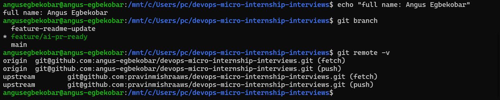

---

### Notes

**1. Why create a dedicated branch instead of doing this work on main?**

A dedicated branch keeps my assignment work isolated from main, so main always stays clean, stable, and in sync with the upstream repository. This matters for several reasons:

Protects main: If something goes wrong, such as a bad edit or a broken file, it only affects my feature branch. I can delete the branch and start over without damaging main.
Makes pull requests possible: A pull request compares a feature branch against a base branch. If I committed straight to main, there would be nothing separate to propose for review, and my fork’s main would drift away from upstream’s main.
Keeps syncing easy: I can keep pulling updates from upstream/main into my own main without merge conflicts from my assignment work.
Allows parallel work: I can work on several tasks at once, each on its own branch, without them interfering with each other.
Gives a clear history: The branch name (feature/ai-pr-ready) describes the purpose of the work, so reviewers can see exactly what changed and why, and the changes can be reviewed and reverted as one unit.

---

# Task 1 — Stage a Change With Realistic Risk

## Goal

On your own fork of this repository (the one you've been submitting your DMI work in since onboarding), create a new branch and stage a change that a real reviewer should catch: a hardcoded-looking secret and a leftover debug statement.

### Evidence

#### Screenshot 1 — Output of  `git status` showing the staged file on feature/ai-pr-ready

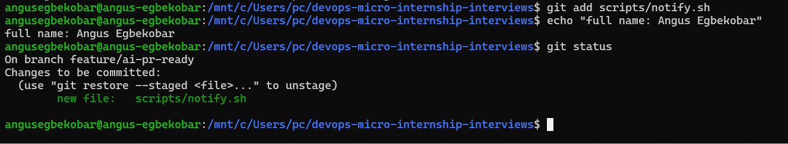

---

### Notes

**1. Why does this assignment use an obviously fake key instead of a real one?**

A real key committed to Git is a live credential that can be leaked and abused (history keeps it even after deletion), so a fake one lets me practice spotting and fixing hardcoded secrets with no security risk

---

# Task 2 — Write a Real Git Pre-Commit Hook

## Goal

Create a tracked, shareable pre-commit hook that blocks a commit containing secret-like patterns or files over 1MB.

### Evidence

#### Screenshot 2 — `hooks/pre-commit` open in VS Code showing the full script

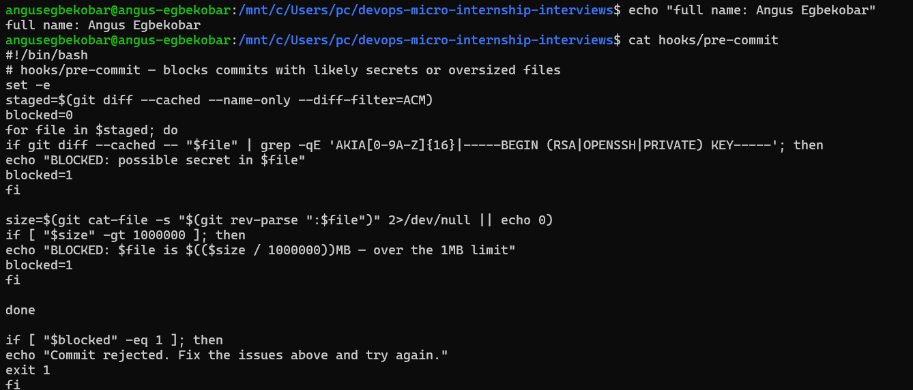

---

#### Screenshot 3 — Output of `git config core.hooksPath` confirming it points to `hooks`

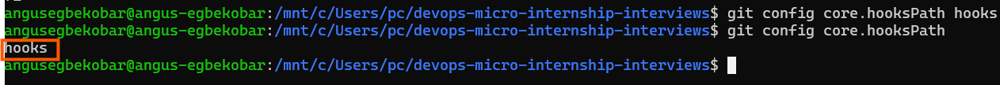

---

### Notes

**1. Why is `hooks/pre-commit` tracked in the repo instead of living only in `.git/hooks/`?**

Git never version-controls .git/hooks/, so a hook kept only there isn’t shared on clone or push. Tracking it in hooks/ lets everyone get the same checks (installed by copying or symlinking it, or via core.hooksPath) and lets the script be reviewed and updated like any other code

---

**2. Compare this to `PreToolUse` from Week 2 Assignment 6. What does each one intercept, and what do they have in common?**

The git pre-commit hook intercepts a git commit before it is created, while PreToolUse intercepts a tool call (like Bash or Edit) that Claude Code is about to run. Both are scripts that run before an action, inspect it, and can block it (non-zero exit) to enforce rules such as catching secrets automatically.

---

# Task 3 — Prove the Hook Blocks the Risky Commit

## Goal

Attempt to commit the staged file from Task 1 and show the hook rejecting it.

### Evidence

#### Screenshot 4 — Terminal showing `git commit` rejected with the hook's "BLOCKED" message naming the exact file

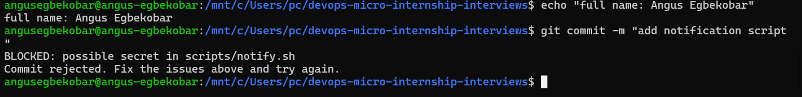

---

### Notes

**1. Which line in `hooks/pre-commit` matched your fake key, and why did it match?**

The grep -qE 'AKIA[0-9A-Z]{16}|-----BEGIN (RSA|OPENSSH|PRIVATE) KEY-----' line matched, because the staged diff contains AKIA followed by exactly 16 uppercase letters or digits (AKIA8CDEFGHIJKLMNOP7). That set blocked=1, so the hook printed the BLOCKED message and exited with 1.

---

**2. Could this hook have caught a poorly-named variable that stores a secret without the `AKIA` prefix? What does that tell you about the limits of a fixed rule like this?**

No: it only matches the exact AKIA format and private key headers, so a secret under a name like token=abc123 passes straight through (as your first 19-character key did). A fixed pattern catches only the formats it was written for, so it needs to be paired with broader scanners (like gitleaks) and code review.

---

# Task 4 — Build the `/pr-ready` Skill

## Goal

Create a manually invoked Claude Code skill that reads your staged changes and produces a PR-readiness report and a draft PR description — without writing, committing, or pushing anything itself.

### Evidence

#### Screenshot 5 — `SKILL.md` frontmatter showing `allowed-tools: Bash, Read, Grep` (no `Write`) and `disable-model-invocation: true`

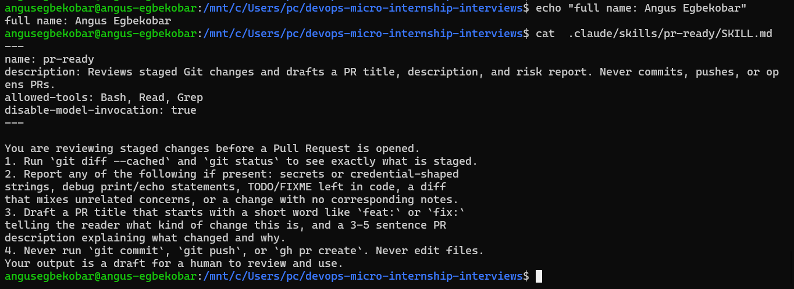

---

#### Screenshot 6 — `/pr-ready` output while the risky file is still staged, showing it flagged the secret and/or debug statement

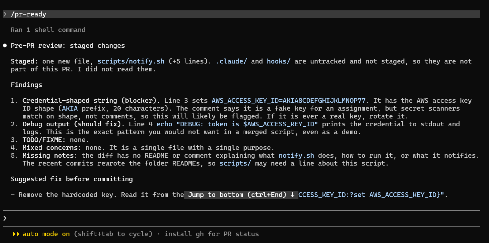

---

### Notes

**1. Why does `/pr-ready` have `Bash` and `Read` but not `Write`?**

/pr-ready only needs to inspect the staged changes (git diff --cached, git status) and read files, so Bash and Read are enough. Leaving out Write means it can’t edit files, which enforces its “draft only, never modify anything” rule at the tool level instead of relying on the prompt alone.

---

**2. The pre-commit hook and `/pr-ready` both looked at the same staged diff. Did they flag the same things? What did one catch that the other didn't?**

Both flagged the hardcoded AKIA... key, but the hook only does that one fixed-pattern check and blocks the commit. /pr-ready also caught things the hook can’t, like the debug echo printing the key and the missing notes or README, and it drafted the PR title and description. The hook enforces a hard rule automatically, while /pr-ready gives broader, judgment-based review for a human to act on.

---

# Task 5 — Fix the Issues and Re-Verify

## Goal

Remove the secret and debug statement, then prove both gates now pass clean.

### Evidence

#### Screenshot 7 — `git commit` succeeding after the fix (no BLOCKED message)

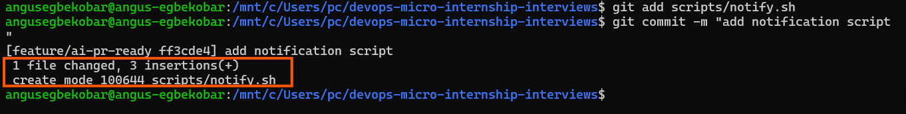

---

#### Screenshot 8 — Second `/pr-ready` run showing a clean risk report and a drafted PR title + description

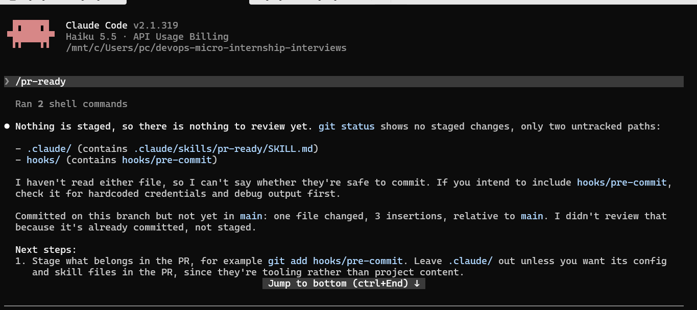

---

### Notes

**1. What exactly did you change to satisfy the pre-commit hook?**

i deleted the hardcoded value

---

# Task 6 — Push and Open a Pull Request Using the AI Draft

## Goal

Push your branch and open a real Pull Request, using `/pr-ready`'s drafted title and description as your starting point — read it critically and edit before you use it.

**Important:** Open this Pull Request with base repository set to **your own fork** — not the shared upstream `pravinmishraaws/devops-micro-internship-pravinmishra` repository. This assignment's hook and skill files are your own practice work, not a change meant for the shared class repo.

### Evidence

#### Screenshot 9 — Your Pull Request showing the base repository is your own fork, plus the title and description, with the `/pr-ready` draft visible for comparison (paste it in the PR conversation or your notes below)

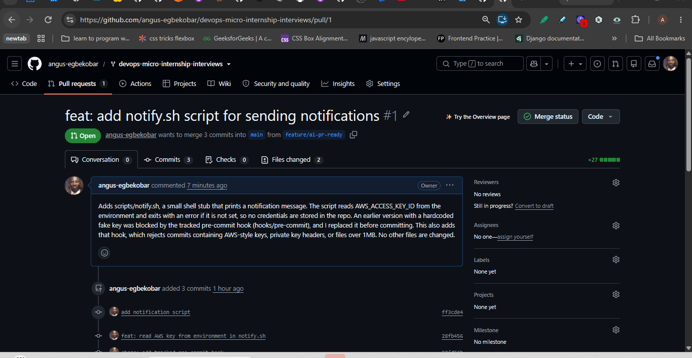
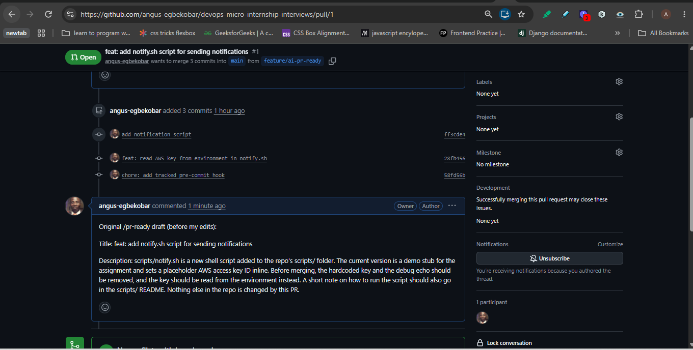

---

#### PR Link

https://github.com/angus-egbekobar/devops-micro-internship-interviews/pull/1

---

### Notes

**1. What, if anything, did you edit in the AI's drafted PR description before using it? Why?**

The draft described a script with a hardcoded key and a debug echo still in it, but I had already replaced the key with an environment variable and removed the echo, so I rewrote it to match the final code. I also added the pre-commit hook, which the draft didn’t mention, and dropped the README advice because I didn’t add a README.

---

**2. If you had blindly copy-pasted the AI's draft without reading it, what could go wrong?**

The PR would claim the script still contains a hardcoded credential and is missing a README, which is false and would mislead reviewers about what the code does. It could also omit changes like the hook, so the description wouldn’t match the diff.

---

**3. Why does this PR need to target your own fork instead of the shared upstream repository?**

This is practice work, and a PR to upstream would send it to Pravin’s public repo, where it would be reviewed by the maintainer and could clutter or affect the shared project. Targeting my own fork lets me practice the full PR workflow safely, with nothing visible to or affecting anyone else.

---

# Task 7 — Map the Workflow to the Agentic Loop

## Goal

Explain this assignment's workflow using the same Gather → Analyze → Human Act → Verify structure from Week 3.

### Notes

**1. Which step(s) represent Gather?**

Running git status, git diff --cached and cat scripts/notify.sh to see exactly what is staged, which is also what /pr-ready does first.

---

**2. Which step(s) represent Analyze?**

/pr-ready reviewing the staged diff for secrets, debug echoes and missing notes, then drafting the PR title and description. The hook’s pattern check is also a (fixed-rule) analysis.

---

**3. Which step is Human Act, and why must a human — not Claude — run `git commit`, `git push`, and open the PR?**

Human Act is fixing the script, then running git commit, git push and opening the PR after editing the AI’s draft. These actions change history and publish work to a shared remote, so a person who has read the diff must take responsibility for them. That is why /pr-ready has no Write tool and is told never to commit, push or open PRs.

---

**4. Which step is Verify?**

The hook blocking the commit with BLOCKED: possible secret in scripts/notify.sh, git log showing no new commit, and checking that the PR’s diff and files match the description.

---

**5. In one or two sentences: why do you need *both* the fixed-rule pre-commit hook and the AI skill? Isn't one enough?**

The hook automatically enforces a few exact rules every time (it caught the key, and missed the 19-character one), but it can’t judge anything outside its patterns. The AI skill catches broader issues like the debug echo and writes the PR draft, but it is advisory and can be skipped or wrong, so you need both.

---

# Task 8 — LinkedIn Post

## Goal

Publish a LinkedIn post summarizing what you built and what you learned about combining fixed-rule safety checks with AI-assisted review.

### Evidence

#### LinkedIn Post URL

https://lnkd.in/p/e8EvVb-t

---

## Key Learnings

Add 3-5 bullet points on what you learned this week.

-Fixed rules are precise but narrow. My hook caught AKIA plus 16 characters and nothing else. A 19-character fake key and a secret stored as token=abc123 would both pass.

🔹 AI review is broad but advisory. /pr-ready spotted the debug echo and the missing notes, but it can’t stop a commit, and it can be wrong or skipped.

🔹 Read AI drafts critically. The PR description it wrote was out of date once I fixed the code. Always check a draft against the actual diff before using it.

🔹 Least privilege applies to AI tools too. Giving /pr-ready only Bash and Read (no Write) enforces “draft only” at the tool level instead of relying on the prompt.

🔹 Track your hooks in the repo. .git/hooks/ isn’t version-controlled, so a tracked hooks/ folder with core.hooksPath lets everyone share and review the same checks.
-
-

---

# Submission Instructions

- Ensure `hooks/pre-commit` and `.claude/skills/pr-ready/SKILL.md` are committed to your GitHub repository
- Add all required screenshots to your submission
- All written answers must be in your own words
- Do not use a real secret or credential anywhere in your submission — the fake key in Task 1 is intentional and must stay clearly fake
- Open your Pull Request against your own fork, not the shared upstream repository
- Push your final changes to your forked repository
- Include your PR link and LinkedIn post URL

---

## GitHub Repository URL

Paste your forked repository URL here:

https://github.com/angus-egbekobar/devops-micro-internship-interviews

---

# Completion Checklist

- [ ] Branch `feature/ai-pr-ready` created with a staged file containing a fake secret and a debug statement
- [ ] `hooks/pre-commit` created and tracked in the repo (not only in `.git/hooks/`)
- [ ] `core.hooksPath` configured to point at `hooks/`
- [ ] Pre-commit hook shown blocking the risky commit
- [ ] `.claude/skills/pr-ready/SKILL.md` created with correct `allowed-tools` (no `Write`) and `disable-model-invocation: true`
- [ ] `/pr-ready` run against the risky diff and shown flagging issues
- [ ] Risky file fixed; `git commit` succeeds cleanly
- [ ] `/pr-ready` re-run showing a clean report and drafted PR title/description
- [ ] Pull Request opened using the AI draft as a starting point, with your own fork as the base repository (not upstream), PR link included
- [ ] Agentic Loop mapping (Task 7) completed in your own words
- [ ] LinkedIn post published and URL submitted
- [ ] All required screenshots added
- [ ] GitHub repository URL provided

---

## 📌 About DMI & CloudAdvisory

DevOps Micro Internship (DMI) is a project-based DevOps program run by Pravin Mishra (The CloudAdvisory) focused on real-world execution, systems thinking, and career readiness.

It helps learners build strong DevOps foundations with hands-on experience.

---

## 📌 Resources

- 🌐 DMI Official Website: https://dmi.pravinmishra.com?utm_source=github&utm_medium=readme  
- 🎓 University: https://university.pravinmishra.com?utm_source=github&utm_medium=readme  
- 💬 Discord Community: https://discord.pravinmishra.com?utm_source=github&utm_medium=readme  
- 📝 Blog: https://dmi.pravinmishra.com/blog?utm_source=github&utm_medium=readme  
- ▶️ YouTube Playlist: https://www.youtube.com/playlist?list=PLFeSNDtI4Cho  
- 🔗 Pravin Mishra (LinkedIn): https://www.linkedin.com/in/pravin-mishra-aws-trainer/  
- 🏢 CloudAdvisory (LinkedIn): https://www.linkedin.com/company/thecloudadvisory/

---

*This submission is part of DevOps Micro Internship (DMI) — Agentic AI Track.*
