# Assignment 3 — Automate React App Deployment Using Azure DevOps CI/CD

Part of the DevOps Micro Internship (DMI) with Agentic AI

---

## Purpose

In this assignment, you will create a multi-stage Azure DevOps pipeline that builds, tests, publishes, and deploys a React application to an Ubuntu VM hosted on AWS or Azure. The pipeline will automatically run when changes are committed to `main`, transfer the production build as an artifact, and deploy it through Nginx.

---

# Task 0 — Verify the Starting Environment

## Goal

Confirm that Azure DevOps, the pipeline agent, Terraform, Ansible, and the selected cloud environment are ready.

No submission screenshot is required for this task.

---

# Task 1 — Import and Personalize the React Application

## Goal

Import the React application into Azure Repos and add your Full Name and the current date.

## Evidence

### Screenshot 1 — Imported React Project in Azure Repos

Add a screenshot of Azure Repos showing:

* Imported React project
* Repository name
* `main` branch
* Project files

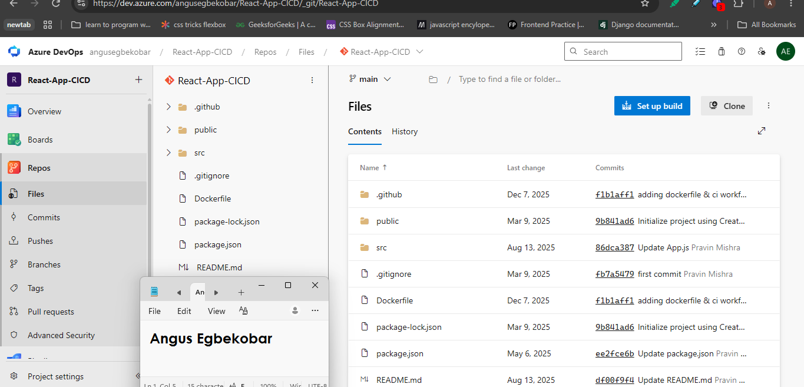
---

# Task 2 — Provision and Configure the Target VM

## Goal

Provision an Ubuntu VM using Terraform and configure Nginx, React SPA routing, SSH access, and deployment permissions using Ansible.

No separate submission screenshot is required for this task.

---

# Task 3 — Create or Update the SSH Service Connection

## Goal

Create or update an Azure DevOps SSH Service Connection that allows the pipeline to connect securely to the target VM.

No separate submission screenshot is required for this task.

> Do not include the VM password, SSH private key, token, or another secret in the submission.

---

# Task 4 — Author the Multi-Stage Azure Pipeline

## Goal

Create an Azure Pipeline containing Build, Test, Publish, and Deploy stages with an automatic trigger for commits to `main`.

## Evidence

### Screenshot 2 — Multi-Stage Pipeline YAML

Add a screenshot of the Azure Pipeline YAML open in the editor showing:

* Trigger
* Build stage
* Test stage
* Publish stage
* Deploy stage

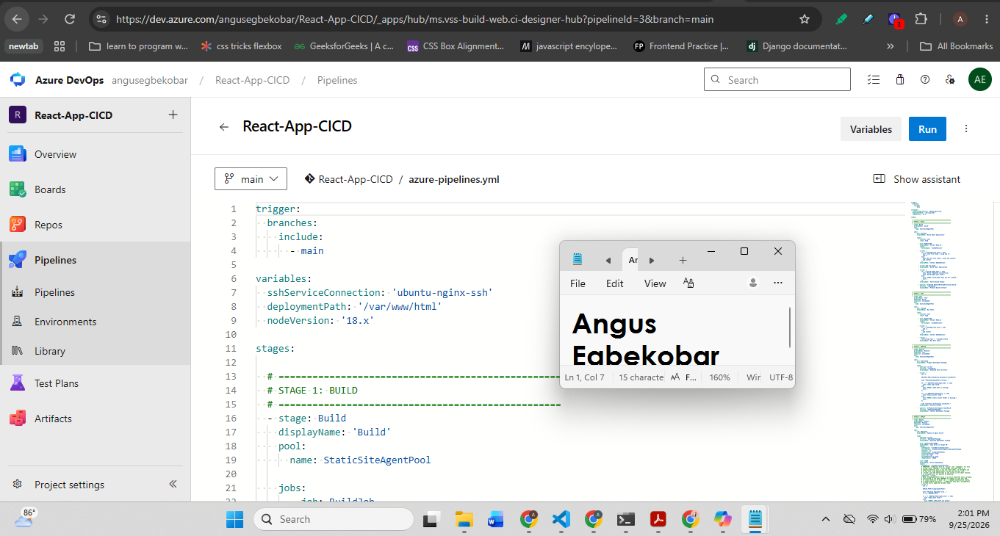

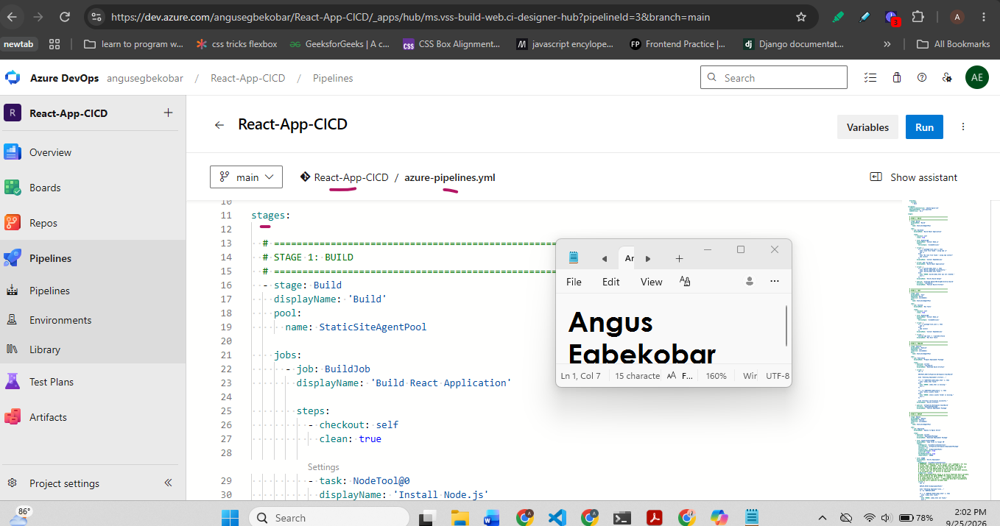

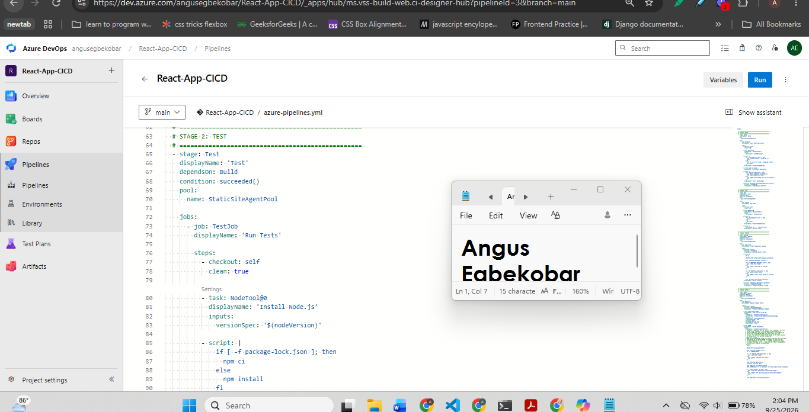

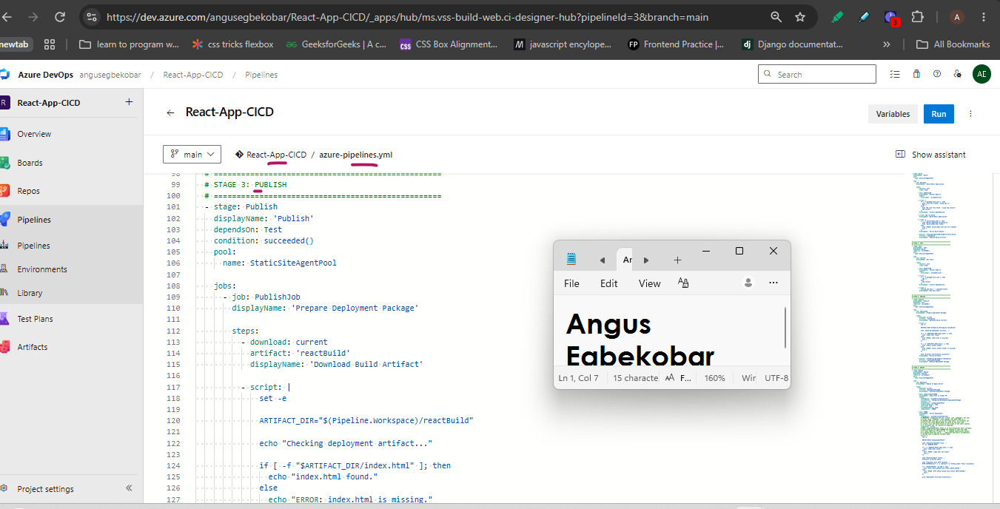

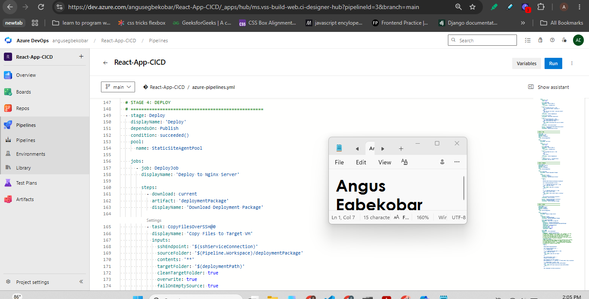

> Do not expose passwords, private keys, tokens, or cloud credentials.

---

# Task 5 — Run the Pipeline and Resolve Configuration Issues

## Goal

Complete a successful end-to-end pipeline run containing all four stages.

## Evidence

### Screenshot 3 — Successful Multi-Stage Pipeline Run

Add a screenshot of one Azure DevOps pipeline run showing all four stages succeeded:

* Build
* Test
* Publish
* Deploy

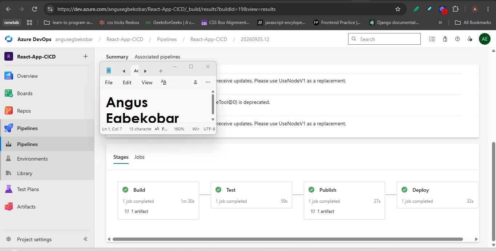

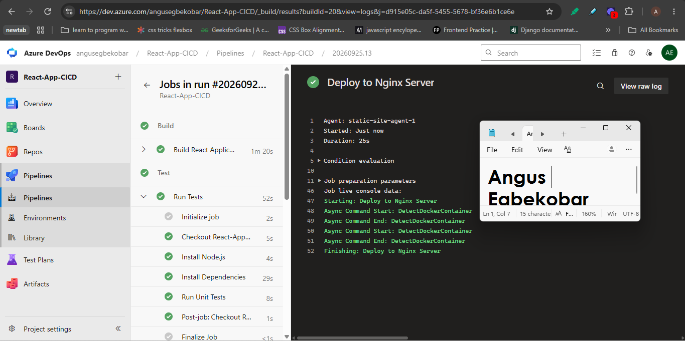
---

# Task 6 — Verify the Deployment on the VM

## Goal

Confirm that the pipeline deployed the production-ready React files to the correct Nginx web root.

## Evidence

### Screenshot 4 — Post-Deployment Contents of /var/www/html

Add a screenshot of the pipeline SSH verification log or VM terminal showing the post-deployment contents of:

`/var/www/html`

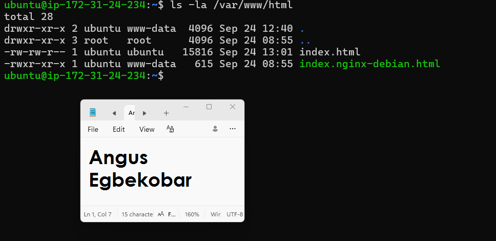
---

# Task 7 — Verify the Website and Automatic Trigger

## Goal

Confirm that the React application is accessible and that a commit to `main` automatically triggers the CI/CD pipeline.

## Evidence

### Screenshot 5 — Deployed React Application

Add a browser screenshot showing:

* Deployed React application
* VM public IP address in the browser address bar
* Your Full Name
* Deployment date

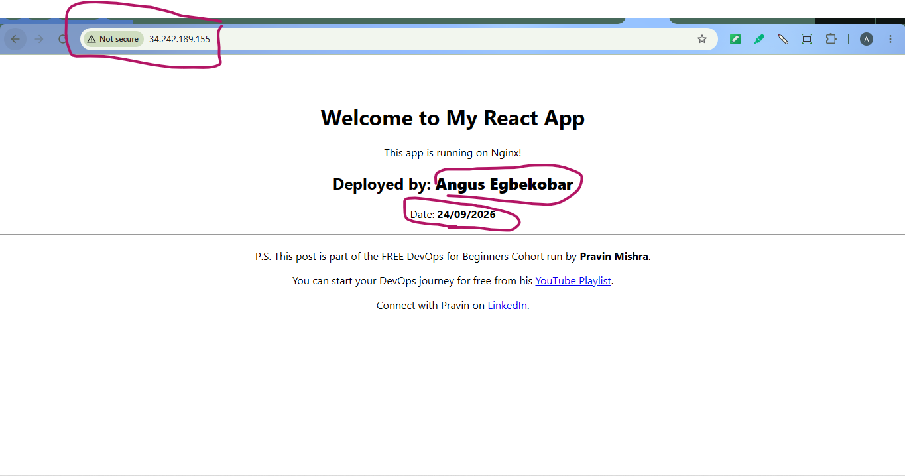
## Final Application URL

`http://34.242.189.155`

Replace the placeholder and paste your final application URL below:

[Paste your final application URL here.]

---

# CI/CD Workflow Summary

Write a short explanation of the CI/CD workflow you created.

In this assignment I built a multi-stage CI/CD pipeline using Azure DevOps that automatically builds, tests, and deploys a React application to an AWS EC2 instance whenever a commit is pushed to the main branch.

The workflow begins with Terraform provisioning a fresh Ubuntu EC2 instance in AWS eu-west-1 with the correct security group rules, SSH key pair, and public IP address. Ansible then configures the instance by installing Nginx, enabling SPA routing for React, setting the correct permissions on /var/www/html, and configuring password-based SSH authentication for the Azure DevOps service connection. A second Ansible playbook installs Node.js and npm on the self-hosted Azure Pipelines agent so it can build the React application.

The Azure DevOps pipeline is organized into four sequential stages. The Build stage checks out the React source code, installs dependencies using npm ci, compiles the application with npm run build, verifies that build/index.html was created, and publishes the output as a reusable artifact called reactBuild. The Test stage downloads the source code independently, installs dependencies again, and runs the application's unit tests with CI=true npm test --watchAll=false. If any test fails the pipeline stops and neither Publish nor Deploy runs. The Publish stage downloads the reactBuild artifact, verifies that index.html and the static folder are present, and republishes it as deploymentPackage — a clean, verified package ready for deployment. The Deploy stage downloads deploymentPackage and uses the CopyFilesOverSSH@0 task to transfer the production files to /var/www/html on the EC2 instance via the ubuntu-nginx-ssh service connection. A final SSH@0 verification step confirms that index.html exists, Nginx is active, and the server returns HTTP 200.

The result is a fully automated deployment pipeline where every commit to main triggers a build, runs tests, verifies the artifact, and deploys the updated React application to the live server — with no manual steps required.
---

# LinkedIn Requirement

## Evidence

### Screenshot 6 — LinkedIn Post

Add a screenshot of your LinkedIn post showing:

* Post text
* At least one image or link

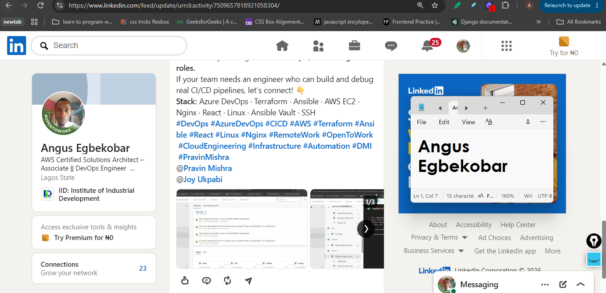

## LinkedIn Post URL

https://lnkd.in/p/eaX85gVF

> Do not expose VM passwords, tokens, private keys, cloud credentials, or other sensitive information.

---

# Submission Instructions

* Complete all tasks in sequence.
* Include the short CI/CD workflow summary.
* Include Screenshots 1–6.
* Include the final application URL.
* Include the public LinkedIn post URL.
* Confirm that all screenshots are readable and show the required context.
* Do not expose passwords, PATs, private keys, cloud credentials, subscription IDs, account IDs, or other secrets.
* Follow the Assignment Submission Guidelines.

---

# Completion Checklist

* [ ] All tasks were completed in sequence
* [ ] The correct React repository was imported into Azure Repos
* [ ] Your Full Name and date were added to the application
* [ ] The pipeline YAML was authored and committed to the repository
* [ ] Commits to `main` trigger the pipeline automatically
* [ ] The pipeline contains Build, Test, Publish, and Deploy stages
* [ ] All four stages succeeded in the same pipeline run
* [ ] The production build moved between stages as a pipeline artifact
* [ ] The Deploy stage used the SSH Service Connection
* [ ] No password or secret is stored in the YAML
* [ ] `index.html` is directly inside `/var/www/html`
* [ ] Raw React source code was not deployed to the Nginx web root
* [ ] `node_modules/` was not deployed to the Nginx web root
* [ ] Nginx is active
* [ ] The application opens through the VM public IP address
* [ ] Your Full Name and date are visible in the browser screenshot
* [ ] Screenshots 1–6 are included and readable
* [ ] No password, token, private key, account ID, or other secret is visible
* [ ] The final application URL is included
* [ ] The LinkedIn post is published
* [ ] The LinkedIn post URL is included

---

*This submission is part of the DevOps Micro Internship (DMI) — Agentic AI Track.*
