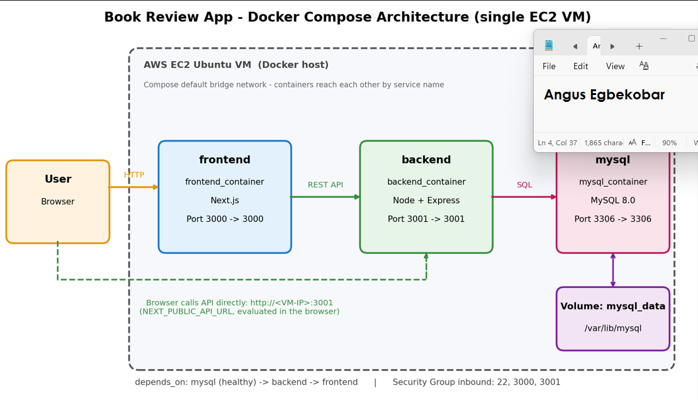
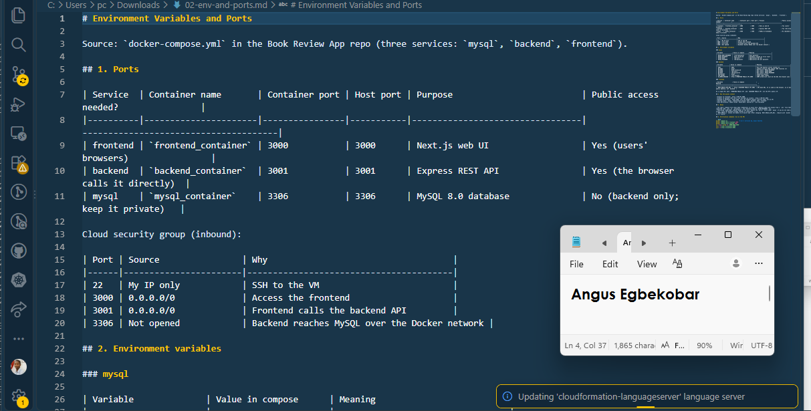
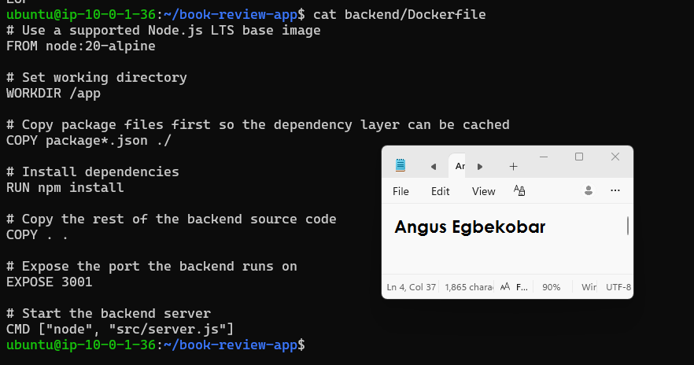
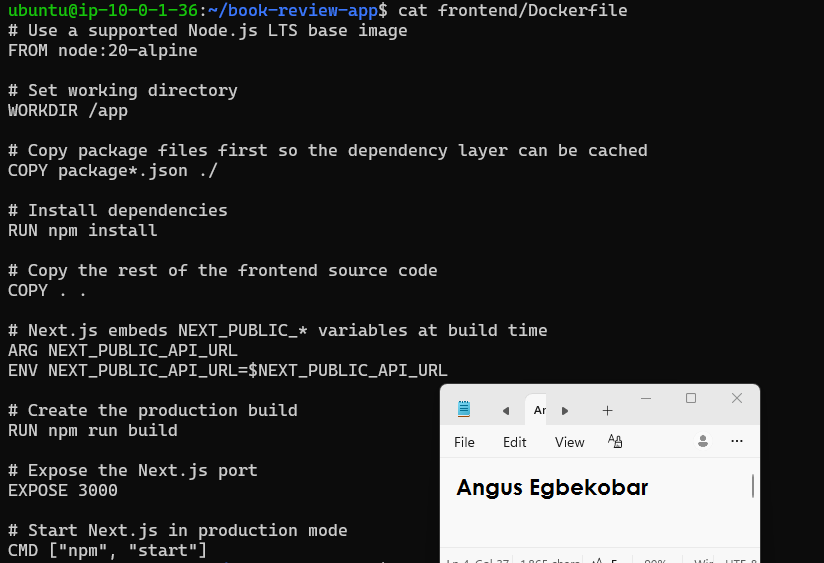
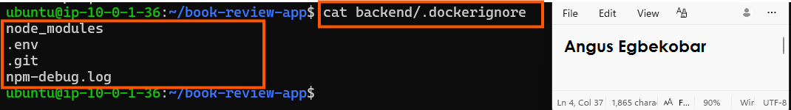
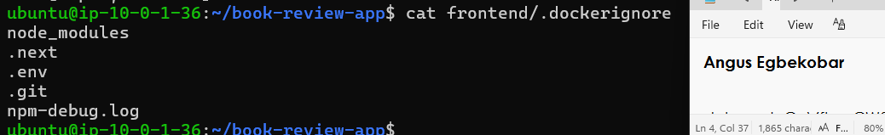

# Assignment 6 — Capstone: Deploy a Production-Grade Stack for The EpicBook

Part of the DevOps Micro Internship (DMI) with Agentic AI

---

## Purpose

In this capstone assignment, you will take the EpicBook application from source code to a fully hardened, production-ready Docker Compose deployment on a cloud VM: multi-stage Dockerfiles, network isolation, healthchecks, persistent volumes with a backup plan, structured logging, a secure reverse proxy, and an operations runbook — with an optional CI/CD pipeline.

---

# Task 0 — App Discovery & Architecture

## Goal

Explore the `theepicbook` repository, identify its components (UI, API, DB, workers), document required environment variables/ports/persistence paths, and draw a component architecture diagram.

### Evidence

#### Deliverable — `docs/01-architecture-diagram.png`

---

#### Deliverable — `docs/02-env-and-ports.md`

Add your content or link here.

---

# Task 1 — Multi-Stage Dockerfiles

## Goal

Create minimal multi-stage Dockerfiles for the frontend and backend services, with `.dockerignore` files to keep the build context lightweight.

### Evidence

#### Deliverable — `frontend/Dockerfile`, `backend/Dockerfile`, and `.dockerignore` files, with a note on layer optimizations and security benefits

Add your content or link here.

# Note: layer optimizations
Cached dependency layer. package*.json is copied and npm ci runs before the source code is copied. Code-only changes reuse the cached dependency layer, so rebuilds take seconds.

Multi-stage builds. Dev dependencies, build tooling and the Next.js build cache stay in earlier stages. The final image contains only what is needed to run.

Small base image. node:20-alpine is far smaller than the full Debian-based node:18 image used originally.

Lean installs. npm ci  installs exactly what the lockfile says, without dev packages, and npm cache clean --force leaves no cache in the layer.

Small build context. .dockerignore excludes node_modules, .next, .git, .env*, logs and docs, so the context sent to the daemon is small and a local node_modules can never overwrite the one installed in the image.

Production frontend. next build runs once at build time and the container runs next start instead of npm run dev.

Build-time API URL. NEXT_PUBLIC_API_URL is passed as a build ARG because Next.js bakes NEXT_PUBLIC_* values into the bundle at build time.

# Note: security benefits
Non-root user. Both runtime stages run as the unprivileged node user, so a compromised app does not get root inside the container.

Smaller attack surface. No compilers, dev dependencies or build tools in the runtime image, so there are fewer packages to carry CVEs.

No secrets in images. .env* is excluded by .dockerignore, so credentials are never baked into a layer. Secrets are supplied at runtime through .env and docker-compose.yml.

Supported runtime. Node 18 reached end of life in April 2025. Node 20 LTS is a safer base.

Production mode. NODE_ENV=production disables development behaviour such as verbose errors and hot-reload endpoints.

---

# Task 2 — Compose Stack & Networks

## Goal

Author `docker-compose.yml` defining the reverse-proxy, frontend, backend, and database services, isolated front-tier/back-tier networks, and named volumes.

### Evidence

#### Deliverable — `docker-compose.yml`

 1  services:
 
     2    mysql:
     3      image: mysql:8.0
     4      restart: unless-stopped
     5      environment:
     6        MYSQL_ROOT_PASSWORD: ${MYSQL_ROOT_PASSWORD}
     7        MYSQL_DATABASE: ${MYSQL_DATABASE}
     8        MYSQL_USER: ${MYSQL_USER}
     9        MYSQL_PASSWORD: ${MYSQL_PASSWORD}
    10      volumes:
    11        - mysql_data:/var/lib/mysql
    12      healthcheck:
    13        test: ["CMD-SHELL", "mysqladmin ping -h localhost -u root -p\"$$MYSQL_ROOT_PASSWORD\" --silent"]
    14        interval: 10s
    15        timeout: 5s
    16        retries: 10
    17        start_period: 30s
    18
    19    backend:
    20      build:
    21        context: ./backend
    22      restart: unless-stopped
    23      environment:
    24        PORT: ${PORT}
    25        DB_HOST: mysql
    26        DB_USER: ${DB_USER}
    27        DB_PASS: ${DB_PASS}
    28        DB_NAME: ${DB_NAME}
    29        DB_DIALECT: ${DB_DIALECT}
    30        JWT_SECRET: ${JWT_SECRET}
    31        ALLOWED_ORIGINS: ${ALLOWED_ORIGINS}
    32      ports:
    33        - "3001:3001"
    34      depends_on:
    35        mysql:
    36          condition: service_healthy
    37
    38    frontend:
    39      build:
    40        context: ./frontend
    41        args:
    42          NEXT_PUBLIC_API_URL: ${NEXT_PUBLIC_API_URL}
    43      restart: unless-stopped
    44      ports:
    45        - "3000:3000"
    46      depends_on:
    47        backend:
    48          condition: service_started
    49
    50  volumes:
    51    mysql_data:
---

# Task 3 — Healthchecks & Startup Order

## Goal

Add a database healthcheck, a `/health` endpoint check on the backend, and `depends_on` conditions checking `service_healthy`.

### Evidence

#### Deliverable — `docs/03-healthchecks-and-depends-on.md`

Add your content or link here.

---

# Task 4 — Reverse Proxy & CORS Config

## Goal

Configure Nginx or Traefik to route `/api` to the backend and `/` to the frontend, with an appropriate CORS allowlist on the backend.

### Evidence

#### Deliverable — `docs/04-proxy-routing-and-cors.md`

Add your content or link here.

---

# Task 5 — Persistence & Backups

## Goal

Mount the database data directory to a named volume, document a snapshot/backup plan, and run a live snapshot restore drill.

### Evidence

#### Deliverable — `docs/05-persistence-and-backup.md`

Add your content or link here.

---

#### Screenshot — System state before and after a manual snapshot restore cycle

Add your screenshot here.

---

# Task 6 — Logging & Observability

## Goal

Bind-mount the reverse proxy log directory to the host, redirect application logs to stdout or named volumes, and enable structured JSON logging where supported.

### Evidence

#### Deliverable — `docs/06-logging-layout.md`

Add your content or link here.

---

#### Screenshot — Live running JSON container log entries

Add your screenshot here.

---

# Task 7 — Cloud Deployment (AWS or Azure)

## Goal

Provision a VM per the security requirements (SSH restricted to your IP; HTTP/HTTPS open), install Docker, and bring the full stack up with a working public URL.

### Evidence

#### Deliverable — `docs/07-cloud-deployment-notes.md` (ports, firewall rules, deployment link)

Add your content or link here.

---

#### Screenshot — Browser showing successful web UI retrieval via the cloud public IP

Add your screenshot here.

---

#### Screenshot — Active page interaction confirming backend API data fetches succeed

Add your screenshot here.

---

# Task 8 — CI/CD Pipeline (Optional)

## Goal

Build a pipeline (Azure Pipelines or GitHub Actions) that builds and tags multi-stage images and automates deployment via SSH restart steps.

### Evidence

#### Deliverable — `docs/08-ci-cd-pipeline.md`

Add your content or link here.

---

#### Screenshot (optional) — Completed automated pipeline run

Add your screenshot here.

---

# Task 9 — Reliability Tests & Ops Runbook

## Goal

Inject faults (drop backend/database dependencies) and evaluate frontend error handling, then write an operations runbook covering startup, shutdown, secret rotation, and disaster recovery.

### Evidence

#### Deliverable — `docs/09-runbook.md`

Add your content or link here.

---

#### Deliverable — `docs/10-reliability-tests.md`

Add your content or link here.

---

# LinkedIn Post (Required)

## Goal

Publish a 6–10 line LinkedIn post covering the architectural decision that most improved reliability, the biggest image size reduction achieved (with numbers), and your key production-hardening takeaways.

## Evidence

#### LinkedIn Post URL

Paste your LinkedIn post URL here:

`Add your URL here`

---

#### Screenshot — Published LinkedIn post showing the text body and a deployment verification image

Add your screenshot here.

---

# Submission Instructions

- Add all required deliverables, screenshots, and links in your submission
- Full name must be visible in required screenshots
- Do not expose passwords, API tokens, cloud account IDs, or private keys

---

# Completion Checklist

- [ ] Task 0: Architecture diagram and env/ports doc completed
- [ ] Task 1: Multi-stage Dockerfiles and `.dockerignore` files created
- [ ] Task 2: `docker-compose.yml` with isolated networks and volumes authored
- [ ] Task 3: Healthchecks and `depends_on` conditions configured
- [ ] Task 4: Reverse proxy routing and CORS configured
- [ ] Task 5: Persistence and backup plan tested (Screenshot)
- [ ] Task 6: Logging and observability configured (Screenshot)
- [ ] Task 7: Cloud deployment live and verified (Screenshots)
- [ ] Task 8: CI/CD pipeline built (optional)
- [ ] Task 9: Reliability tests and runbook completed
- [ ] LinkedIn post published and URL submitted
- [ ] No sensitive information exposed
- [ ] VM torn down after grading to avoid unexpected charges

---

## 📌 About DMI & CloudAdvisory

DevOps Micro Internship (DMI) is a project-based DevOps program run by Pravin Mishra (The CloudAdvisory) focused on real-world execution, systems thinking, and career readiness.

It helps learners build strong DevOps foundations with hands-on experience.

---

## 📌 Resources

- 🌐 DMI Official Website: https://dmi.pravinmishra.com?utm_source=github&utm_medium=readme  
- 🎓 University: https://university.pravinmishra.com?utm_source=github&utm_medium=readme  
- 💬 Discord Community: https://discord.pravinmishra.com?utm_source=github&utm_medium=readme  
- 📝 Blog: https://dmi.pravinmishra.com/blog?utm_source=github&utm_medium=readme  
- ▶️ YouTube Playlist: https://www.youtube.com/playlist?list=PLFeSNDtI4Cho  
- 🔗 Pravin Mishra (LinkedIn): https://www.linkedin.com/in/pravin-mishra-aws-trainer/  
- 🏢 CloudAdvisory (LinkedIn): https://www.linkedin.com/company/thecloudadvisory/

---

*This submission is part of DevOps Micro Internship (DMI) — Agentic AI Track.*
