# Assignment 7 — Capstone: Deploy a Production-Grade Stack for The EpicBook

Part of the DevOps Micro Internship (DMI) with Agentic AI

---

## Purpose

In this assignment, you will deploy the EpicBook application as a production-oriented Docker Compose stack on a cloud VM. You will use optimized container images, isolated networks, health checks, persistent MySQL storage, a selected reverse proxy, logging, backup and restore testing, and reliability procedures.

---

# Task 0 — App Discovery and Architecture

## Goal

Review the EpicBook repository and design the intended application architecture.

### Evidence

#### Screenshot 1 — EpicBook Project Structure

Add a terminal screenshot showing the EpicBook project structure after cloning the repository.


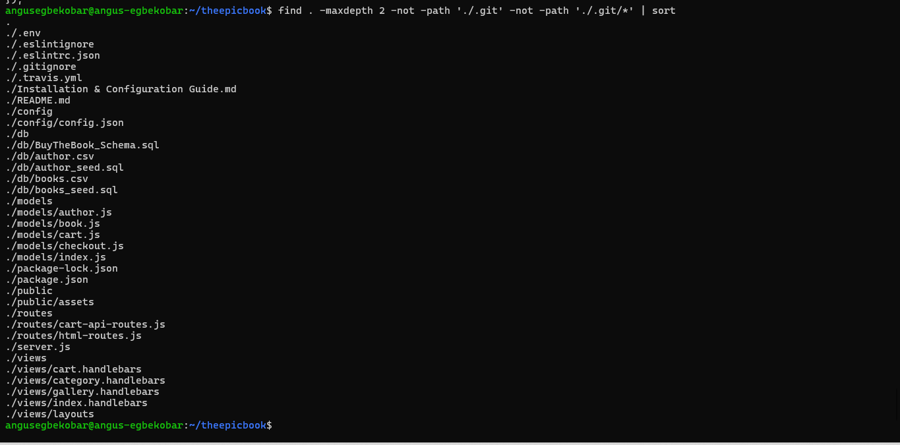
---

#### Screenshot 2 — Architecture Diagram

Add a screenshot of your architecture diagram showing:

- Public user
- Reverse proxy
- Frontend
- Backend
- Database
- Docker networks
- Public and private ports
- Persistent database storage

Add your full name inside the diagram or as a clear caption below it.


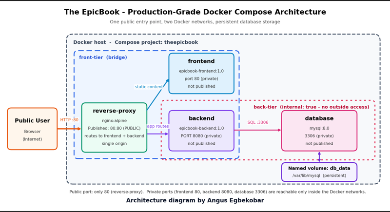
---

#### Screenshot 3 — Environment Variables and Ports Document

Add a screenshot showing the contents of:

```text
docs/02-env-and-ports.md
```

It must document environment-variable names, internal ports, persistent-data details, and the health-check method. Do not expose real credentials or values.


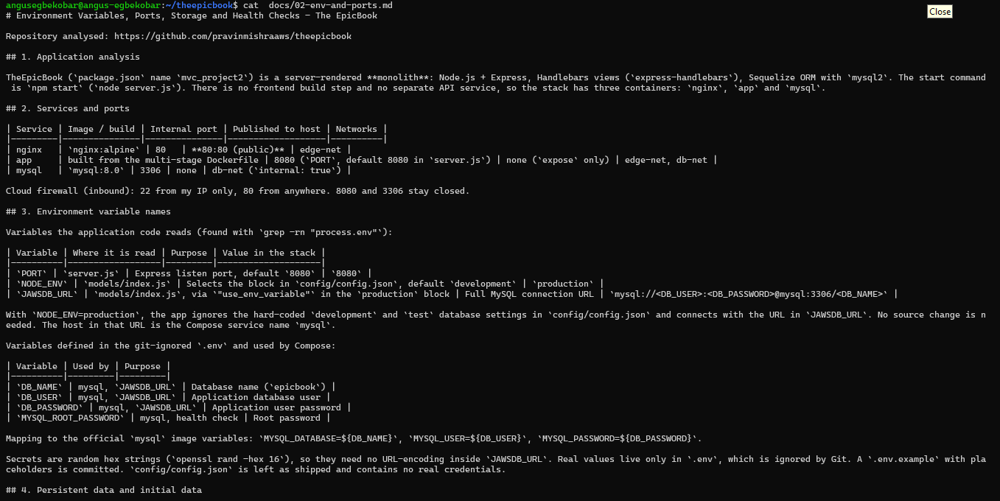
---

# Task 1 — Create Production Docker Images

## Goal

Create optimized production images for the EpicBook backend and frontend.

### Evidence

#### Screenshot 4 — Backend Dockerfile

Add a screenshot showing `backend/Dockerfile`, including:

- Dependency stage
- Minimal runtime stage
- Production startup command
- Internal backend port
- Non-root user configuration


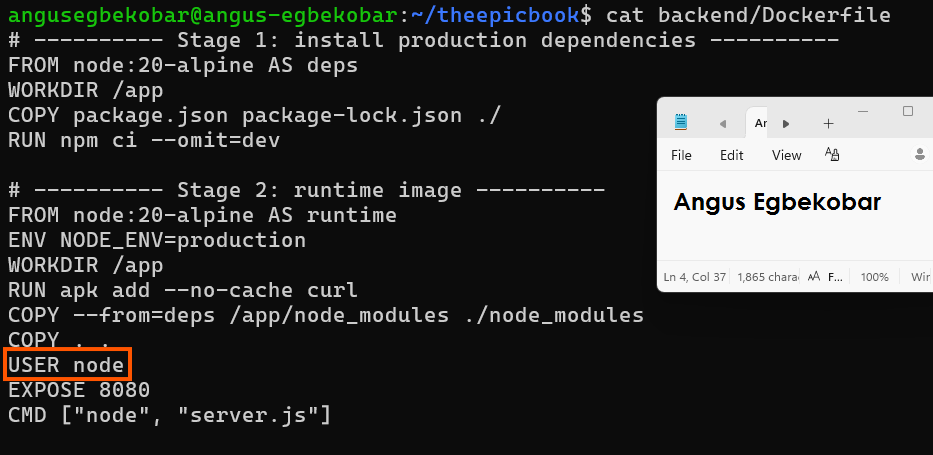
---

#### Screenshot 5 — Frontend Dockerfile

Add a screenshot showing `frontend/Dockerfile`, including:

- Nginx runtime image
- Static frontend files copied to the Nginx web root


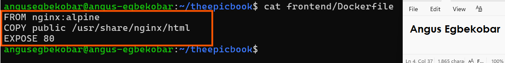
---

#### Screenshot 6 — Docker Ignore Files

Add a screenshot showing both:

```text
backend/.dockerignore
frontend/.dockerignore
```


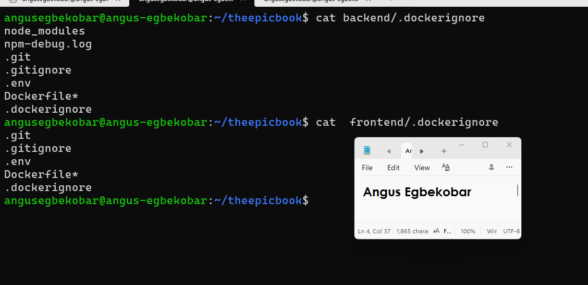
---

#### Screenshot 7 — Docker Image Builds and Size Comparison

Add a terminal screenshot showing successful builds of:

- Baseline backend image
- Optimized backend image
- Frontend image

The screenshot must also show the baseline and optimized backend image-size comparison.


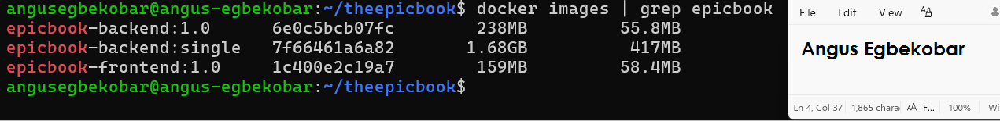
---

#### Screenshot 8 — Backend Running as Non-Root User

Add a terminal screenshot showing the optimized backend container running as a non-root user.


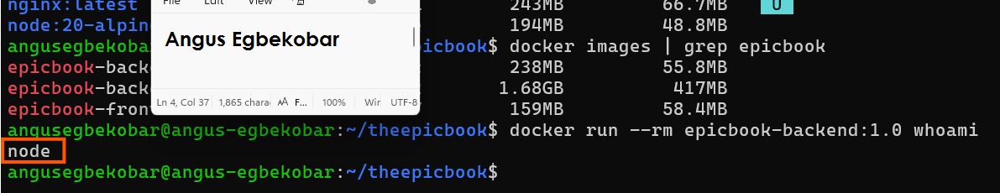
---

### Notes

Write a short note covering:

- Baseline and optimized backend image sizes
- The image-size reduction achieved
- One Docker layer-caching optimization used
- The security benefit of running the backend as a non-root user


### Image sizes

The baseline backend image (epicbook-backend:single, single-stage on a full Node base image) is 1.68 GB on disk (417 MB content size). The optimized image (epicbook-backend:1.0, multi-stage on node:20-alpine) is 238 MB on disk (55.8 MB content size).

### Size reduction
The optimized image is about 1,440 MB smaller, a reduction of roughly 86% by disk usage. By content size, 417 MB drops to 55.8 MB, about 87% smaller. The saving comes from the small Alpine base image and from copying only production dependencies and application code into the final stage, so build tools and dev packages stay behind in earlier stages.

### Layer-caching optimization
The Dockerfile copies package*.json and runs the dependency install before copying the application source. Docker caches each layer, so when only source code changes, the dependency layer is reused and the rebuild takes seconds instead of reinstalling every package. A .dockerignore file also keeps node_modules and .git out of the build context, which keeps the context small and the cache stable.

### Security benefit of a non-root user


 * The final stage ends with USER node, so the app runs as an unprivileged user instead of root. If an attacker exploits a flaw in the application, they get only that user’s limited permissions inside the container, which makes it much harder to modify system files, install tools or attempt a container escape. docker run --rm epicbook-backend:1.0 whoami prints node, while the baseline image prints root.
---

# Task 2 — Create the Docker Compose Stack and Networks

## Goal

Create one Docker Compose stack containing the reverse proxy, frontend, backend, and MySQL database.

### Evidence

#### Screenshot 9 — Docker Compose Services

Add a screenshot showing `docker-compose.yml` with all four services:

```text
reverse-proxy
frontend
backend
database
```


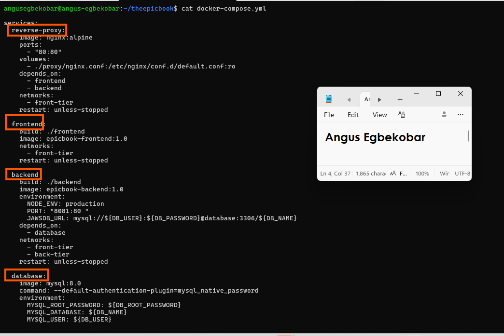
---

#### Screenshot 10 — Networks and Named Volume

Add a screenshot showing:

- `front-tier` network
- `back-tier` network
- `db_data` named volume


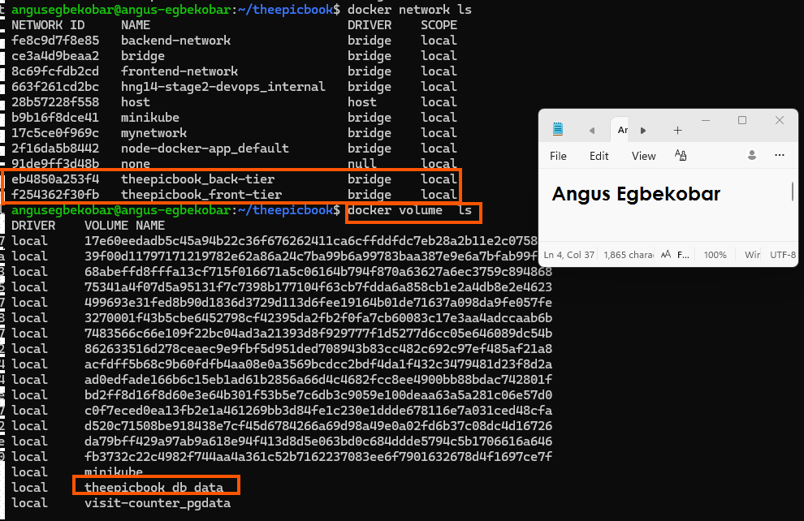
---

#### Screenshot 11 — Docker Compose Validation

Add a terminal screenshot showing successful Docker Compose validation without exposing environment-variable values or secrets.


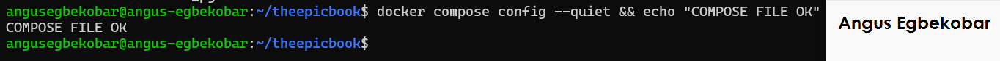
---

# Task 3 — Configure Health Checks and Startup Dependencies

## Goal

Configure health checks and ensure services start only after their dependencies are healthy.

### Evidence

#### Screenshot 12 — Backend Health Endpoint

Add a screenshot showing the backend application configuration for the `/health` endpoint.


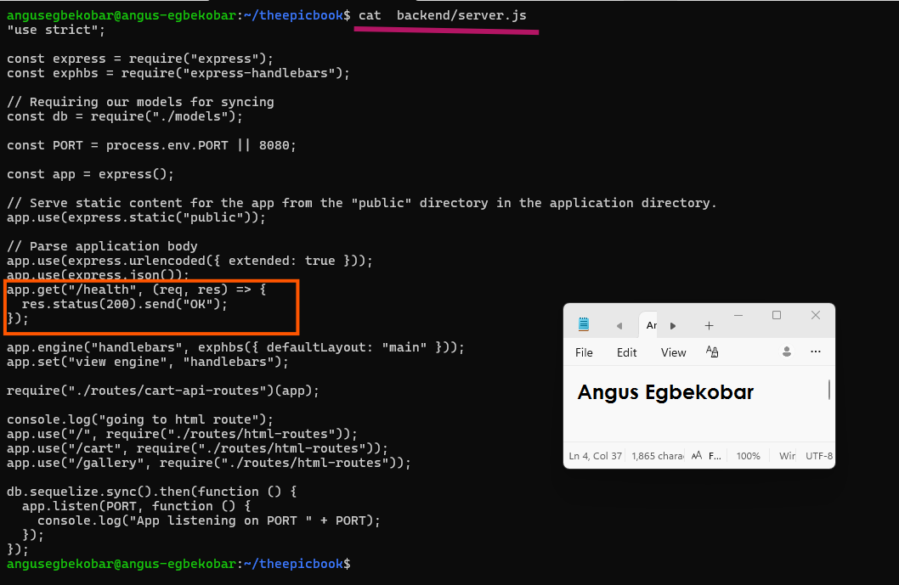
---

#### Screenshot 13 — MySQL and Backend Health Checks

Add a screenshot showing `docker-compose.yml` with health checks for MySQL and the backend.


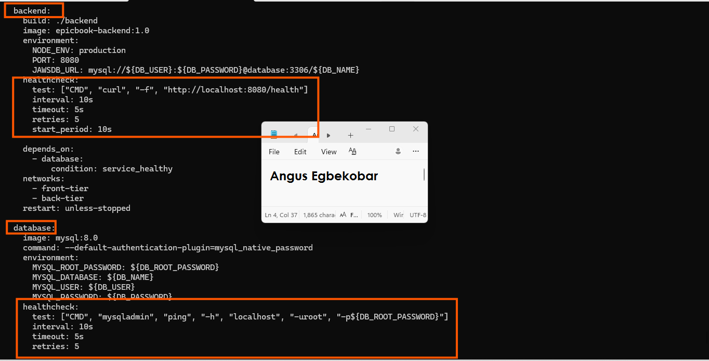
---

#### Screenshot 14 — Frontend and Reverse-Proxy Health Checks

Add a screenshot showing:

- Frontend health check
- Reverse-proxy health check
- `depends_on` conditions using `service_healthy`


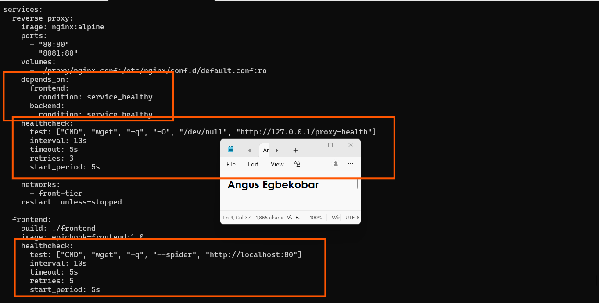
---

#### Screenshot 15 — Running Healthy Services

Add a terminal screenshot showing Docker Compose service status. The database, backend, frontend, and reverse proxy must be running successfully.


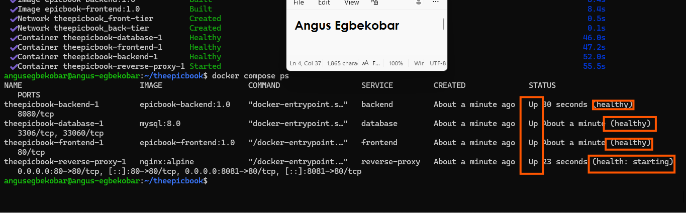
---

#### Screenshot 16 — Public Health Endpoint

Add a terminal screenshot showing a successful response from the public application health endpoint through the reverse proxy.


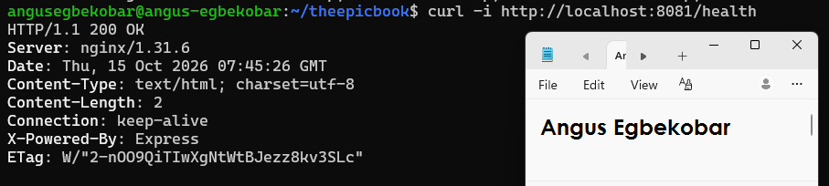
---

#### Screenshot 17 — Health-Check and Startup-Order Document

Add a screenshot showing the contents of:

```text
docs/03-healthchecks-and-depends-on.md
```

Explain the health-check method for each service and the startup dependency order.


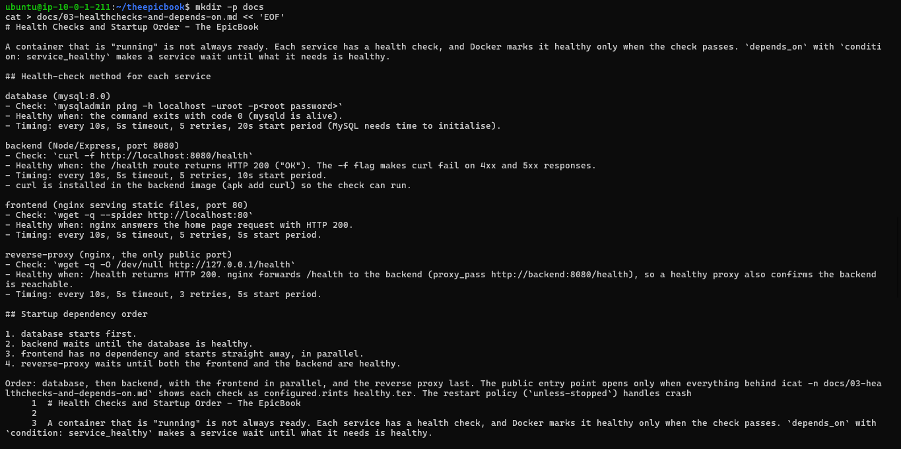
---

# Task 4 — Configure the Reverse Proxy and Same-Origin Routing

## Goal

Use either Nginx or Traefik as the only public entry point for the EpicBook application.

### Evidence

#### Screenshot 18 — Selected Reverse-Proxy Configuration

Add a screenshot showing the configuration for your selected reverse proxy.

It must show routes for:

- Static frontend assets
- Application pages
- API requests
- Health endpoint


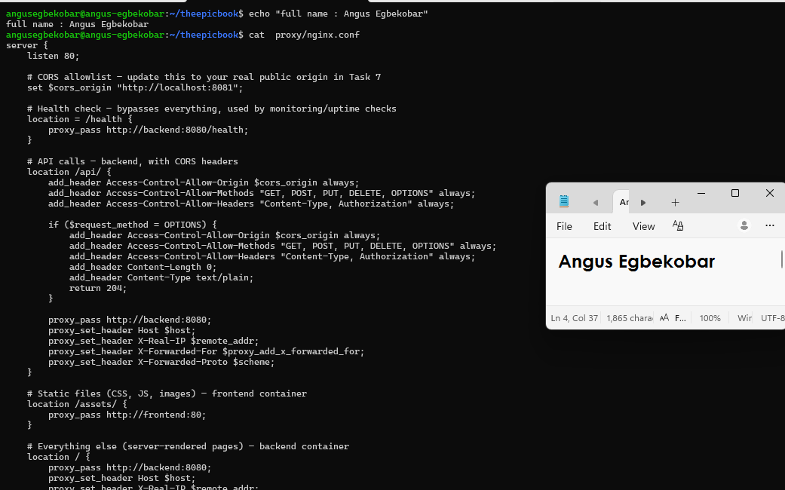
---

#### Screenshot 19 — Only Reverse Proxy Publishes Port 80

Add a screenshot of `docker-compose.yml` showing that only the `reverse-proxy` service publishes port 80.


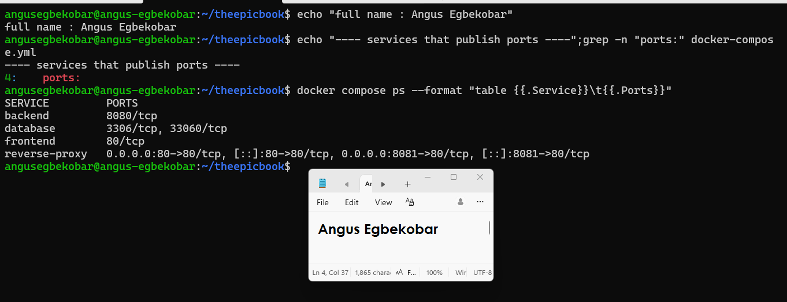
---

#### Screenshot 20 — Reverse-Proxy Route Testing

Add a terminal screenshot showing successful requests through the selected reverse proxy to:

- Application page
- One API endpoint
- One static asset
- Health endpoint


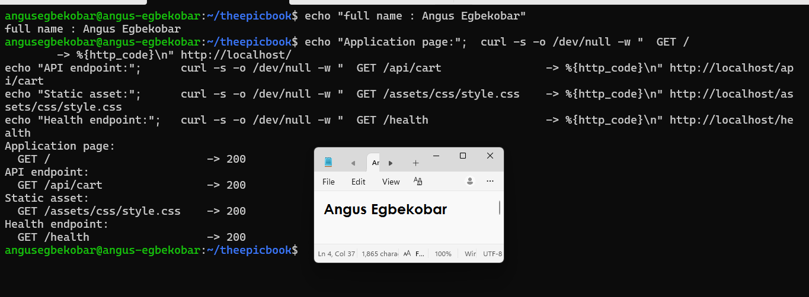
---

#### Screenshot 21 — EpicBook Application Through Public IP

Add a browser screenshot showing the EpicBook application loaded through the VM public IP address.

Add your full name as a clear caption below the screenshot.


---

#### Screenshot 22 — Proxy Routing and CORS Document

Add a screenshot showing the contents of:

```text
docs/04-proxy-routing-and-cors.md
```

Explain the proxy routes and state whether CORS was required and why.


# Task 5 — Prove Data Persistence, Backup, and Restore

## Goal

Verify MySQL persistence and perform a controlled backup and restore drill.

### Evidence

#### Screenshot 23 — MySQL Volume Configuration

Add a terminal screenshot showing the `db_data` named volume and its MySQL mount configuration.


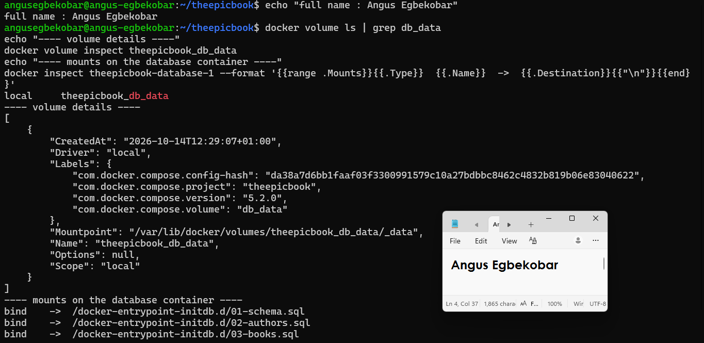
---

#### Screenshot 24 — Test Data Before Backup

Add a terminal screenshot showing the selected test data before the backup and restore drill.


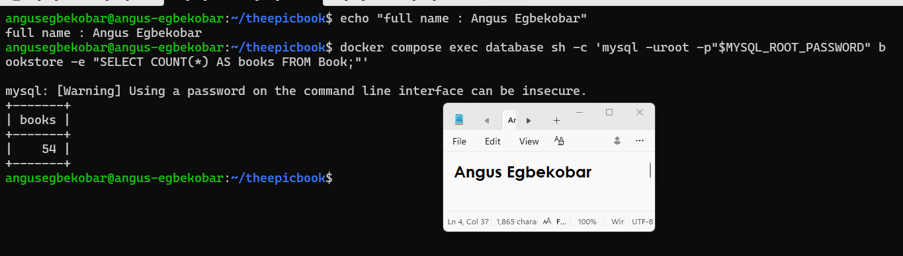
---

#### Screenshot 25 — Successful Backup Creation

Add a terminal screenshot showing successful backup creation and the backup file stored in the host backup directory.


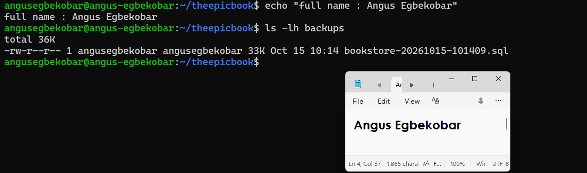
---

#### Screenshot 26 — Controlled Data-Loss Test

Add a terminal screenshot showing that the selected test record was removed during the controlled data-loss test.


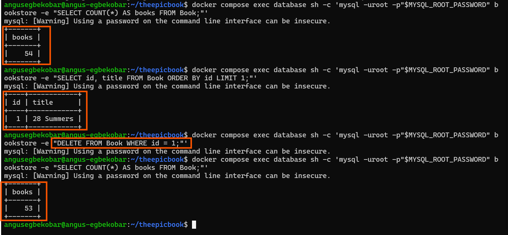
---

#### Screenshot 27 — Restore Verification

Add a terminal screenshot showing successful restore and verification that the deleted test record is available again.


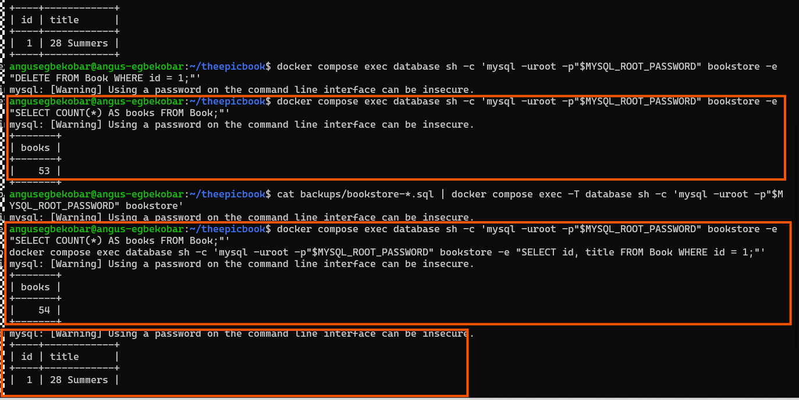
---

#### Screenshot 28 — Persistence After Down/Up Cycle

Add a terminal screenshot showing that database data remains available after a non-destructive Docker Compose down/up cycle.

Do not use `docker compose down -v`.


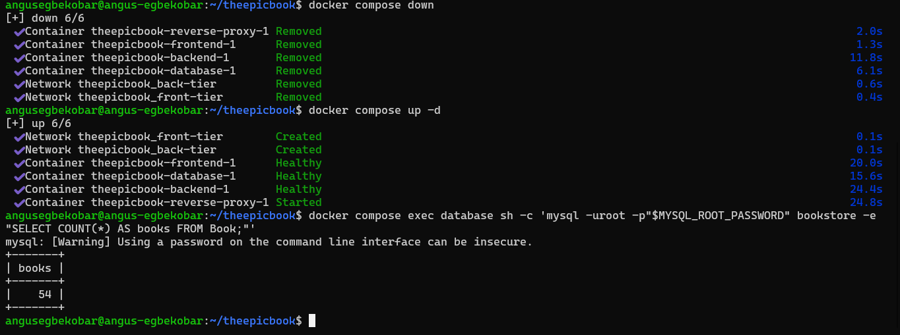

---

#### Screenshot 29 — Persistence and Backup Document

Add a screenshot showing the contents of:

```text
docs/05-persistence-and-backup.md
```

Include the backup plan and restore procedure.


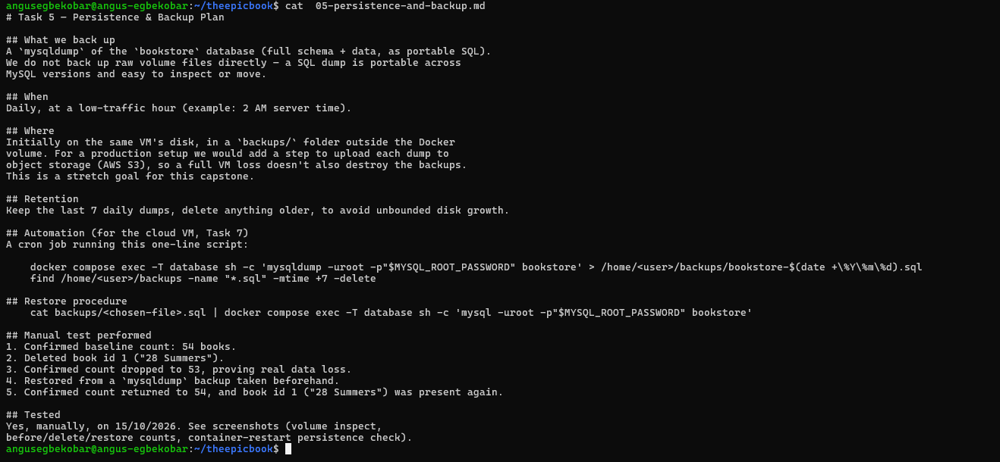
---

# Task 6 — Configure Logging and Observability

## Goal

Configure useful reverse-proxy and backend logs without exposing sensitive information.

### Evidence

#### Screenshot 30 — Logging Configuration

Add a screenshot showing:

- Configuration for the selected reverse proxy
- Proxy log format
- Docker Compose host log-directory bind mount


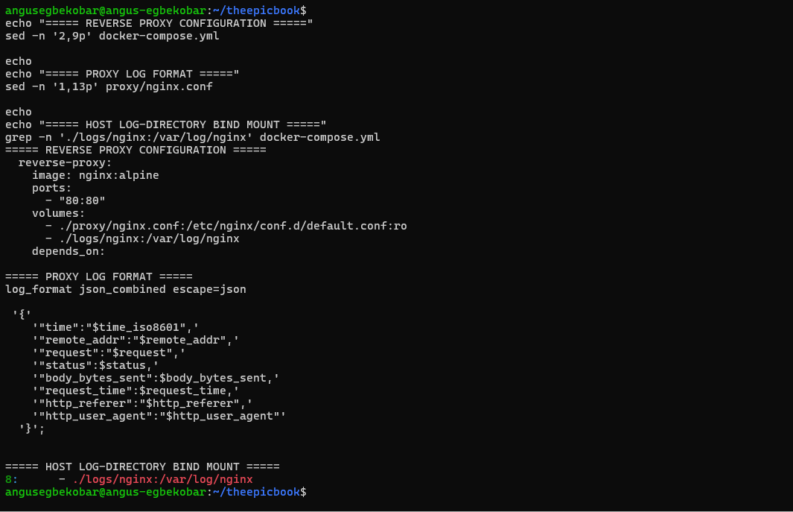
---

#### Screenshot 31 — Persistent Proxy Logs and Backend Logs

Add a terminal screenshot showing:

- Selected reverse-proxy logs available from the host directory after a proxy restart
- Backend logs displayed through Docker Compose


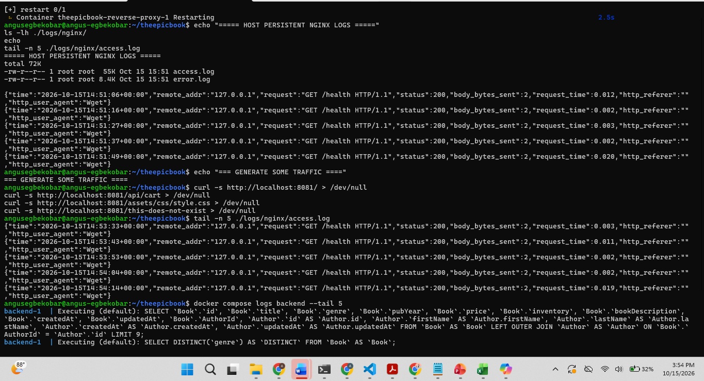
---

### Notes

Write a short note covering:

- The selected reverse proxy
- Host path used for reverse-proxy logs
- How backend logs are viewed
- Whether JSON or standard text logs were used
- Why passwords, tokens, headers, and database connection strings must not appear in logs


### Notes: Reverse Proxy Logging

* **Selected reverse proxy:** Nginx, running in an Alpine Linux Docker container.
* **Host path for reverse-proxy logs:** `./logs/nginx/`, mounted to `/var/log/nginx/` inside the Nginx container using a Docker Compose bind mount. This allows proxy logs to persist on the host even when the container is restarted or recreated.
* **Viewing backend logs:** Backend logs can be viewed using `docker compose logs backend`. To display only the latest 10 lines, use `docker compose logs --tail=10 backend`.
* **Log format:** JSON-formatted access logs were configured using Nginx's `json_combined` log format. This makes log entries structured and easier to search, filter, and analyze.
* **Protecting sensitive information:** Passwords, access tokens, authorization headers, and database connection strings must not appear in logs because logs may be stored for long periods or accessed by people who should not have access to secrets. Exposing these details could lead to unauthorized access, data breaches, and compromised application infrastructure. Logs should capture operational information while masking or excluding sensitive values.

---

# Task 7 — Deploy and Verify the Stack on a Cloud VM

## Goal

Deploy the completed Docker Compose stack on an AWS or Azure VM and verify public access.

### Evidence

#### Screenshot 32 — VM Public IP and Inbound Rules

Add a cloud-console screenshot showing:

- VM public IP address
- SSH port 22 restricted to your IP address
- HTTP port 80 allowed from Anywhere


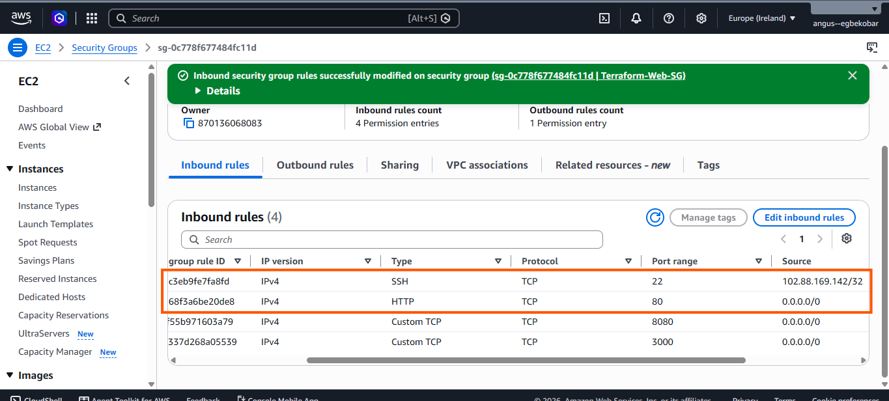
---

#### Screenshot 33 — Cloud VM Stack Verification

Add a VM terminal screenshot showing:

- Docker Compose service status
- Successful public health or API response
- No published database, frontend, or backend ports


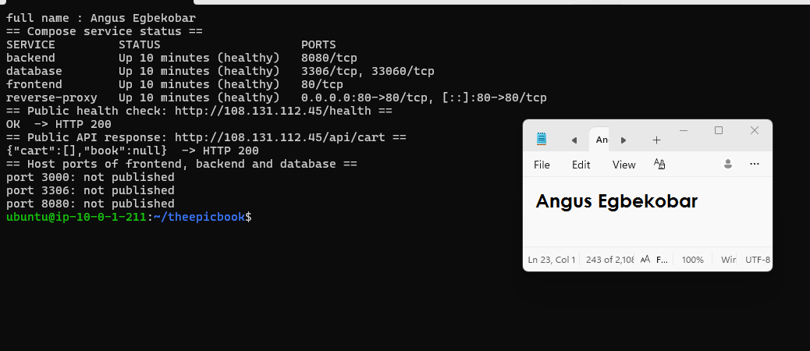
---

#### Screenshot 34 — EpicBook Application on Cloud VM

Add a browser screenshot showing the EpicBook application loaded through the VM public IP address.

Add your full name as a clear caption below the screenshot.


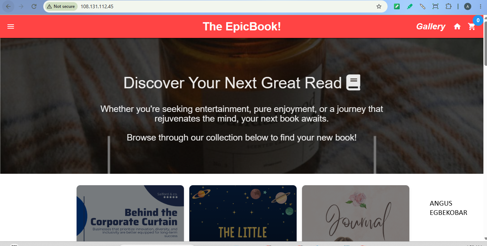
---

### Notes

Write a short note covering:

- Cloud provider used
- VM operating system
- Public port exposed
- Security rules configured
- Confirmation that the application and backend API worked through the reverse proxy


Cloud provider: AWS (an EC2 instance).

VM operating system: Ubuntu 22.04.5 LTS, with Docker Engine and the Docker Compose plugin installed.

Public port exposed: only port 80, published by the reverse-proxy (nginx) container. The frontend, backend and database containers publish no host ports and are reachable only through the Docker networks, with the database on an internal-only network.

Security rules configured: the EC2 security group has two inbound rules: TCP 22 (SSH) from my own IP address only, and TCP 80 (HTTP) from anywhere (0.0.0.0/0). No other inbound ports are open, so 3000, 8080 and 3306 are closed to the internet.

Verification: the application and backend API both worked through the reverse proxy at the VM’s public IP. The home page returned 200 OK and rendered the EpicBook catalogue, /api/cart returned a JSON response from the backend, the static CSS file loaded, and /health returned OK. The database was seeded correctly, with 54 books in the Book table, and all four services showed Up (healthy) in docker compose ps.
---

# Task 8 — Automate Deployment with CI/CD (Optional)

## Goal

Optionally automate image build, image push, and deployment through GitHub Actions or Azure Pipelines.

### Optional Evidence

#### Optional Screenshot — Successful CI/CD Pipeline Run

Add a screenshot showing a successful pipeline run with build, image push, deployment, and verification stages.

---

### Optional Notes

Write a short note covering:

- CI/CD platform used
- Image-tagging method
- Registry used
- Deployment trigger
- Manual approval or secret-handling approach

Write your note here.

---

# Task 9 — Perform Reliability Tests and Create an Operations Runbook

## Goal

Test controlled service failures and document safe operating procedures.

### Evidence

#### Screenshot 35 — Backend Failure and Recovery

Add a terminal screenshot showing:

- Backend failure test
- Expected unavailable response through the reverse proxy
- Backend restart
- Successful health-check recovery


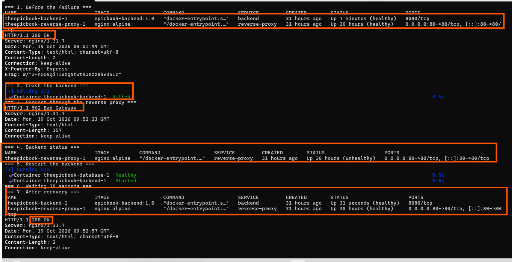
---

#### Screenshot 36 — Database Failure and Recovery

Add a terminal screenshot showing:

- Database outage test
- Failed database-dependent request
- Database restart
- Successful application recovery


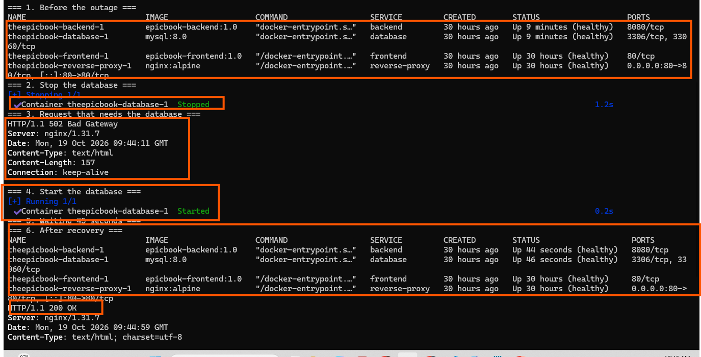
---

### Notes

Write a short operations runbook covering:

- Safe restart procedure for reverse proxy, frontend, backend, and database
- Backup and restore procedure
- Secret-rotation approach
- Database recovery procedure
- What to check when the application returns an error
- Results of backend and database reliability tests

Write your note here.
# Operations Runbook - The EpicBook

The app has four services: reverse-proxy (the only public port, 80), frontend, backend and database. 

## 1. Safe restart procedure

Before and after each step, run `docker compose ps`. Every service should show `Up (healthy)`.

- Database: `docker compose restart database`. Wait until it is healthy, then restart the backend.
- Backend: `docker compose restart backend`. Wait until it is healthy, then run `curl -I http://localhost/health`.
- Frontend: `docker compose restart frontend`. Wait until it is healthy.
- Reverse proxy: `docker compose restart reverse-proxy`. Then run `curl -I http://localhost/health`, which should return 200.

For a full restart, go in this order: database, backend, frontend, reverse proxy. If the proxy shows 502 after the backend comes back, restart the proxy.

Never use `docker compose down -v`. It deletes the database. `docker compose down` followed by `docker compose up -d` is safe.

## 2. Backup and restore

Backup:

```bash
mkdir -p backups
docker compose exec -T database sh -c 'mysqldump -uroot -p"$MYSQL_ROOT_PASSWORD" "$MYSQL_DATABASE"' > backups/epicbook-$(date +%F).sql
```

Take a backup every day and before every change. Keep a copy outside the VM.

Restore:

```bash
docker compose stop backend
docker compose exec -T database sh -c 'mysql -uroot -p"$MYSQL_ROOT_PASSWORD" "$MYSQL_DATABASE"' < backups/FILENAME.sql
docker compose start backend
```

Then check that `curl -I http://localhost/` returns 200 and that the Book table still has its 54 rows.

## 3. Secret-rotation approach

The secrets are DB_PASSWORD and DB_ROOT_PASSWORD in the `.env` file. The `.env` file is never committed to Git. Rotate them every 90 days, and immediately if one is exposed.

MySQL only reads the passwords from `.env` when the database is first created, so changing `.env` alone is not enough. The steps are:

1. Take a backup.
2. Generate a new password for each secret with `openssl rand -hex 16`.
3. Change the passwords inside MySQL with `ALTER USER`.
4. Put the same new passwords in `.env`.
5. Run `docker compose up -d --force-recreate database backend`.
6. Check that `docker compose ps` shows everything healthy and the site returns 200.

Passwords are never pasted into chats or commits.

## 4. Database recovery procedure

- If the database container stopped or crashed: run `docker compose start database`, wait until it is healthy, then run `docker compose restart backend`.
- If data was deleted or damaged: restore the latest backup using section 2.
- If the volume was lost: run `docker compose up -d database`. The files in the `db` folder rebuild the tables and the sample books. Then restore the latest backup.

After any recovery, run `docker compose ps` and `curl -I http://localhost/`.

## 5. What to check when the application returns an error

1. Run `docker compose ps`. Look for services that are Exited, unhealthy or restarting.
2. Run `curl -I http://localhost/health` and `curl -I http://localhost/`.
3. Read the logs one service at a time: `docker compose logs --tail=30 reverse-proxy`, then backend, then database.
4. Check the disk with `df -h /` and the memory with `free -h`.
5. Run `docker compose config --quiet` to check the compose file.
6. If it works on the VM but not in the browser, check that the public IP did not change and that the security group still allows port 80.

Common errors:

- 502 Bad Gateway: the backend is stopped. Run `docker compose start backend`, and restart the proxy if the error stays.
- Backend log shows ECONNREFUSED or ENOTFOUND database: the database is down or still starting. Start it, wait until it is healthy, then restart the backend.
- Proxy shows unhealthy: the backend health route is not answering. Fix the backend first.

## 6. Reliability test results

Backend failure test:
- I stopped the backend with `docker compose kill backend`.
- Requests through the reverse proxy returned 502 Bad Gateway, and the proxy became unhealthy.
- A manual kill is not restarted by Docker, so I ran `docker compose start backend`. After about 30 seconds the backend was healthy and `/health` returned 200 OK.
- I also crashed the backend process directly. Docker restarted it automatically within seconds, because of the restart policy.

Database failure test:
- I stopped the database with `docker compose stop database`, and the site returned 502 Bad Gateway.
- The backend still showed healthy during the outage, because its health route does not check the database. This is a known gap.
- After `docker compose start database`, the services became healthy again after about 45 seconds and the site returned 200 OK.

Improvement identified: make the backend health route check the database.
---

# Final Public Application URL

**EpicBook URL:** `http://108.131.112.45`

Replace the placeholder with your working public URL.

---

# GitHub Repository URL

**Your Fork or Repository URL:** https://github.com/pravinmishraaws/theepicbook

---

# LinkedIn Requirement

## Goal

Create a professional LinkedIn post of 6–10 lines about your EpicBook capstone deployment.

Your post must include:

- The architectural decision that most improved reliability
- Your biggest image-size reduction, with numbers
- Key production-hardening lessons
- A deployment verification image

### Evidence

**LinkedIn Post URL:** https://lnkd.in/p/ewXna2Kw

#### LinkedIn Post Screenshot

Add a screenshot of the published LinkedIn post showing the text body and deployment verification image.
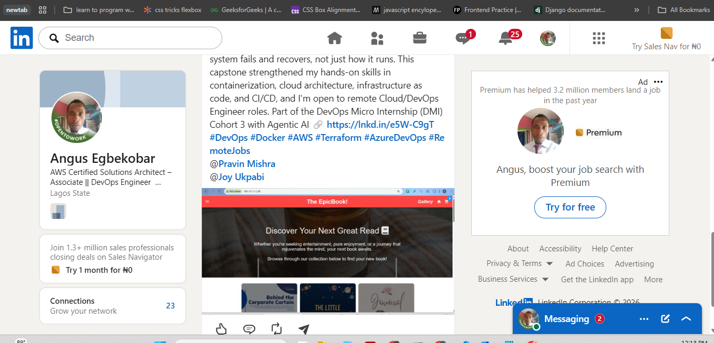
---

# Submission Checklist

- [ ] EpicBook repository reviewed and architecture diagram created
- [ ] Environment variables, ports, persistence, and health-check details documented
- [ ] Backend and frontend production Dockerfiles created
- [ ] Backend runs as a non-root user
- [ ] Docker image-size comparison completed
- [ ] Docker Compose stack includes reverse proxy, frontend, backend, and database
- [ ] `front-tier` and `back-tier` networks configured
- [ ] `db_data` named volume configured
- [ ] MySQL, backend, frontend, and reverse-proxy health checks configured
- [ ] Startup dependencies use `service_healthy`
- [ ] Nginx or Traefik selected as the only public reverse proxy
- [ ] Only reverse-proxy port 80 is publicly published
- [ ] Same-origin routing configured and CORS used only when required
- [ ] Backup, restore, and persistence testing completed
- [ ] Reverse-proxy and backend logs verified
- [ ] Cloud VM deployment verified through the public IP
- [ ] Backend and database reliability tests completed
- [ ] Screenshots 1–36 included
- [ ] Required notes completed
- [ ] LinkedIn post URL and screenshot included
- [ ] Full name visible in required screenshots or captions
- [ ] No passwords, tokens, private keys, account IDs, or other sensitive information exposed

---

## 📌 About DMI & CloudAdvisory

DevOps Micro Internship (DMI) is a project-based DevOps program run by Pravin Mishra (The CloudAdvisory) focused on real-world execution, systems thinking, and career readiness.

It helps learners build strong DevOps foundations with hands-on experience.

---

## 📌 Resources

- 🌐 DMI Official Website: https://dmi.pravinmishra.com?utm_source=github&utm_medium=readme  
- 🎓 University: https://university.pravinmishra.com?utm_source=github&utm_medium=readme  
- 💬 Discord Community: https://discord.pravinmishra.com?utm_source=github&utm_medium=readme  
- 📝 Blog: https://dmi.pravinmishra.com/blog?utm_source=github&utm_medium=readme  
- ▶️ YouTube Playlist: https://www.youtube.com/playlist?list=PLFeSNDtI4Cho  
- 🔗 Pravin Mishra (LinkedIn): https://www.linkedin.com/in/pravin-mishra-aws-trainer/  
- 🏢 CloudAdvisory (LinkedIn): https://www.linkedin.com/company/thecloudadvisory/

---

*This submission is part of DevOps Micro Internship (DMI) — Agentic AI Track.*
