# Assignment 5 — Kubernetes Health Probes (Readiness)

Part of the DevOps Micro Internship (DMI) with Agentic AI

---

## Purpose

In this assignment, you will configure and test a Kubernetes readiness probe. You will create a baseline NGINX Deployment, add an HTTP readiness probe, intentionally break it, observe a stalled rollout, and restore the working configuration.

You will also demonstrate how readiness probes protect rolling updates.

---

# Task 0 — Prepare the Lab Environment

## Goal

Confirm that you are connected to your learning cluster and remove the previous assignment’s HPA and NGINX Deployment before starting this lab.

No screenshot or written notes are required for this pre-check.

---

# Task 1 — Set Up Your Lab Directory

## Goal

Create and enter a dedicated directory for the readiness-probe lab.

### Evidence

#### Screenshot 1 — Terminal showing that you are working inside `~/k8s-labs/health-probes-readiness`

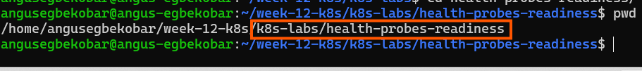
---

### Notes

**1. What is the purpose of a readiness probe?**

It checks if a Pod is ready to accept traffic, ensuring Kubernetes only routes requests to healthy containers.

**2. Why is a Pod being Running not always enough to confirm it can serve traffic?**

Because a Pod may be running but still initializing, loading data, or failing internally, so it might not yet be able to handle requests.

---

# Task 2 — Create a Baseline Deployment Without Probes

## Goal

Create a baseline NGINX Deployment with two replicas and no readiness probe.

### Evidence

#### Screenshot 2 — Completed `00-nginx-deploy-baseline.yaml` manifest

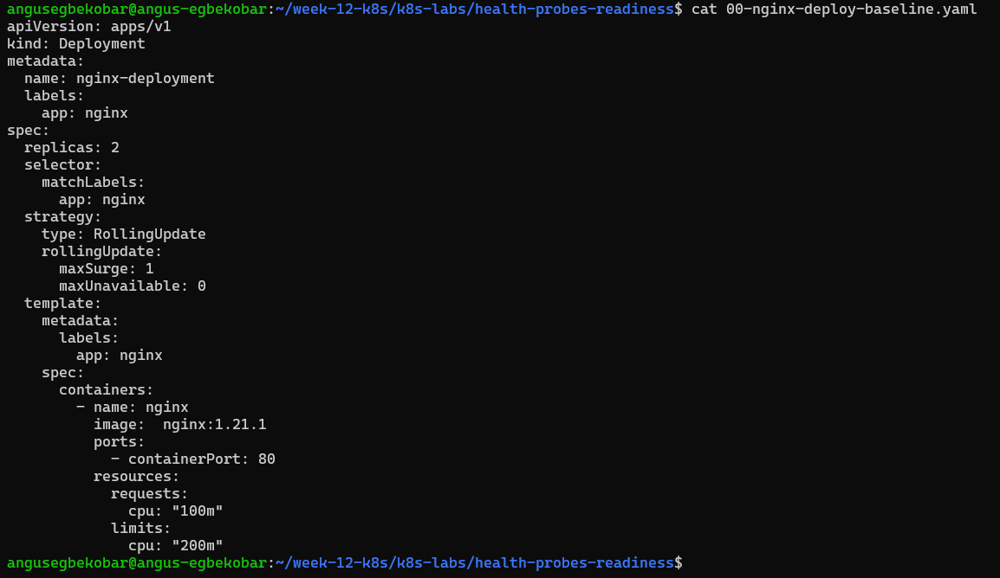
---

#### Screenshot 3 — Output showing a successful rollout and two running NGINX Pods

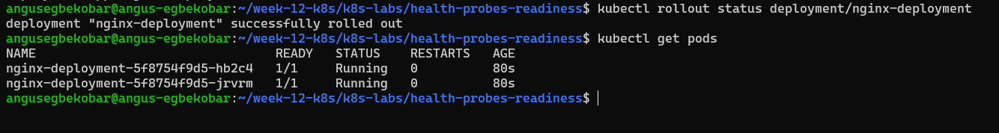
---

#### Screenshot 4 — Relevant output from `kubectl describe deployment nginx-deployment`

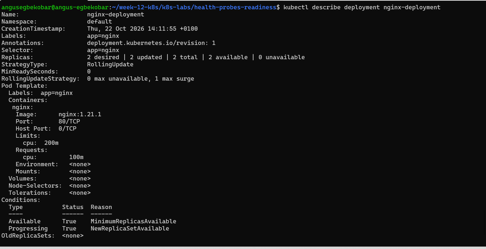
---

### Notes

**1. How many replicas does this Deployment maintain?**

2

**2. What does `maxUnavailable: 0` mean during a rolling update?**

It means that during the update, no Pods are allowed to be unavailable — all existing Pods must stay running until new ones are ready

**3. Is a readiness probe configured in this baseline Deployment?**

No, the baseline Deployment does not have a readiness probe, so Kubernetes only checks if the Pod is running, not whether it can actually serve traffic.

---

# Task 3 — Add a Readiness Probe

## Goal

Add an HTTP readiness probe so Kubernetes checks whether each NGINX container is ready to accept requests.

### Evidence

#### Screenshot 5 — Completed `01-nginx-deploy-readiness.yaml` manifest showing the readiness probe

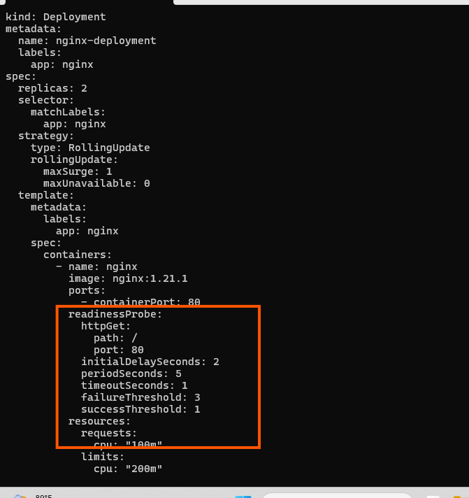
---

#### Screenshot 6 — Output of the successful rollout and ready Pods

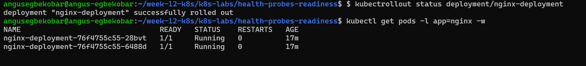
---

#### Screenshot 7 — Pod description showing readiness conditions and readiness probe details

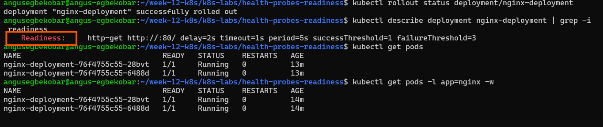
---

### Notes

**1. What path and port does the readiness probe check?**

It checks the HTTP path / on port 80.

**2. What does `initialDelaySeconds: 2` do?**

It waits 2 seconds after the container starts before running the first readiness check.

**3. What does `periodSeconds: 5` do?**

It runs the readiness probe every 5 seconds to continually verify if the container is ready.

**4. What must happen before Kubernetes considers this Pod ready?**

The readiness probe must successfully return a 200 OK response from the / path on port 80, meeting the success threshold defined.

---

# Task 4 — Break and Restore Readiness

## Goal

Intentionally fail the readiness probe, observe the NotReady behavior, and then restore the working probe configuration.

### Evidence

#### Screenshot 8 — `02-nginx-readiness-broken.yaml` showing `/does-not-exist`

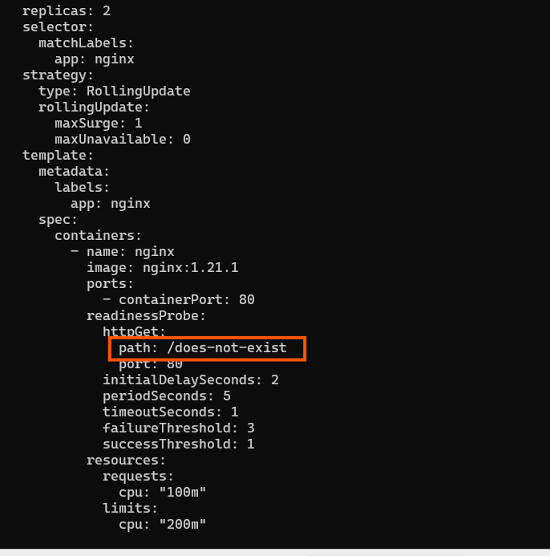
---

#### Screenshot 9 — Output showing the rollout timeout or incomplete rollout

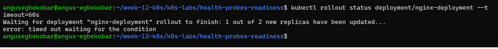
---

#### Screenshot 10 — Pod details showing `Ready: False` or readiness-probe failure events

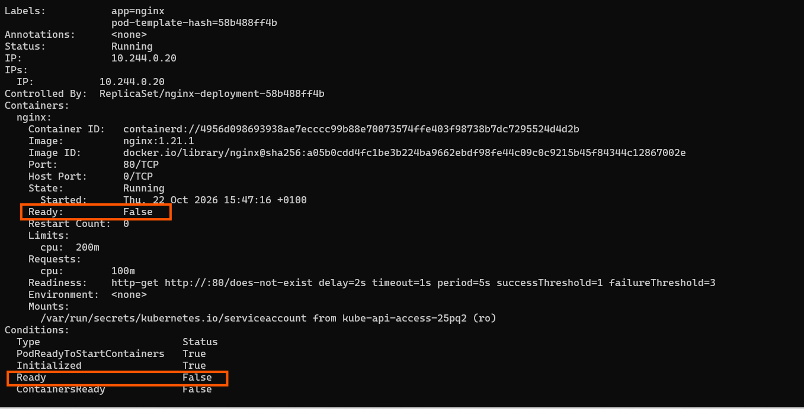
---

#### Screenshot 11 — Output showing successful rollout and ready Pods after the fix

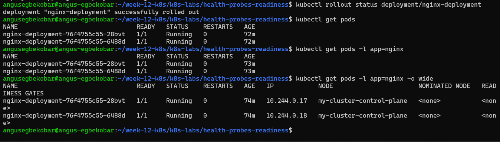
---

### Notes

**1. Why did the readiness probe fail?**

Because the probe was configured to check the path /does-not-exist on port 80, which returned a 404 Not Found. The container was running, but the probe could not succeed

**2. What happened to the Pod readiness status?**

The Pod stayed in Running state, but its Ready condition was False. This means Kubernetes did not consider it ready to serve traffic, so it wasn’t added to the Service endpoints.

**3. Why did the rollout fail to complete?**

During a rolling update, Kubernetes waits for new Pods to become ready before replacing old ones. Since the readiness probe never succeeded, the new Pods were never marked ready, so the rollout stalled and could not finish.

**4. How did you restore the Deployment successfully?**

By fixing the readiness probe configuration — for example, changing the probe path back to / (a valid endpoint for Nginx). Once the probe returned successful responses, the Pods became ready, and Kubernetes completed the rollout.

---

# Task 5 — See How Readiness Protects Rolling Updates

## Goal

Observe how readiness prevents a bad new Pod from replacing healthy Pods during a rolling update.

### Evidence

#### Screenshot 12 — Successful update command and rollout status

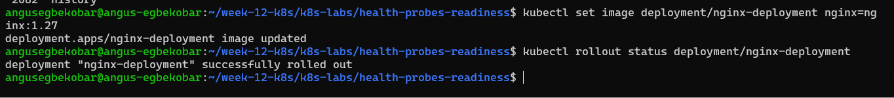
---

#### Screenshot 13 — ReplicaSets and Pods after the successful rolling update

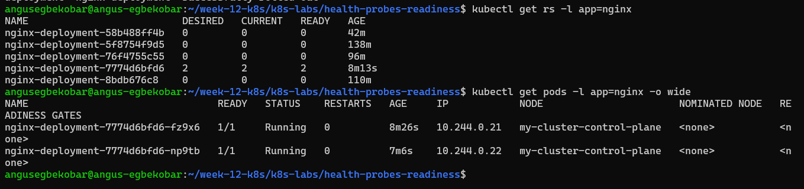
---

#### Screenshot 14 — Completed `04-readiness-broken-patch.yaml`

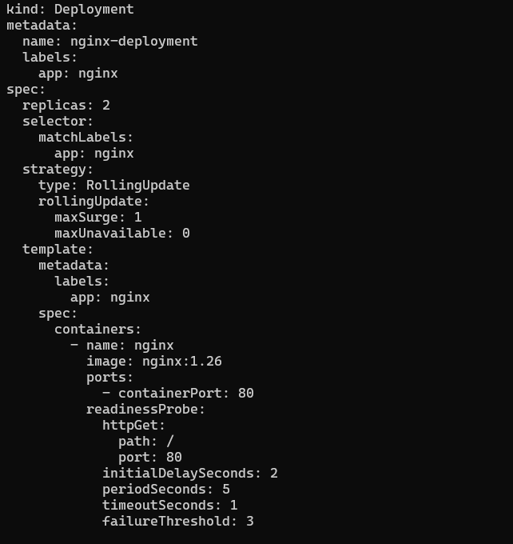
---

#### Screenshot 15 — Output showing the expected stalled rollout or timeout

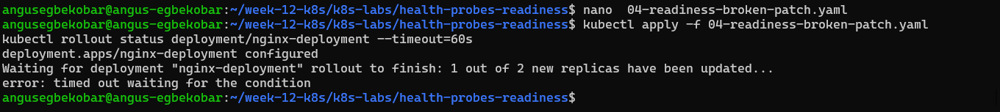
---

#### Screenshot 16 — Deployment or Pod output showing the effect of the broken readiness probe

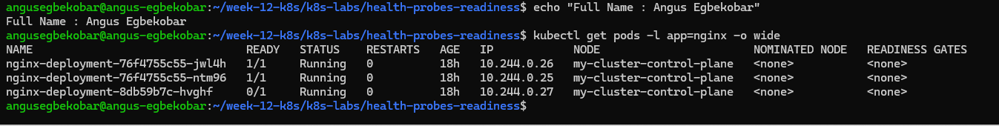
---

#### Screenshot 17 — Successful rollout status after restoring the fixed configuration

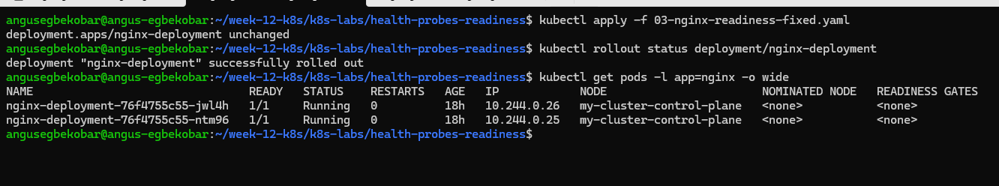
---

### Notes

**1. What happened during the successful rolling update?**

Kubernetes replaced the old Pods with new ones using the updated configuration. Each new Pod passed its readiness probe, became ready, and then the old Pods were terminated — completing the rollout smoothly.

**2. Why did Kubernetes create a new ReplicaSet?**

Because every Deployment update (like a YAML change or image update) generates a new ReplicaSet to manage the new version of Pods while keeping the old ReplicaSet until the rollout finishes.

**3. Why were the new Pods unable to replace the existing healthy Pods after readiness was broken?**

The new pods failed their readiness probe because the path was misconfigured to /does-not-exist. As a result, Kubernetes marked them as NotReady (0/1 Ready), and because they never achieved a ready status, the rolling update stalled.

**4. How does `maxUnavailable: 0` protect availability during this rollout?**

It ensures that no Pods are taken down until new ones are confirmed ready, guaranteeing uninterrupted service throughout the update process.
---

# Task 6 — Share Your Readiness-Probe Learning on LinkedIn

## Goal

Share what you learned about Kubernetes readiness probes and how they protect rolling updates.

### Evidence

#### Screenshot 18 — Published LinkedIn post

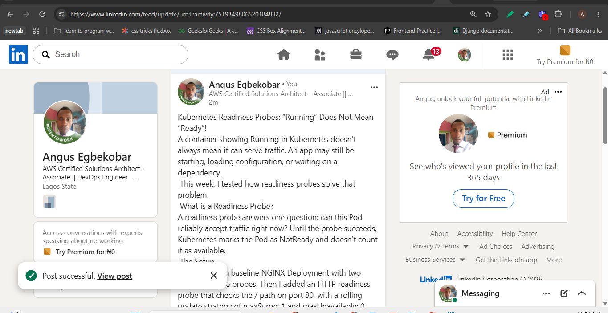

#### Linkedin post link

https://lnkd.in/p/ekU34b7v

---

# Submission Instructions

- Add all required screenshots numbered 1–18.
- Ensure your full name is visible in required screenshots.
- Use clear, readable screenshots showing the relevant manifest or output.
- Include the completed baseline and readiness-probe manifests in your repository.
- Answer all Notes questions for Tasks 1–5 in your own words.
- Include evidence of the intentional readiness failure and successful recovery.
- Do not expose tokens, passwords, kubeconfig files, account IDs, or other sensitive information.

---

# Completion Checklist

- [ ] Learning cluster confirmed and previous assignment resources removed where applicable
- [ ] Readiness-probe lab directory created (Screenshot 1)
- [ ] Baseline Deployment created successfully (Screenshot 2)
- [ ] Two baseline Pods running and successful rollout verified (Screenshot 3)
- [ ] Baseline Deployment details reviewed (Screenshot 4)
- [ ] Readiness probe added successfully (Screenshot 5)
- [ ] Successful readiness rollout verified (Screenshot 6)
- [ ] Pod readiness conditions and probe details inspected (Screenshot 7)
- [ ] Broken readiness configuration created (Screenshot 8)
- [ ] Stalled rollout or timeout observed (Screenshot 9)
- [ ] NotReady status or readiness-probe failure events captured (Screenshot 10)
- [ ] Working readiness configuration restored (Screenshot 11)
- [ ] Successful image update completed (Screenshot 12)
- [ ] ReplicaSets and Pods inspected after the update (Screenshot 13)
- [ ] Broken-readiness patch created (Screenshot 14)
- [ ] Stalled rollout observed after the patch (Screenshot 15)
- [ ] Effect of broken readiness captured (Screenshot 16)
- [ ] Final recovery completed (Screenshot 17)
- [ ] LinkedIn post published (Screenshot 18)
- [ ] Notes for Tasks 1–5 completed
- [ ] Required manifests included
- [ ] All screenshots are clear and readable
- [ ] No sensitive data exposed

---

## 📌 About DMI & CloudAdvisory

DevOps Micro Internship (DMI) is a project-based DevOps program run by Pravin Mishra (The CloudAdvisory) focused on real-world execution, systems thinking, and career readiness.

It helps learners build strong DevOps foundations with hands-on experience.

---

## 📌 Resources

- 🌐 DMI Official Website: https://dmi.pravinmishra.com?utm_source=github&utm_medium=readme  
- 🎓 University: https://university.pravinmishra.com?utm_source=github&utm_medium=readme  
- 💬 Discord Community: https://discord.pravinmishra.com?utm_source=github&utm_medium=readme  
- 📝 Blog: https://dmi.pravinmishra.com/blog?utm_source=github&utm_medium=readme  
- ▶️ YouTube Playlist: https://www.youtube.com/playlist?list=PLFeSNDtI4Cho  
- 🔗 Pravin Mishra (LinkedIn): https://www.linkedin.com/in/pravin-mishra-aws-trainer/  
- 🏢 CloudAdvisory (LinkedIn): https://www.linkedin.com/company/thecloudadvisory/

---

*This submission is part of DevOps Micro Internship (DMI) — Agentic AI Track.*
