# Assignment 6 — Kubernetes Health Probes (Liveness)

Part of the DevOps Micro Internship (DMI) with Agentic AI

---

## Purpose

In this assignment, you will configure and test a Kubernetes liveness probe. You will create a baseline NGINX Deployment, add an HTTP liveness probe, intentionally make it fail, observe container restarts, and restore the working configuration.

---

# Task 0 — Prepare the Lab Environment

## Goal

Confirm that you are connected to your learning cluster and remove the previous HPA and NGINX Deployment before starting this lab.

No screenshot or written notes are required for this pre-check.

---

# Task 1 — Set Up Your Lab Directory

## Goal

Create and enter a dedicated directory for the liveness-probe lab.

### Evidence

#### Screenshot 1 — Terminal showing that you are working inside `~/k8s-labs/health-probes-liveness`

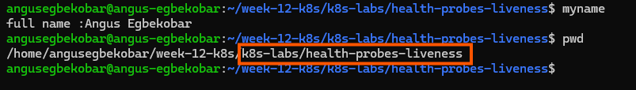
---

### Notes

**1. What problem does a liveness probe solve?**

A liveness probe detects if a container has become unresponsive or stuck. If the probe fails, Kubernetes automatically restarts the container to restore it to a healthy state, preventing situations where an application is running but no longer functioning properly

**2. What is the key difference between a readiness probe and a liveness probe?**

A readiness probe decides whether a Pod can receive traffic (failing it marks the Pod NotReady without restarting it), while a liveness probe decides whether the container is still healthy (failing it causes Kubernetes to restart the container).
---

# Task 2 — Create a Baseline Deployment Without Probes

## Goal

Create a baseline NGINX Deployment with two replicas and no health probes.

### Evidence

#### Screenshot 2 — Completed `00-nginx-deploy-baseline.yaml` manifest

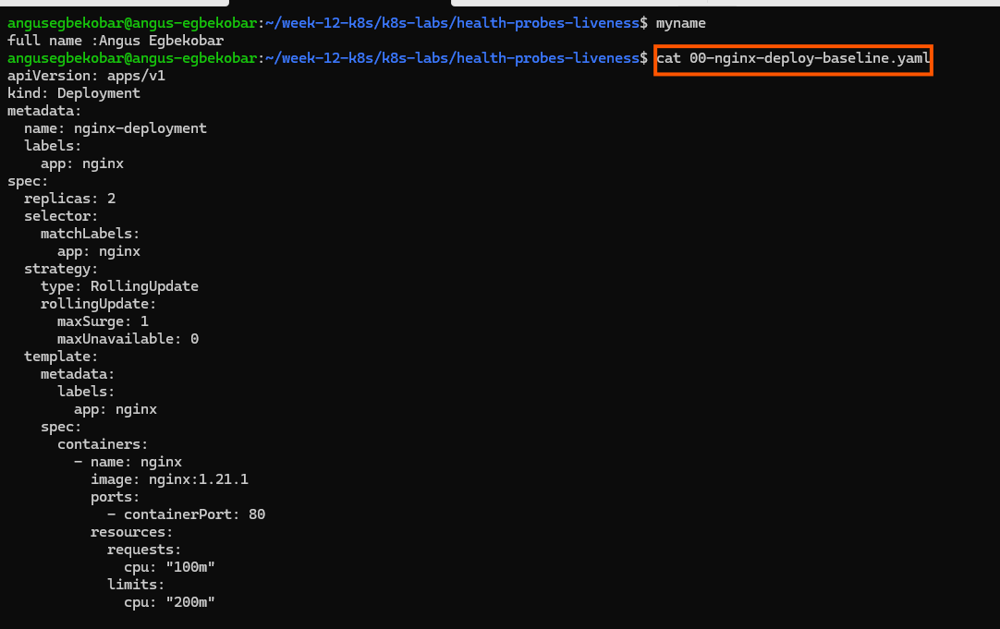
---

#### Screenshot 3 — Output showing a successful rollout and two running NGINX Pods

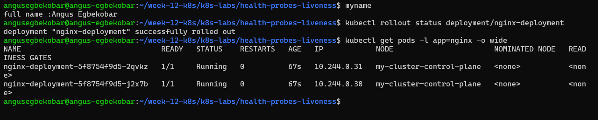
---

#### Screenshot 4 — Relevant output from `kubectl describe deployment nginx-deployment`

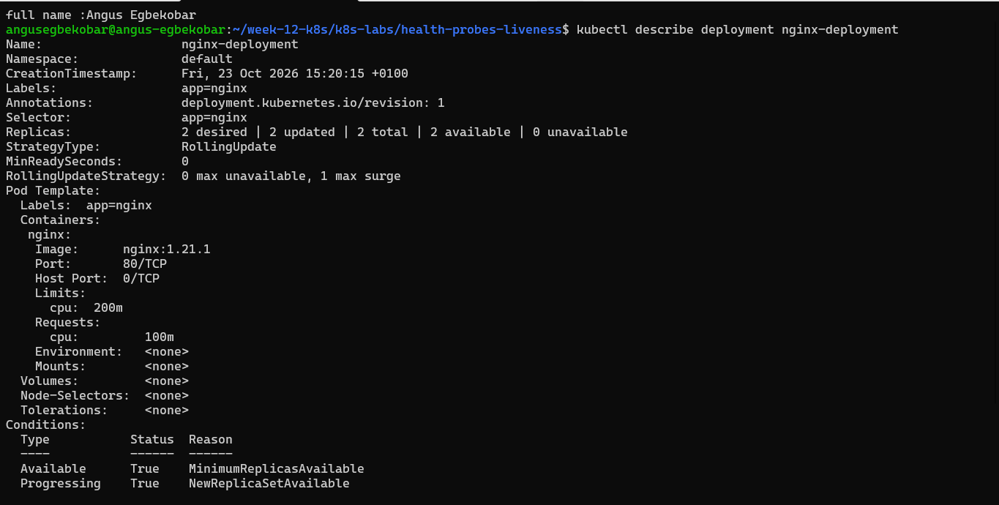
---

### Notes

**1. How many replicas does this Deployment maintain?**

2

**2. Are any health probes configured in the baseline Deployment?**

no

**3. Why is a baseline useful before adding a liveness probe?**

A baseline Deployment gives you a stable starting point with no probes, so you can confirm that Pods run correctly under normal conditions. This way, when you add a liveness probe, you can clearly see the difference it makes — whether it restarts unhealthy containers or not. It also helps isolate issues: if something breaks after adding the probe, you know the probe configuration is the cause, not the Deployment itself.
---

# Task 3 — Add a Liveness Probe

## Goal

Add an HTTP liveness probe so Kubernetes can periodically check whether the NGINX container is still responsive.

### Evidence

#### Screenshot 5 — Completed `01-nginx-deploy-liveness.yaml` manifest showing the liveness probe

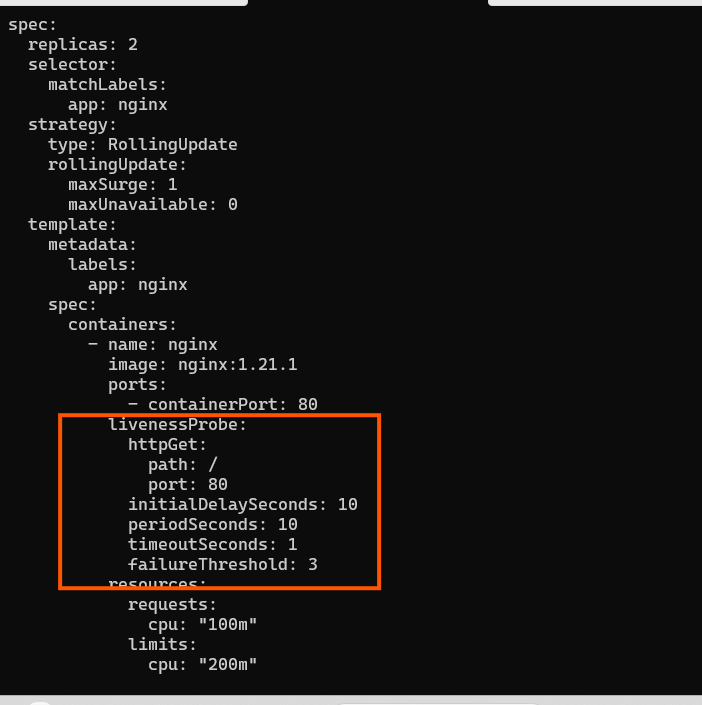
---

#### Screenshot 6 — Output showing successful rollout and running Pods

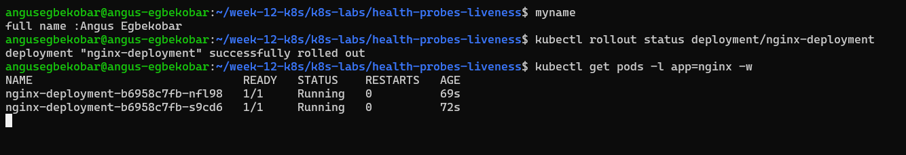
---

#### Screenshot 7 — Pod description showing liveness-probe details

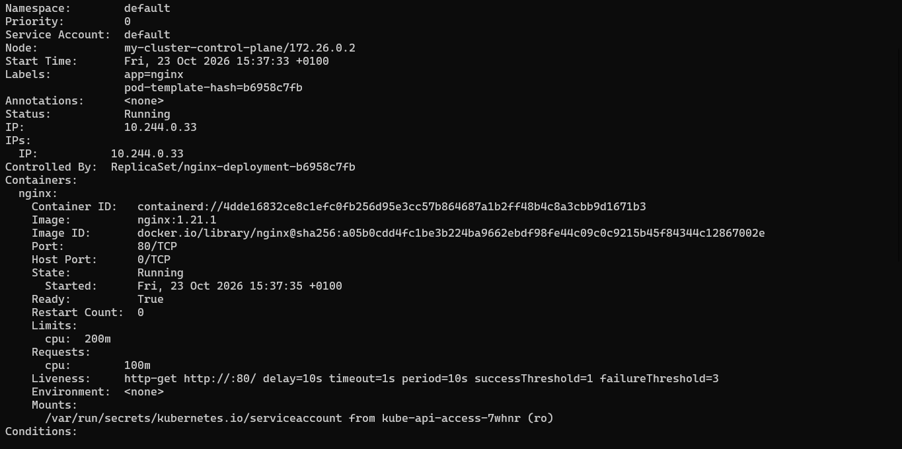
---

### Notes

**1. What path and port does the liveness probe check?**

It checks the HTTP path / on port 80.

**2. What does `initialDelaySeconds: 10` do?**

It waits 10 seconds after the container starts before running the first liveness check, giving the application time to initialize.

**3. What does `failureThreshold: 3` mean?**

If the liveness probe fails 3 consecutive times, Kubernetes considers the container unhealthy and restarts it.

**4. Does a successful liveness probe control whether a Pod receives traffic? Explain briefly.**

No. A liveness probe only determines if the container should be restarted when unhealthy. Readiness probes control whether a Pod is marked Ready and can receive traffic. Liveness ensures recovery, while readiness ensures availability.

---

# Task 4 — Trigger and Observe a Liveness Restart

## Goal

Intentionally make the liveness probe fail and observe Kubernetes restart the unhealthy container.

### Evidence

#### Screenshot 8 — `02-nginx-liveness-broken.yaml` showing `/does-not-exist`

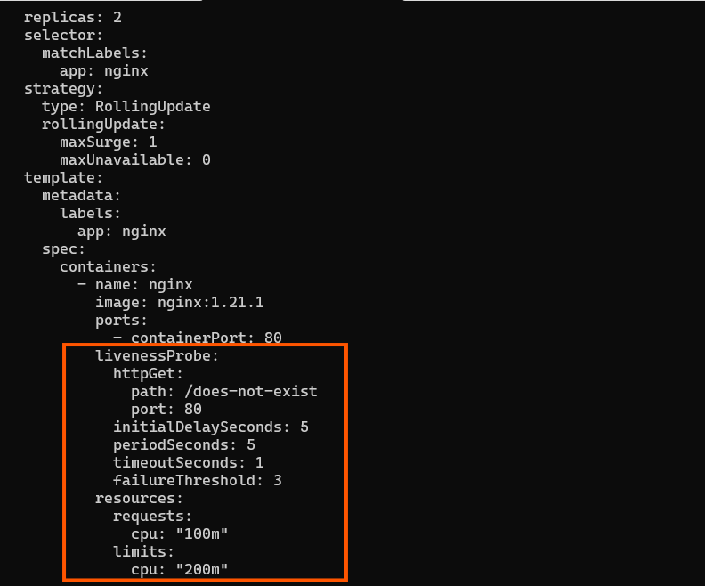
---

#### Screenshot 9 — Pod output showing an increased RESTARTS count

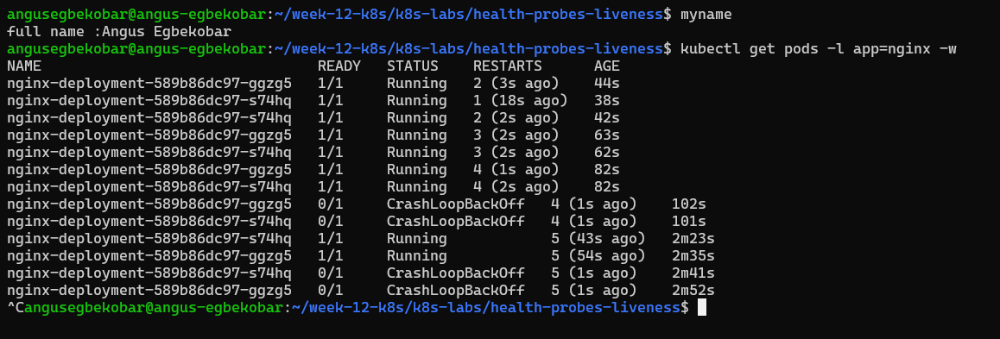
---

#### Screenshot 10 — Pod description showing liveness-probe failure events or restart details

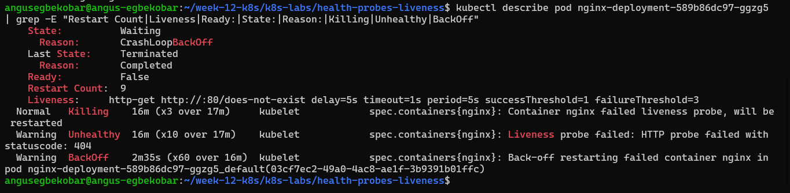
---

#### Screenshot 11 — Output showing stable running Pods after applying the fixed configuration

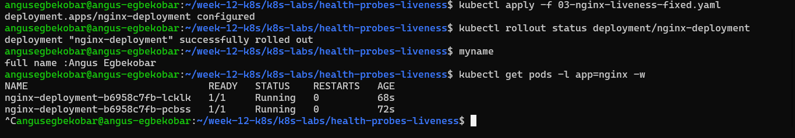
---

### Notes

**1. Why did the liveness probe fail?**

The probe was configured to check /does-not-exist on port 80, which NGINX doesn’t serve, so every check returned HTTP 404 and counted as a failure.

**2. What happened after Kubernetes detected repeated liveness-probe failures?**

After three consecutive failures, the kubelet killed the container and restarted it, and because the probe kept failing, the Pod ended up in CrashLoopBackOff with increasing delays between restarts.

**3. What does the RESTARTS column prove?**

It proves that Kubernetes automatically restarted the container each time the liveness probe failed, which is the self-healing behavior a liveness probe provides.

**4. How did you restore the Deployment to a stable state?**

i applied a fixed version of a working liveness yaml file 

---

# Task 5 — Optional: Observe a Restart Loop

## Goal

Observe why overly aggressive or incorrectly configured liveness probes can create restart loops.

Complete this section only if you attempt Task 5. Otherwise, mark it as “Not attempted.”

**Task status:** Completed 

### Evidence

#### Optional Screenshot — Pod output showing the RESTARTS count increasing during the restart-loop observation

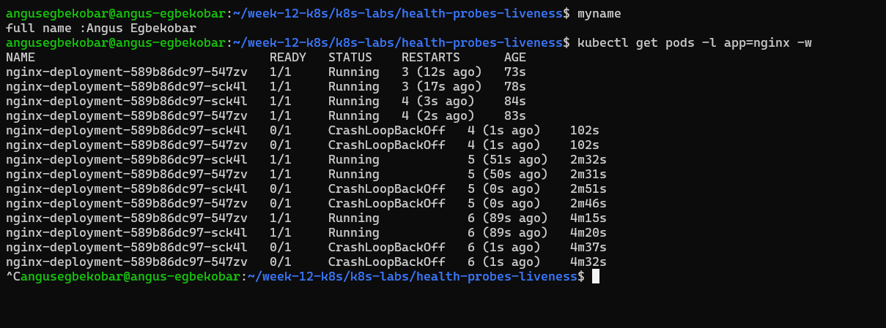

No specific restart count or CrashLoopBackOff status is required.

---

### Notes — Answer Only If Attempted

**1. What is a restart loop?**

A restart loop is when a container repeatedly starts, fails, and is restarted by Kubernetes, with growing delays between attempts (CrashLoopBackOff), so it never stays healthy.

**2. Why can an aggressive liveness probe be harmful?**

A probe with a short delay, tight timeout or low failure threshold can mark a healthy but slow or busy container as failed, causing needless restarts that can turn a temporary slowdown into an outage.

**3. Why should liveness checks be lightweight and carefully tuned?**

A heavy check (such as one that calls a database or an external service) adds load and can fail for reasons unrelated to the container itself, so it should be a cheap local check with sensible delay, timeout and threshold values that only trigger a restart when the container is truly stuck.

---

# Task 6 — Share Your Liveness-Probe Learning on LinkedIn

## Goal

Share what you learned about Kubernetes liveness probes, container restarts, and the difference between readiness and liveness.

### Evidence

#### Screenshot 12 — Published LinkedIn post

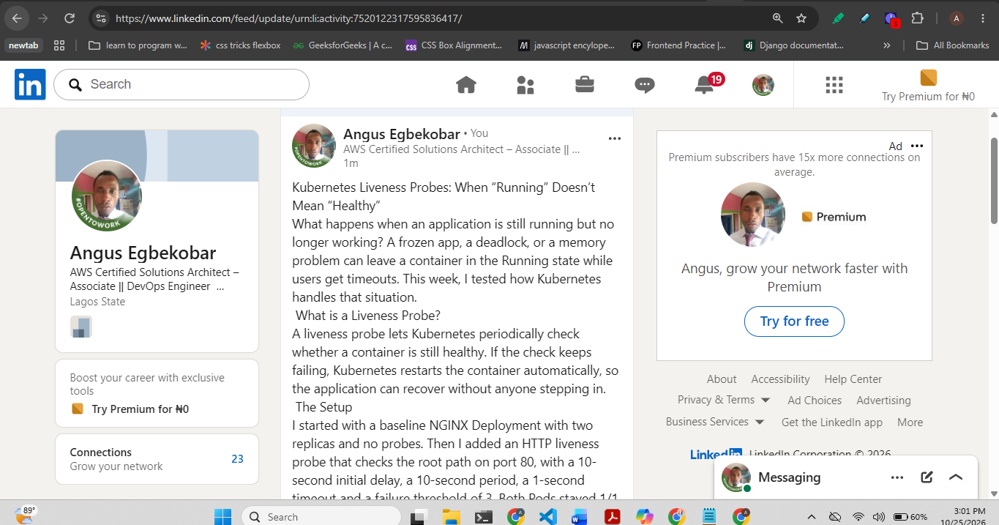

#### Linkedin post URL

https://lnkd.in/p/ekQvHc7J

---

# Submission Instructions

- Add all required screenshots numbered 1–12.
- Include the optional Task 5 screenshot only if you attempt that task.
- Ensure your full name is visible in required screenshots.
- Use clear, readable screenshots showing the relevant manifest or output.
- Include the completed baseline and liveness-probe manifests in your repository.
- Answer all Notes questions for Tasks 1–4 in your own words.
- If you attempt Task 5, complete its Notes and restore the working configuration afterward.
- Do not expose tokens, passwords, kubeconfig files, account IDs, or other sensitive information.

---

# Completion Checklist

- [ ] Learning cluster confirmed and previous assignment resources removed where applicable
- [ ] Liveness-probe lab directory created (Screenshot 1)
- [ ] Baseline Deployment manifest completed (Screenshot 2)
- [ ] Successful rollout and two baseline Pods verified (Screenshot 3)
- [ ] Baseline Deployment details reviewed (Screenshot 4)
- [ ] Liveness probe added successfully (Screenshot 5)
- [ ] Successful liveness-probe rollout verified (Screenshot 6)
- [ ] Liveness-probe details inspected (Screenshot 7)
- [ ] Broken liveness configuration created (Screenshot 8)
- [ ] Increased container restart count observed (Screenshot 9)
- [ ] Liveness-probe failure events or restart details captured (Screenshot 10)
- [ ] Working liveness configuration restored and stable Pods verified (Screenshot 11)
- [ ] Optional Task 5 evidence and Notes completed, if attempted
- [ ] Working configuration restored after Task 5, if attempted
- [ ] LinkedIn post published (Screenshot 12)
- [ ] Notes for Tasks 1–4 completed
- [ ] Required manifests included
- [ ] All required screenshots are clear and readable
- [ ] No sensitive data exposed

---

## 📌 About DMI & CloudAdvisory

DevOps Micro Internship (DMI) is a project-based DevOps program run by Pravin Mishra (The CloudAdvisory) focused on real-world execution, systems thinking, and career readiness.

It helps learners build strong DevOps foundations with hands-on experience.

---

## 📌 Resources

- 🌐 DMI Official Website: https://dmi.pravinmishra.com?utm_source=github&utm_medium=readme  
- 🎓 University: https://university.pravinmishra.com?utm_source=github&utm_medium=readme  
- 💬 Discord Community: https://discord.pravinmishra.com?utm_source=github&utm_medium=readme  
- 📝 Blog: https://dmi.pravinmishra.com/blog?utm_source=github&utm_medium=readme  
- ▶️ YouTube Playlist: https://www.youtube.com/playlist?list=PLFeSNDtI4Cho  
- 🔗 Pravin Mishra (LinkedIn): https://www.linkedin.com/in/pravin-mishra-aws-trainer/  
- 🏢 CloudAdvisory (LinkedIn): https://www.linkedin.com/company/thecloudadvisory/

---

*This submission is part of DevOps Micro Internship (DMI) — Agentic AI Track.*
