# Assignment 7 — Kubernetes Services (ClusterIP)

Part of the DevOps Micro Internship (DMI) with Agentic AI

---

## Purpose

In this assignment, you will create and test a Kubernetes ClusterIP Service. You will connect it to a healthy NGINX Deployment, access it using DNS and its ClusterIP, break and restore its selector, and observe how readiness affects Service routing.

---

# Task 0 — Prepare the Lab Environment

## Goal

Confirm your learning-cluster context and remove previous lab resources where applicable before starting this assignment.

No screenshot or written notes are required for this pre-check.

---

# Task 1 — Set Up Your Lab Directory

## Goal

Create and enter a dedicated directory for the ClusterIP Service lab.

### Evidence

#### Screenshot 1 — Terminal showing that you are working inside `~/k8s-labs/services/clusterip`

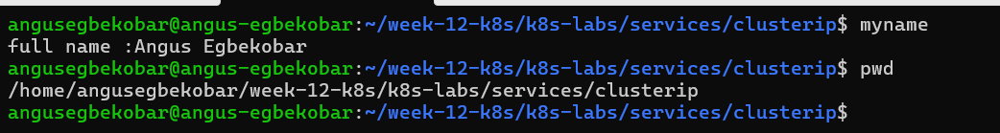

---

### Notes

**1. Why is it not reliable to communicate with an application using a Pod IP address?**

A Pod’s IP address is temporary: when a Pod is deleted, restarted or rescheduled, it gets a new IP, so any client using the old address stops working.

**2. What Kubernetes resource provides a stable internal address for a group of Pods?**

A Service (a ClusterIP Service for internal access), which gives the group of Pods a fixed virtual IP and DNS name and routes traffic to the matching Pods using a label selector.

---

# Task 2 — Create a Healthy NGINX Deployment

## Goal

Create an NGINX Deployment with labels, readiness probes, and liveness probes that can act as the backend for a Service.

### Evidence

#### Screenshot 2 — Completed `00-nginx-deploy.yaml` manifest

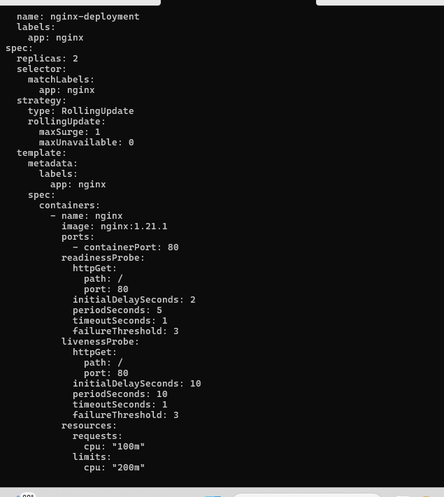
---

#### Screenshot 3 — Output showing successful rollout and two ready NGINX Pods

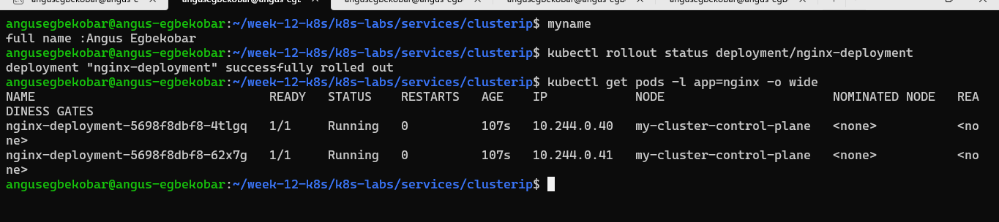
---

### Notes

**1. Which label will the Service use to find these Pods?**

The Service uses the label app: nginx to select and connect to the Pods.

**2. Why is readiness important before connecting Pods to a Service?**

Readiness ensures that only Pods that are truly able to serve traffic are added to the Service endpoints. Without readiness checks, a Pod might be marked available too early (while still starting up or misconfigured), leading to failed requests for users.

**3. What port does the NGINX container listen on?**

The NGINX container listens on port 80.

---

# Task 3 — Create a ClusterIP Service

## Goal

Create a stable internal Service that routes traffic to the NGINX Pods.

### Evidence

#### Screenshot 4 — Completed `01-nginx-svc-clusterip.yaml` manifest

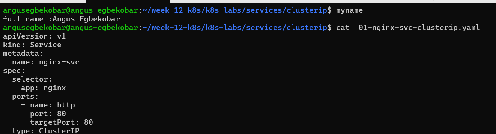

---

#### Screenshot 5 — Output showing the ClusterIP Service, endpoints, or EndpointSlices

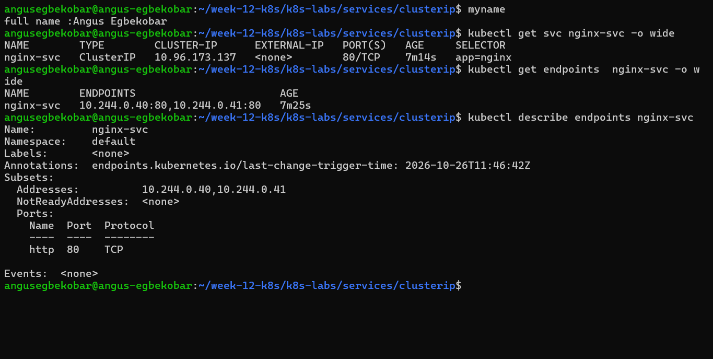
---

### Notes

**1. What is the purpose of a ClusterIP Service?**

A ClusterIP Service gives a group of Pods a stable internal IP address and DNS name, so other applications inside the cluster can reach them reliably even as individual Pods are replaced and get new ip

**2. What is the difference between `port` and `targetPort`?**

port is the port the Service itself listens on for incoming requests, while targetPort is the port on the Pod’s container that the Service forwards the traffic to.

**3. Why must the Service selector match the Pod labels?**

Because the Service uses the selector to find and connect to the correct Pods. If the labels don’t match, the Service won’t discover any Pods, and traffic won’t be routed.

**4. What information do EndpointSlices contain?**

EndpointSlices list the IP addresses (and ports) of the Pods that currently match the Service’s selector, along with their readiness status, and Kubernetes keeps them updated as Pods come and go.

---

# Task 4 — Access the Service from Inside the Cluster

## Goal

Create a client Pod and access the NGINX Service using DNS and its ClusterIP.

### Evidence

#### Screenshot 6 — Output showing the `tester` Pod running

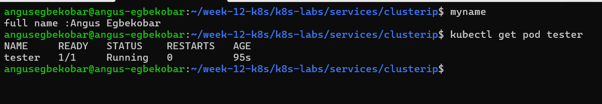
---

#### Screenshot 7 — Successful Service request using DNS name and ClusterIP

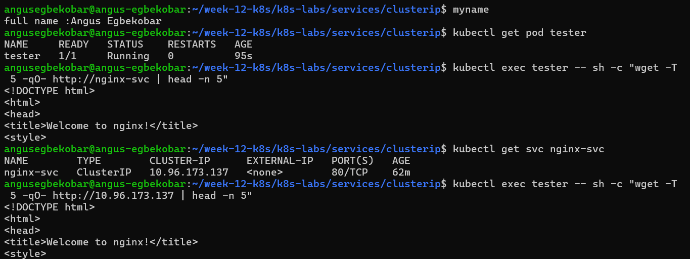
---

#### Screenshot 8 — Successful DNS lookup for the Service

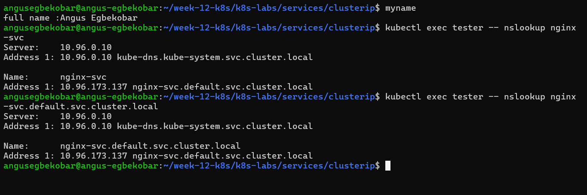
---

### Notes

**1. Why should an application use `nginx-svc` instead of a Pod IP address?**

Pod IPs change whenever a Pod is replaced, while the Service name stays fixed and always routes to the current healthy Pods.

**2. What does the DNS name `nginx-svc.default.svc.cluster.local` represent?**

It is the full DNS name of the Service nginx-svc in the default namespace, following the pattern <service>.<namespace>.svc.cluster.local, and it resolves to the Service’s ClusterIP.

**3. Why can the client access the Service even if the backend Pod IPs change?**

Because the Service automatically tracks the Pods that match its selector and updates its EndpointSlices. Clients connect to the Service’s stable IP/DNS, and Kubernetes transparently routes traffic to whichever Pods are currently healthy and ready, regardless of their changing IPs.

---

# Task 5 — Break and Restore the Label-Selector Contract

## Goal

Break the Service selector, observe that usable endpoints disappear, and then restore the correct selector.

### Evidence

#### Screenshot 9 — `02-nginx-svc-selector-broken.yaml` showing the incorrect selector

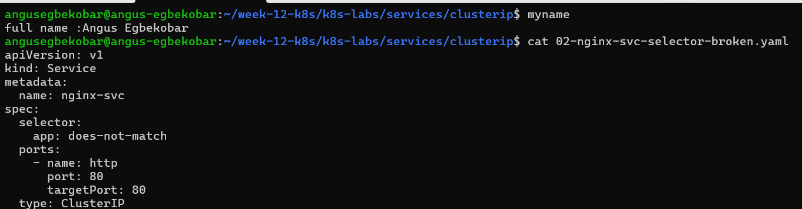
---

#### Screenshot 10 — Empty endpoints or EndpointSlice output after applying the broken selector

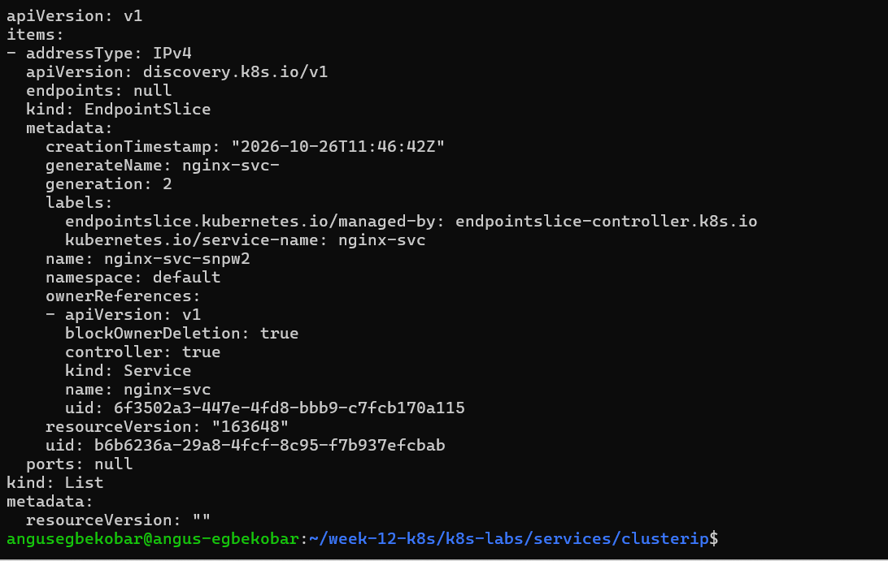
---

#### Screenshot 11 — Failed request output from the `tester` Pod

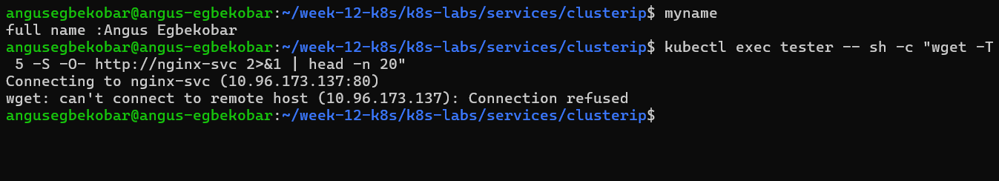
---

#### Screenshot 12 — Restored endpoints and successful Service request

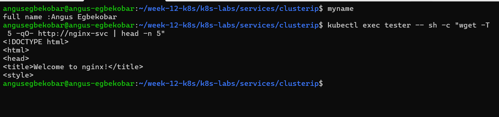
---

### Notes

**1. Why did the Service endpoints become empty?**

I changed the Service selector to app: does-not-match, which no Pod carries, so the Service had no matching Pods and its EndpointSlice showed endpoints: null.

**2. What caused the request from the client Pod to fail?**

With no endpoints behind the Service, there was nowhere to forward the traffic, so the request from the tester Pod hung and timed out even though the NGINX Pods were still running.

**3. How did you restore connectivity to the NGINX Pods?**

I re-applied the original Service manifest (01-nginx-svc-clusterip.yaml) so the selector was app: nginx again, after which the EndpointSlice listed the Pod IPs and the request from the tester Pod succeeded.

---

# Task 6 — Observe How Readiness Affects Service Routing

## Goal

Observe how a new Pod that fails readiness is excluded from ready Service backends while the existing healthy Pod continues serving traffic.

### Evidence

#### Screenshot 13 — Output showing the Deployment scaled to one ready Pod

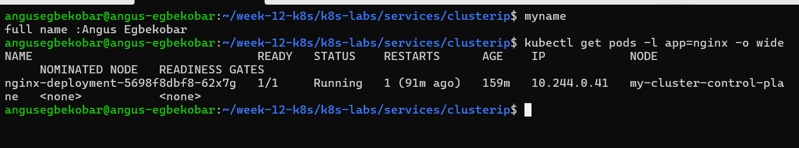
---

#### Screenshot 14 — Completed `03-readiness-broken.yaml` patch file

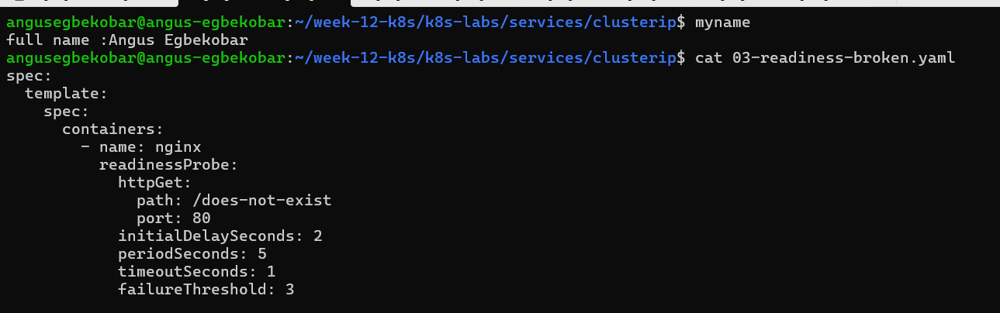
---

#### Screenshot 15 — Output showing the expected incomplete rollout or NotReady Pod

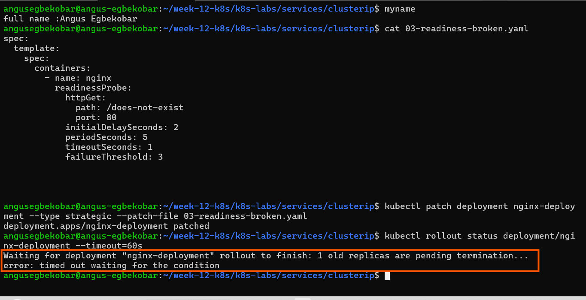
---

#### Screenshot 16 — EndpointSlice output showing the healthy Pod with `ready: true` and the new NotReady Pod with `ready: false`

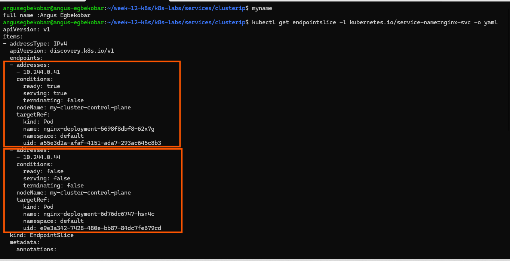
---

#### Screenshot 17 — Service EndpointSlice output showing ready backends after restoring the Deployment

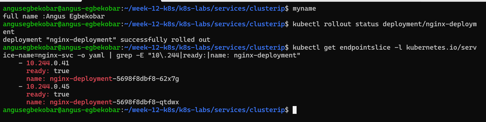
---

### Notes

**1. Why was the new NotReady Pod excluded from ready Service backends?**

Because Kubernetes only adds Pods that pass their readiness probe to the Service’s endpoints. A Pod marked NotReady is excluded so it doesn’t receive traffic until it’s healthy.Its readiness probe was failing, so Kubernetes marked the Pod NotReady and the EndpointSlice flagged it as not ready, which kept it out of the backends that receive traffic.

**2. What is the relationship between readiness probes and Service routing?**

The readiness probe decides whether a Pod is ready, and a Service only routes traffic to Pods that are ready, so a failing probe takes the Pod out of routing without restarting it.

**3. Why does this behavior protect users from unhealthy application instances?**

Requests only reach Pods that have proven they can serve traffic, so users are never sent to a Pod that is still starting up or failing, and the healthy Pods keep serving them.It prevents clients from being sent to Pods that aren’t able to serve requests. By excluding unhealthy Pods, Kubernetes ensures users only connect to healthy, responsive application instances, improving reliability and user experience.

---

# Task 7 — Share Your ClusterIP Service Learning on LinkedIn

## Goal

Share what you learned about ClusterIP Services, Kubernetes DNS, selectors, and readiness-aware Service routing.

### Evidence

#### Screenshot 18 — Published LinkedIn post

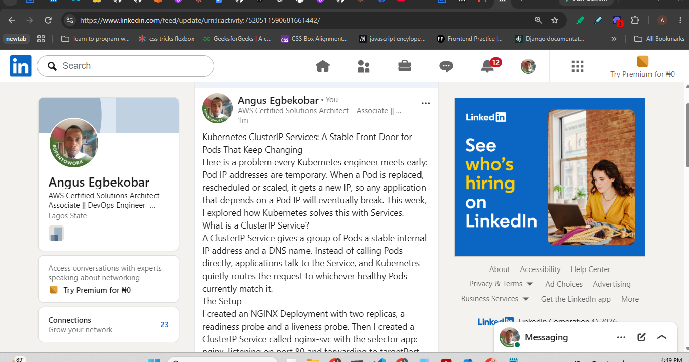

#### Linkedin post link

https://lnkd.in/p/eYZfh4mZ

---

# Submission Instructions

- Add all required screenshots numbered 1–18.
- Ensure your full name is visible in required screenshots.
- Use clear, readable screenshots showing the relevant manifest or output.
- Include the completed NGINX Deployment and ClusterIP Service manifests in your repository.
- Answer all Notes questions for Tasks 1–6 in your own words.
- Include evidence of the intentional failures and successful recovery.
- Do not expose tokens, passwords, kubeconfig files, account IDs, or other sensitive information.

---

# Completion Checklist

- [ ] Learning-cluster context confirmed and previous lab resources removed where applicable
- [ ] ClusterIP lab directory created (Screenshot 1)
- [ ] Healthy NGINX Deployment manifest completed (Screenshot 2)
- [ ] Successful rollout and two ready NGINX Pods verified (Screenshot 3)
- [ ] ClusterIP Service manifest completed (Screenshot 4)
- [ ] Service and backend endpoints or EndpointSlices verified (Screenshot 5)
- [ ] Client Pod created and running (Screenshot 6)
- [ ] Service accessed using DNS name and ClusterIP (Screenshot 7)
- [ ] Service DNS resolution verified (Screenshot 8)
- [ ] Broken selector manifest created (Screenshot 9)
- [ ] Empty endpoints observed (Screenshot 10)
- [ ] Failed Service request captured (Screenshot 11)
- [ ] Original selector restored and connectivity verified (Screenshot 12)
- [ ] Deployment scaled to one ready Pod (Screenshot 13)
- [ ] Broken readiness patch created (Screenshot 14)
- [ ] Incomplete rollout or NotReady Pod observed (Screenshot 15)
- [ ] Readiness effect on Service backends verified (Screenshot 16)
- [ ] Deployment restored and ready Service backends verified (Screenshot 17)
- [ ] LinkedIn post published (Screenshot 18)
- [ ] Notes for Tasks 1–6 completed
- [ ] Required manifests included
- [ ] All required screenshots are clear and readable
- [ ] No sensitive data exposed

---

## 📌 About DMI & CloudAdvisory

DevOps Micro Internship (DMI) is a project-based DevOps program run by Pravin Mishra (The CloudAdvisory) focused on real-world execution, systems thinking, and career readiness.

It helps learners build strong DevOps foundations with hands-on experience.

---

## 📌 Resources

- 🌐 DMI Official Website: https://dmi.pravinmishra.com?utm_source=github&utm_medium=readme  
- 🎓 University: https://university.pravinmishra.com?utm_source=github&utm_medium=readme  
- 💬 Discord Community: https://discord.pravinmishra.com?utm_source=github&utm_medium=readme  
- 📝 Blog: https://dmi.pravinmishra.com/blog?utm_source=github&utm_medium=readme  
- ▶️ YouTube Playlist: https://www.youtube.com/playlist?list=PLFeSNDtI4Cho  
- 🔗 Pravin Mishra (LinkedIn): https://www.linkedin.com/in/pravin-mishra-aws-trainer/  
- 🏢 CloudAdvisory (LinkedIn): https://www.linkedin.com/company/thecloudadvisory/

---

*This submission is part of DevOps Micro Internship (DMI) — Agentic AI Track.*
