# Assignment 8 — Kubernetes Services (NodePort)

Part of the DevOps Micro Internship (DMI) with Agentic AI

---

## Purpose

Create a healthy NGINX Deployment, expose it through a NodePort Service, test access using a node IP and NodePort, and observe how the Service behaves when a backend Pod is replaced.

---

# Task 1 — Set Up Your Lab Directory

## Goal

Create and enter a dedicated directory for the NodePort Service lab.

### Evidence

#### Screenshot 1 — Terminal showing that you are working inside `~/k8s-labs/services/nodeport`

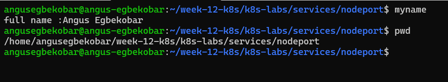

### Notes

**1. What is the difference between ClusterIP and NodePort?**

A ClusterIP Service is reachable only from inside the cluster, while a NodePort Service also opens a fixed port (30000-32767) on every node so it can be reached from outside the cluster.

**2. What does a NodePort Service allow users to do?**

It allows users outside the cluster to access the application by sending requests to <node-IP>:<nodePort>, which Kubernetes forwards to the matching Pods.

---

# Task 2 — Create a Healthy NGINX Deployment

## Goal

Create a healthy NGINX Deployment that can act as the backend for the NodePort Service.

### Evidence

#### Screenshot 2 — Completed `00-nginx-deploy.yaml` manifest

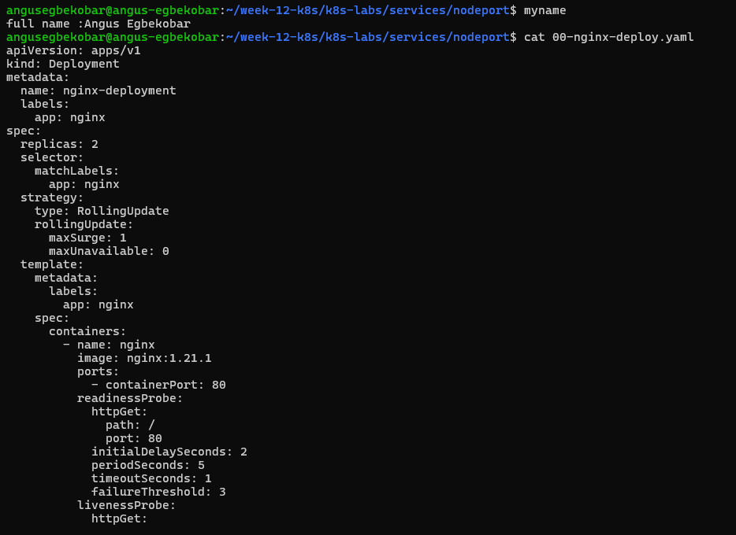

---

#### Screenshot 3 — Output showing successful rollout and two ready NGINX Pods

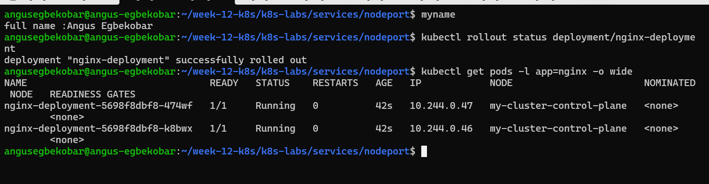

### Notes

**1. Which label will the NodePort Service use to find the NGINX Pods?**

The Service will use the label app: nginx to select the Pods, since both the Deployment’s selector and Pod template specify that label.

**2. Why must the Pods be ready before they can receive Service traffic?**

Because Kubernetes only routes traffic to Pods that pass their readiness probe. This ensures that the Pod is fully initialized and able to serve requests before being added to the Service’s backend list.

**3. What port does the NGINX container listen on?**

The container listens on port 80, as defined in the containerPort: 80 field.

---

# Task 3 — Create the NodePort Service

## Goal

Create a NodePort Service that exposes the NGINX application through a port on every cluster node.

### Evidence

#### Screenshot 4 — Completed `01-nginx-svc-nodeport.yaml` manifest

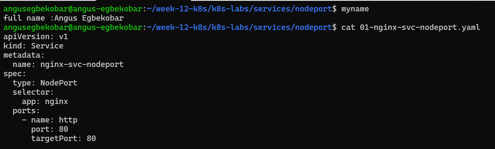

---

#### Screenshot 5 — Output showing the NodePort Service and its endpoints or EndpointSlices

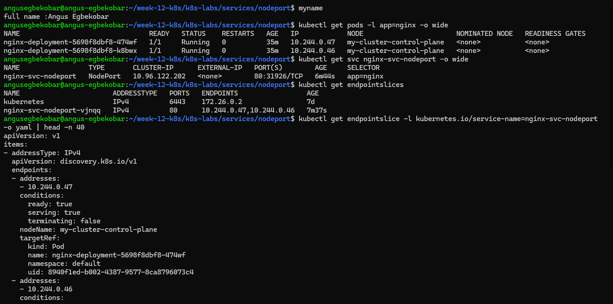

### Notes

**1. What is the purpose of `type: NodePort`?**

It exposes the Service on a static port on every node’s IP address, so the NGINX Pods can be reached from outside the cluster as well as from inside it.It exposes the Service on a static port on every Node’s IP, allowing external clients to access Pods through <NodeIP>:<NodePort>.

**2. What is the difference between `port`, `targetPort`, and `nodePort`?**

port is the port the Service listens on inside the cluster(ClusterIP), targetPort is the port on the Pod’s container that traffic is forwarded to, and nodePort is the port opened on every node (30000-32767) for external access.

**3. What NodePort was assigned or selected in your environment?**

Your YAML doesn’t set nodePort, so Kubernetes picked one automatically from the 30000-32767 range. To see which, run: 31926

**4. Why do Service endpoints need ready Pods?**

Endpoints only include Pods that pass their readiness probe, so traffic is sent only to Pods that can actually serve requests and never to ones that are starting up or failing.

---

# Task 4 — Find a Node IP and Test the NodePort

## Goal

Find a reachable node IP and access the NodePort Service.

### Evidence

#### Screenshot 6 — Output of `kubectl get nodes -o wide`

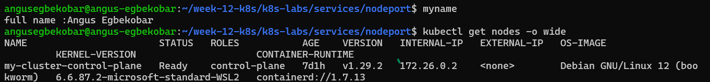

---

#### Screenshot 7 — Output showing the `tester` Pod running

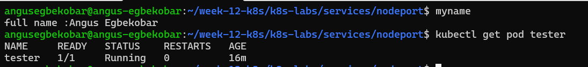

---

#### Screenshot 8 — Successful NodePort response from the laptop or the `tester` Pod

If neither route is supported by your environment, include the failed request output and ready endpoint evidence, and explain the limitation in your Notes.

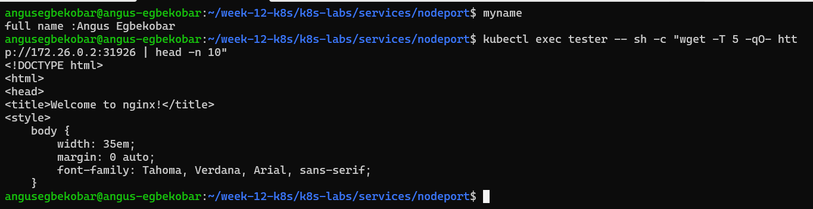

### Notes

**1. Which node IP and NodePort did you test?**

172.26.0.2:31926 

**2. Was your laptop able to reach the NodePort directly? Explain your result.**

Yes, curl http://172.26.0.2:31926 from my laptop terminal returned the NGINX welcome page. This worked because the kind node’s IP (172.26.0.2) sits on the Docker network of the same machine, so the laptop could route to it, and the Service forwarded the request to a ready NGINX Pod.

**3. Why can external NodePort access behave differently in Minikube, kind, Docker Desktop, and cloud clusters?**

Each environment runs its nodes differently: in kind and Minikube the nodes are containers or VMs on a private network, so their IPs are often not reachable from the laptop (Minikube offers minikube service or its own IP, and kind needs port mappings). Docker Desktop forwards some ports to localhost, and cloud clusters give nodes real IPs, but firewall or security group rules must allow the NodePort.

---

# Task 5 — Optional: Test the Label-Selector Contract

## Goal

Break the Service selector, observe that usable endpoints disappear, and restore the correct selector.

Complete the Evidence and Notes below only if you attempted this optional task.

### Evidence

#### Screenshot 9 — `02-nginx-svc-selector-broken.yaml` showing the incorrect selector

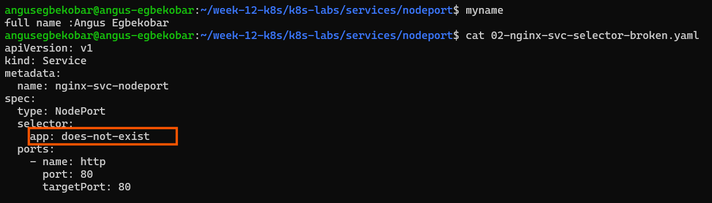

---

#### Screenshot 10 — Empty endpoints or EndpointSlice output after applying the broken selector

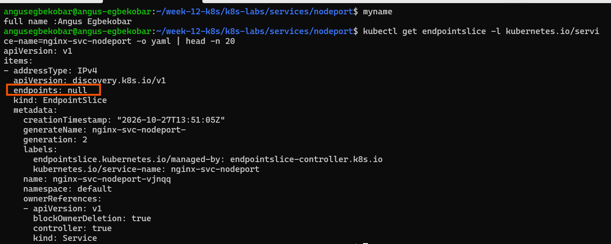

---

#### Screenshot 11 — Restored endpoints or EndpointSlices after applying the original Service manifest

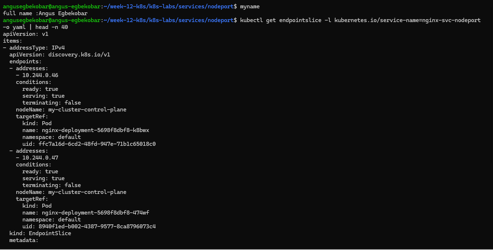

### Notes

**1. Why did the Service endpoints become empty?**

I changed the Service selector to app: does-not-exist, which no Pod carries, so the Service matched no Pods and its EndpointSlice had no endpoints.

**2. Why is NodePort only useful when matching ready Pods exist?**

A NodePort only opens a port on the node and forwards traffic to the Service’s endpoints, so if no ready Pods match its selector there is nothing to forward to and requests fail or time out.

**3. How did you restore the backend connectivity?**

I re-applied the original manifest with kubectl apply -f 01-nginx-svc-nodeport.yaml, which set the selector back to app: nginx, after which the EndpointSlice listed the Pod IPs again and the request through the NodePort returned the NGINX page.

---

# Task 6 — Observe Resilience During Pod Churn

## Goal

Delete one NGINX Pod and observe its replacement while the Service continues routing traffic to available Pods.

### Evidence

#### Screenshot 12 — Output of the Pod deletion command

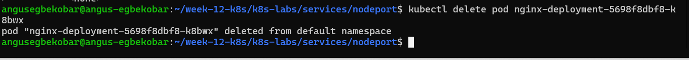

---

#### Screenshot 13 — Output showing the replacement Pod and two running, ready Pods

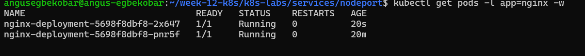

### Notes

**1. What happened after you deleted one Pod?**

Kubernetes immediately created a replacement Pod with a new name and IP address, and the Service kept answering requests, with at most a brief failure while the old Pod was removed.

**2. Which Kubernetes resource created the replacement Pod?**

The ReplicaSet, which the Deployment manages, created it to bring the Pod count back to the desired number of replicas.

**3. Why can the NodePort Service continue working during Pod churn?**

The Service routes by label selector rather than by fixed Pod IPs, so it automatically updates its endpoints to include the new Pod and drop the deleted one, while the NodePort and ClusterIP stay the same

---

# Task 7 — Share Your NodePort Learning on LinkedIn

## Goal

Share what you learned about NodePort Services, backend Pods, and network access in your Kubernetes environment.

### Evidence

#### Screenshot 14 — Published LinkedIn post about your NodePort Service lab

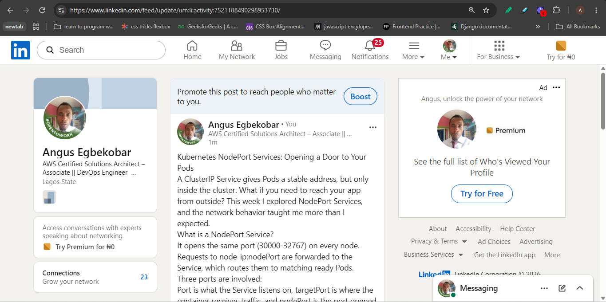

#### Linkedin post link

https://lnkd.in/p/e6CdJv7h

---

# Submission Instructions

- Include the completed YAML manifests created during the lab.
- Add all required screenshots: Screenshots 1–8 and 12–14.
- Include Screenshots 9–11 only if you attempted optional Task 5.
- Complete the Notes for Tasks 1–4 and Task 6.
- Complete Task 5 Notes only if you attempted that task.
- Use clear, readable screenshots showing the relevant commands and outputs.
- Ensure your full name is visible in the required screenshots.
- If NodePort access is restricted by your environment, include the failed request output, ready endpoint evidence, and an explanation.
- Do not expose passwords, access tokens, private keys, kubeconfig contents, or account IDs.

---

# Completion Checklist

- [ ] Created and entered `~/k8s-labs/services/nodeport` (Screenshot 1)
- [ ] Created and applied the NGINX Deployment manifest (Screenshot 2)
- [ ] Confirmed successful rollout and two ready NGINX Pods (Screenshot 3)
- [ ] Created the NodePort Service manifest (Screenshot 4)
- [ ] Verified the Service and its endpoints or EndpointSlices (Screenshot 5)
- [ ] Recorded the assigned or selected NodePort
- [ ] Identified a node IP (Screenshot 6)
- [ ] Confirmed that the `tester` Pod is running (Screenshot 7)
- [ ] Tested NodePort access, or documented the environment limitation with evidence (Screenshot 8)
- [ ] Optional: Tested and restored the Service selector (Screenshots 9–11)
- [ ] Deleted one NGINX Pod (Screenshot 12)
- [ ] Confirmed the replacement Pod and two running, ready Pods (Screenshot 13)
- [ ] Completed all required Notes
- [ ] Published the LinkedIn post (Screenshot 14)
- [ ] No sensitive data exposed

---

## 📌 About DMI & CloudAdvisory

DevOps Micro Internship (DMI) is a project-based DevOps program run by Pravin Mishra (The CloudAdvisory) focused on real-world execution, systems thinking, and career readiness.

It helps learners build strong DevOps foundations with hands-on experience.

---

## 📌 Resources

- 🌐 DMI Official Website: https://dmi.pravinmishra.com?utm_source=github&utm_medium=readme  
- 🎓 University: https://university.pravinmishra.com?utm_source=github&utm_medium=readme  
- 💬 Discord Community: https://discord.pravinmishra.com?utm_source=github&utm_medium=readme  
- 📝 Blog: https://dmi.pravinmishra.com/blog?utm_source=github&utm_medium=readme  
- ▶️ YouTube Playlist: https://www.youtube.com/playlist?list=PLFeSNDtI4Cho  
- 🔗 Pravin Mishra (LinkedIn): https://www.linkedin.com/in/pravin-mishra-aws-trainer/  
- 🏢 CloudAdvisory (LinkedIn): https://www.linkedin.com/company/thecloudadvisory/

---

*This submission is part of DevOps Micro Internship (DMI) — Agentic AI Track.*
