# Assignment 09 — Kubernetes Services: LoadBalancer on AKS

Part of the DevOps Micro Internship (DMI) with Agentic AI

---

## Purpose

Deploy a healthy NGINX application to Azure Kubernetes Service (AKS), expose it publicly using a LoadBalancer Service, observe readiness behavior, and scale the application behind the same public endpoint.

---

# Task 1 — Create or Connect to an AKS Cluster

## Goal

Create a small AKS cluster for this lab, or connect to an existing approved AKS lab cluster.

### Evidence

#### Screenshot 1 — Output of `kubectl get nodes` showing ready AKS node(s)

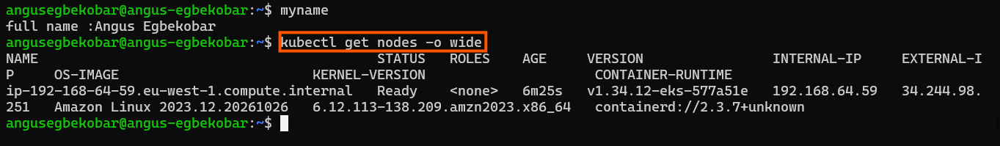

### Notes

**1. Why does this lab use a cloud-capable Kubernetes environment such as AKS for the LoadBalancer Service?**

A LoadBalancer Service relies on the cloud provider to create an external load balancer with a public IP, and local clusters like kind or Minikube have no cloud integration to do that. I used EKS on AWS, which provides that integration.

**2. What Azure resources can Kubernetes provision when a LoadBalancer Service is created?**

On AWS, Kubernetes asks the cloud provider to create an external load balancer (a Classic Load Balancer by default, or a Network Load Balancer with annotations), with a public DNS name, health checks and security group rules that route traffic to the nodes and then to the Pods. On Azure/AKS, the equivalent is an Azure Load Balancer with a public IP address, load-balancing rules and health probes.

**3. Why is it important to delete unused AKS resources after the lab?**

Cloud resources bill while they exist, whether or not they receive traffic, so leaving the cluster, nodes and load balancer running keeps costing money. Deleting them (the Service first, then the cluster) avoids unexpected charges and orphaned load balancers. In my case, those resources are EKS and EC2 on AWS.

---

# Task 2 — Set Up Your Lab Directory

## Goal

Create and enter a dedicated directory for the LoadBalancer Service manifests.

### Evidence

#### Screenshot 2 — Terminal showing the output of `pwd` confirming that you are working inside `~/k8s-labs/services/loadbalancer`

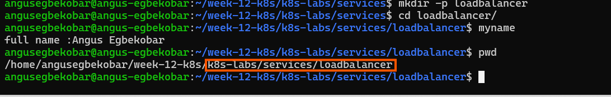

### Notes

**1. Why is it useful to keep Kubernetes manifests organized in dedicated directories?**

A dedicated directory keeps the files for each lab or application together, so they are easy to find, apply and review, and they don’t get mixed up with manifests from other labs that use the same resource names.

**2. What are the names of the main Deployment and LoadBalancer Service YAML files you will create in this assignment?**

00-nginx-deploy.yaml

---

# Task 3 — Deploy a Healthy NGINX Application

## Goal

Create a healthy NGINX Deployment with readiness and liveness probes.

### Evidence

#### Screenshot 3 — Completed `00-nginx-deploy.yaml` manifest

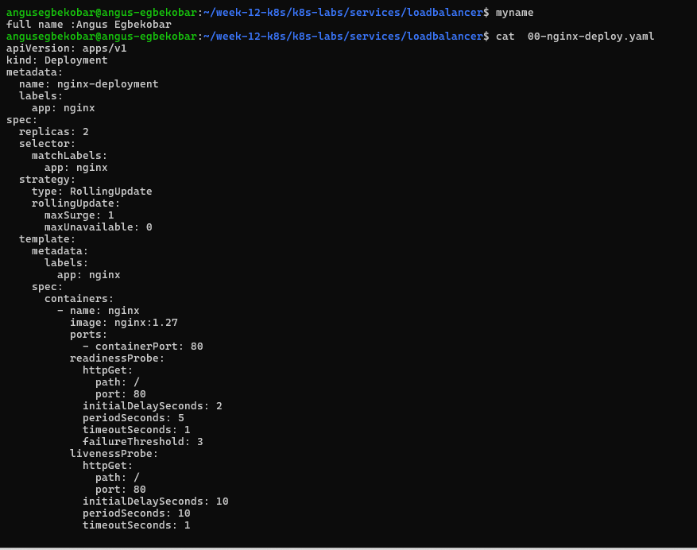

---

#### Screenshot 4 — Output showing successful rollout and two ready NGINX Pods

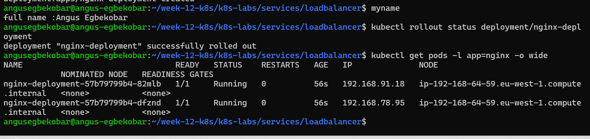

### Notes

**1. Why must Pods be ready before they should receive public traffic?**

A Pod that is still starting or failing can’t serve requests properly, so sending public traffic to it would give users errors or timeouts. Waiting until the Pod is ready means only working Pods receive requests.

**2. What is the role of the readiness probe in this Deployment?**

The readiness probe checks whether each NGINX Pod can accept traffic, and only Pods that pass it are added to the Service’s endpoints and receive requests from the load balancer.

**3. What is the role of the liveness probe in this Deployment?**

The liveness probe checks whether the NGINX container is still healthy, and if it keeps failing, Kubernetes restarts the container to recover it.

---

# Task 4 — Create and Test the LoadBalancer Service

## Goal

Create a public LoadBalancer Service and verify that the NGINX application is reachable from the internet.

### Evidence

#### Screenshot 5 — Completed `01-nginx-svc-loadbalancer.yaml` manifest

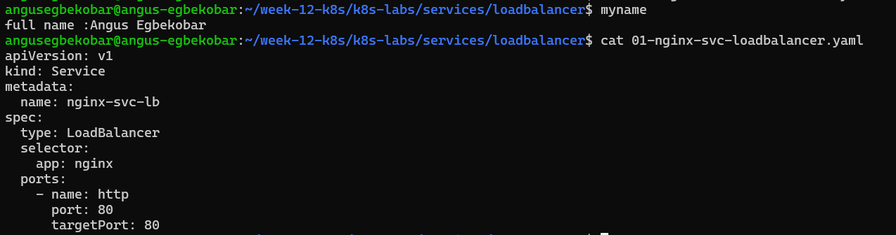

---

#### Screenshot 6 — Output showing the Service with an assigned EXTERNAL-IP

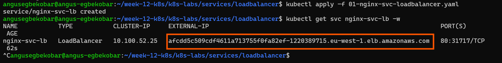

---

#### Screenshot 7 — Successful curl output from the public IP

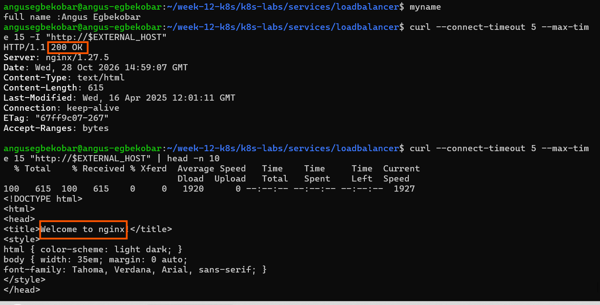

### Notes

**1. What does `type: LoadBalancer` instruct AKS to do?**

It instructs the cloud provider to create an external load balancer with a public address for the Service and route internet traffic to the NGINX Pods. On AWS (EKS), which I used, it creates an AWS Elastic Load Balancer; on AKS, it would be an Azure Load Balancer with a public IP.

**2. What public IP was assigned to your Service?**

afcdd5c509cdf4611a713755f0fa82ef-1220389715.eu-west-1.elb.amazonaws.com. On AWS, the load balancer is given a DNS hostname rather than a plain IP address,

**3. How does the public request eventually reach the NGINX Pods?**

The request goes to the load balancer’s public address, which forwards it to a node’s NodePort, then kube-proxy routes it through the Service to one of the ready NGINX Pods on port 80.

**4. Why should you wait for EXTERNAL-IP before testing the Service?**

The cloud provider needs time to create the load balancer and assign its address, and until EXTERNAL-IP changes from <pending> to a real value, there is nothing to send requests to.

---

# Task 5 — Observe How Readiness Protects Public Traffic

## Goal

Intentionally break readiness and observe how Kubernetes excludes unready Pods from ready Service backends while existing healthy Pods continue serving public traffic.

### Evidence

#### Screenshot 8 — Completed `02-readiness-broken.yaml` patch file

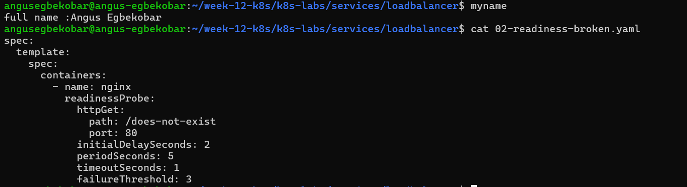

---

#### Screenshot 9 — Output showing the expected incomplete rollout or readiness failure

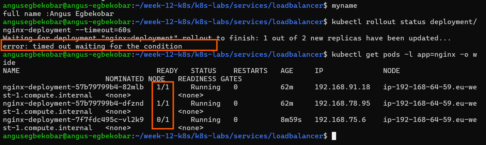

---

#### Screenshot 10 — EndpointSlice output showing ready healthy backends and the effect of the readiness failure

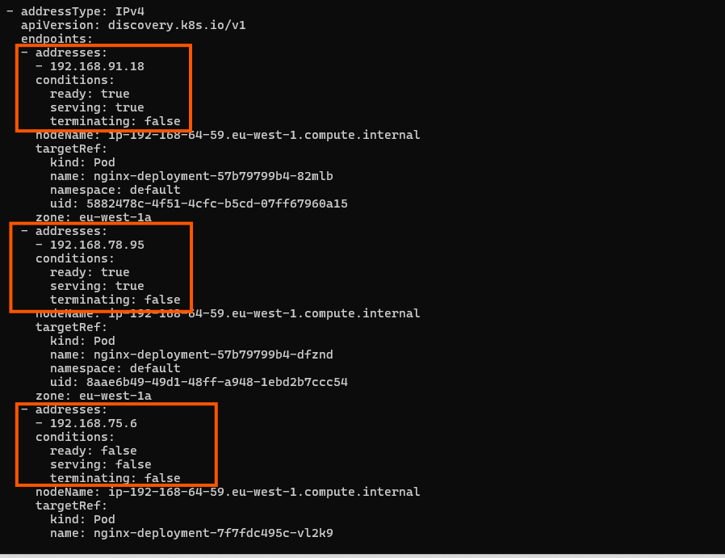

---

#### Screenshot 11 — Successful public curl response after recovery

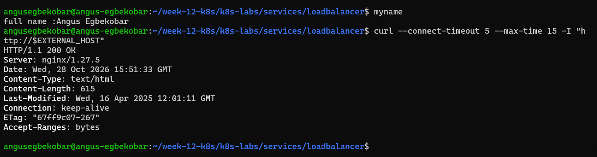

### Notes

**1. Why did the rollout not complete?**

The new Pods failed their readiness probe (the path returned 404), so they never became Ready. Because maxUnavailable: 0 stops Kubernetes from removing the old healthy Pods until their replacements are Ready, the rollout stalled and timed out.

**2. Why can the public endpoint still work while new Pods fail readiness?**

The Service only routes traffic to Ready Pods, so the NotReady Pods were excluded from its endpoints, while the old healthy Pods stayed in place and kept serving requests through the load balancer.

**3. What would happen if Kubernetes routed traffic to Pods before they were ready?**

Users would be sent to Pods that can’t serve requests yet, so they would get errors or timeouts, and a bad rollout would cause an outage.

**4. How did you restore the Deployment successfully?**

I re-applied the original Deployment manifest (kubectl apply -f 00-nginx-deploy.yaml) with the correct readiness probe path /, after which the new Pods became Ready, the rollout completed, and both Pods showed 1/1 Running.

---

# Task 6 — Scale the Deployment Behind the Load Balancer

## Goal

Scale the NGINX Deployment and confirm that more ready Pods become available behind the same public endpoint.

### Evidence

#### Screenshot 12 — Two ready NGINX Pods verified initially; four ready Pods verified after scaling

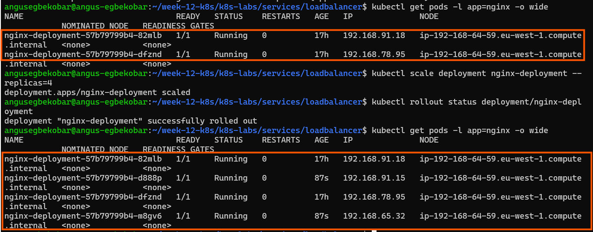

---

#### Screenshot 13 — Successful public curl response after scaling

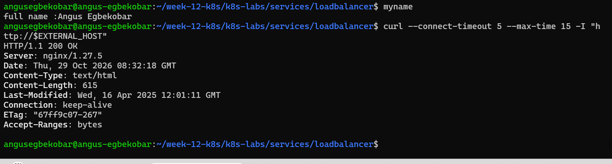

### Notes

**1. What changed after scaling the Deployment from two to four replicas?**

The Deployment’s ReplicaSet created two more NGINX Pods, giving four Pods in total. After the new Pods passed their readiness checks, the Service’s EndpointSlice listed four ready Pod IPs instead of two.

**2. Did the public IP change after scaling? Explain why or why not.**

No, the public address stayed the same, because it belongs to the LoadBalancer Service, not to any Pod. Scaling only changes the number of Pods behind the Service, and the Service itself wasn’t modified.

**3. Why does scaling behind a LoadBalancer Service not require users to change the URL or IP they use?**

Users connect to the load balancer’s fixed address, and Kubernetes automatically adds the new Pods to the Service’s endpoints and spreads traffic across them, so the way clients reach the app never changes.

---

# Task 7 — Share Your LoadBalancer Lab on LinkedIn

## Goal

Share what you learned about exposing an NGINX application publicly through a LoadBalancer Service on AKS.

### Evidence

#### Screenshot 14 — Published LinkedIn post about your LoadBalancer lab on AKS

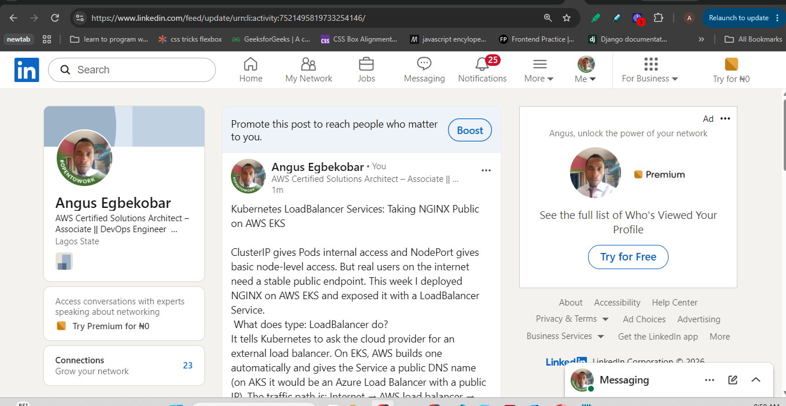

#### LinkedIn post link

https://lnkd.in/p/eUpXdRPf

---

# Submission Instructions

- Include the completed YAML files:
  - `00-nginx-deploy.yaml`
  - `01-nginx-svc-loadbalancer.yaml`
  - `02-readiness-broken.yaml`
- Add all required screenshots, numbered 1–14, under their corresponding Evidence sections.
- Use clear, readable screenshots showing the relevant commands, configuration, and outputs.
- Ensure your full name is visible in the required screenshots.
- Complete the Notes for Tasks 1–6 in your own words.
- Capture all required evidence before cleaning up Azure resources.
- Plan or complete Azure cleanup according to your lab ownership and reuse arrangements.
- Do not expose passwords, tokens, private keys, cluster credentials, kubeconfig contents, subscription IDs, account IDs, or infrastructure details you are not permitted to share.

---

# Completion Checklist

- [ ] Created or connected to an approved AKS lab cluster
- [ ] Confirmed ready AKS node(s) (Screenshot 1)
- [ ] Created and entered the LoadBalancer lab directory (Screenshot 2)
- [ ] Created the NGINX Deployment manifest (Screenshot 3)
- [ ] Verified successful rollout and two ready NGINX Pods initially (Screenshot 4)
- [ ] Created the LoadBalancer Service manifest (Screenshot 5)
- [ ] Verified the assigned external IP (Screenshot 6)
- [ ] Verified successful public access using curl (Screenshot 7)
- [ ] Created the broken readiness patch (Screenshot 8)
- [ ] Observed the expected incomplete rollout or readiness failure (Screenshot 9)
- [ ] Inspected EndpointSlices during the readiness failure (Screenshot 10)
- [ ] Restored the healthy Deployment and verified public access (Screenshot 11)
- [ ] Scaled the Deployment to four ready Pods and verified updated Service backends (Screenshot 12)
- [ ] Verified public access after scaling (Screenshot 13)
- [ ] Completed the Notes for Tasks 1–6
- [ ] Published the LinkedIn post (Screenshot 14)
- [ ] Included all required YAML files and screenshots
- [ ] Planned or completed Azure cleanup
- [ ] No sensitive data exposed

---

## 📌 About DMI & CloudAdvisory

DevOps Micro Internship (DMI) is a project-based DevOps program run by Pravin Mishra (The CloudAdvisory) focused on real-world execution, systems thinking, and career readiness.

It helps learners build strong DevOps foundations with hands-on experience.

---

## 📌 Resources

- 🌐 DMI Official Website: https://dmi.pravinmishra.com?utm_source=github&utm_medium=readme  
- 🎓 University: https://university.pravinmishra.com?utm_source=github&utm_medium=readme  
- 💬 Discord Community: https://discord.pravinmishra.com?utm_source=github&utm_medium=readme  
- 📝 Blog: https://dmi.pravinmishra.com/blog?utm_source=github&utm_medium=readme  
- ▶️ YouTube Playlist: https://www.youtube.com/playlist?list=PLFeSNDtI4Cho  
- 🔗 Pravin Mishra (LinkedIn): https://www.linkedin.com/in/pravin-mishra-aws-trainer/  
- 🏢 CloudAdvisory (LinkedIn): https://www.linkedin.com/company/thecloudadvisory/

---

*This submission is part of DevOps Micro Internship (DMI) — Agentic AI Track.*
