# Assignment 10 — Capstone: Deploy the Book Review App to Kubernetes

Part of the DevOps Micro Internship (DMI) with Agentic AI

---

## Purpose

Deploy the Book Review App as a production-style three-tier application using Kubernetes manifests or Helm charts, with an accessible frontend, an internal backend, and a managed or persistent MySQL database.

---

## Submission Details

**Full Name:** Angus Egbekobar

**Kubernetes Platform:** AWS EKS

**Namespace:** book-review

**Frontend URL or IP:** a09115e295de94a1aa0504ce82e54fc5-851348780.eu-west-1.elb.amazonaws.com

**Access Method:** Public LoadBalancer.

**GitHub Manifests or Helm Chart URL:** https://github.com/angus-egbekobar

**Architecture Diagram:** Add your diagram or link here.

---

# Task 1 — Prepare the Kubernetes Cluster and Project

## Goal

Prepare the cluster, application source, container images, and tooling needed for the deployment.

### Evidence

#### Screenshot 1 — Active Kubernetes context and Ready nodes

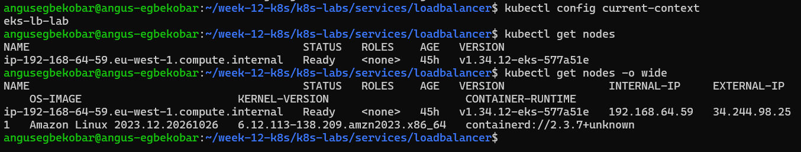

---

#### Screenshot 2 — If using Helm: Output of `helm version`

Required only if you choose Helm. Skip this screenshot if using YAML manifests.

Not applicable

---

# Task 2 — Design the Three-Tier Kubernetes Architecture

## Goal

Document the workloads, networking, configuration, storage, and permitted communication paths before deployment.

### Evidence

#### Screenshot 3 — Completed Kubernetes architecture diagram

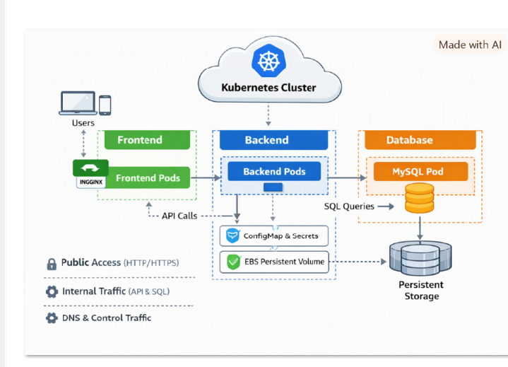

---

# Task 3 — Create ConfigMaps and Secrets

## Goal

Provide application configuration and credentials without embedding sensitive values in images or committing them to Git.

### Evidence

#### Screenshot 4 — ConfigMap configuration or describe output showing non-sensitive values

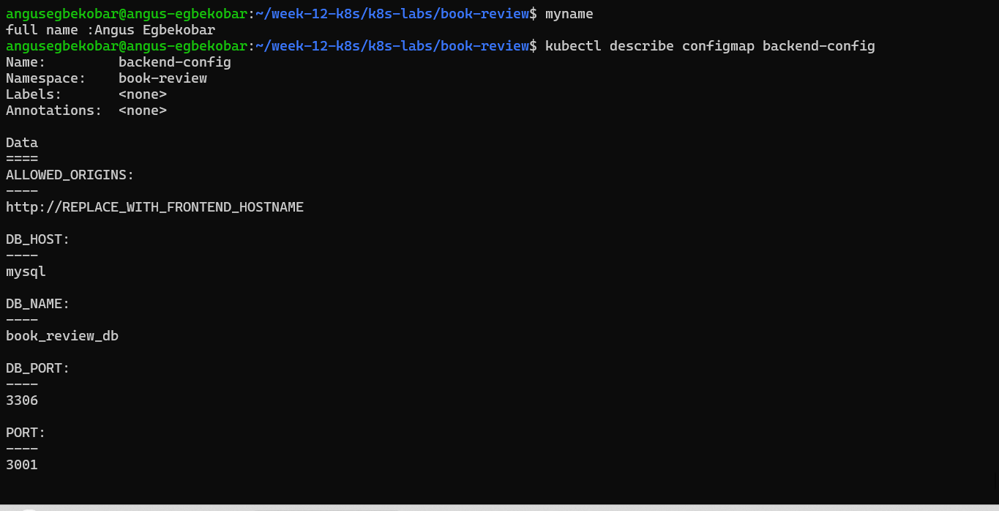

---

#### Screenshot 5 — Secret references or describe output showing names and keys without sensitive values

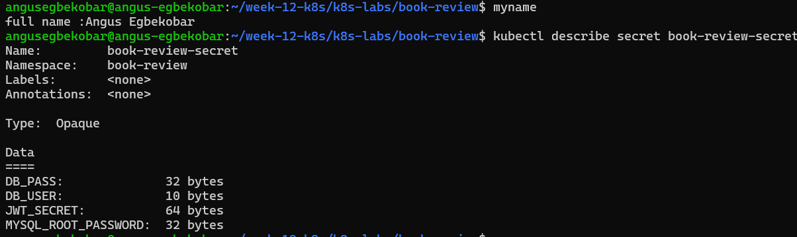

---

# Task 4 — Deploy and Configure the MySQL Data Tier

## Goal

Provide persistent MySQL storage and allow the backend to connect without exposing the database publicly.

### Evidence

#### Screenshot 6 — Managed MySQL status or MySQL StatefulSet and PVC status

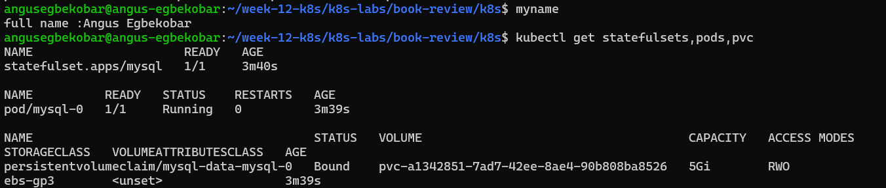

---

#### Screenshot 7 — Successful database connectivity or schema verification with credentials hidden

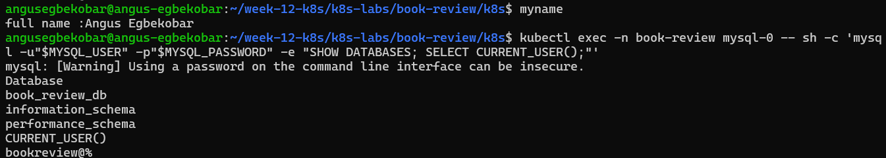

---

# Task 5 — Deploy the Backend Application Tier

## Goal

Run one or two Node.js/Express backend replicas on port 3001 and expose them through an internal ClusterIP Service.

### Evidence

#### Screenshot 8 — Backend Deployment, ready Pods, and internal Service

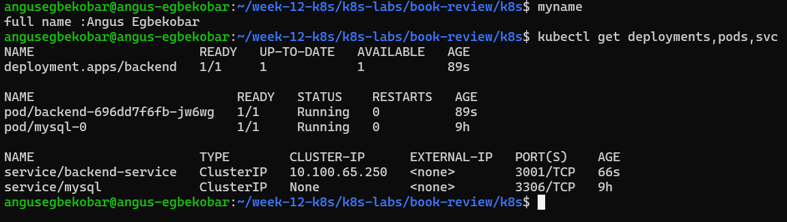

---

#### Screenshot 9 — Backend startup logs and database connectivity evidence

If the application does not log successful database connections, provide a successful database-backed request alongside the startup logs.

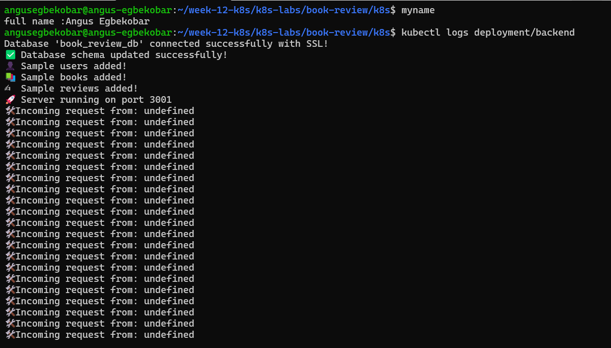

---

# Task 6 — Deploy the Frontend and Configure Nginx

## Goal

Run the Next.js frontend behind Nginx on port 80 and proxy API requests to the internal backend Service.

### Evidence

#### Screenshot 10 — Frontend Deployment and Ready Pods

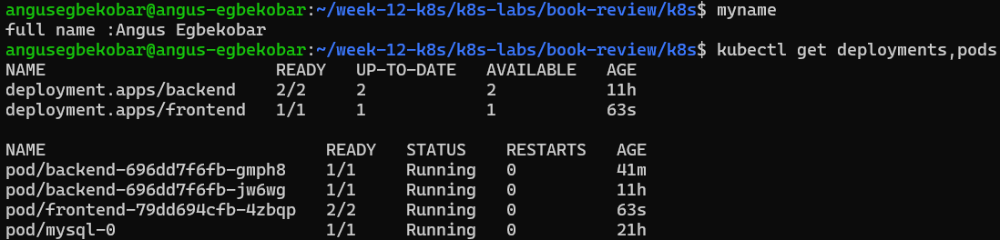

---

#### Screenshot 11 — Nginx reverse-proxy configuration showing the internal backend Service name and port 3001

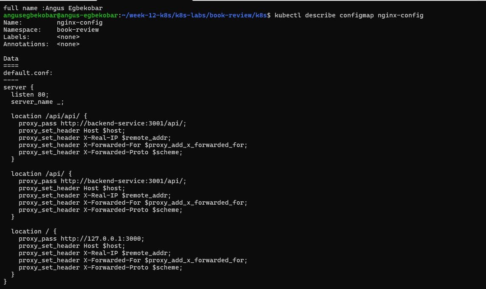

---

# Task 7 — Configure External and Internal Networking

## Goal

Expose the frontend and enforce the intended communication path between application tiers.

### Evidence

#### Screenshot 12 — Frontend LoadBalancer or Ingress configuration and assigned endpoint, or documented local access method

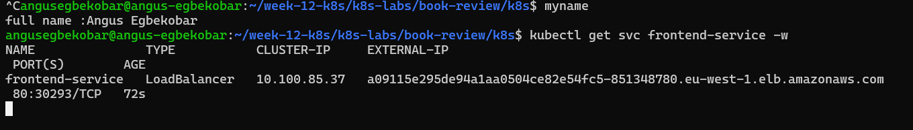

---

#### Screenshot 13 — Internal backend Service and NetworkPolicy or equivalent restriction, with access-test evidence

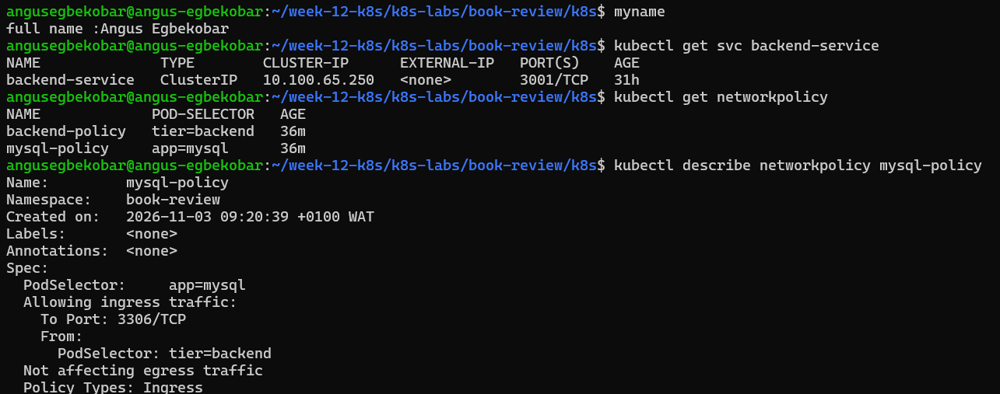
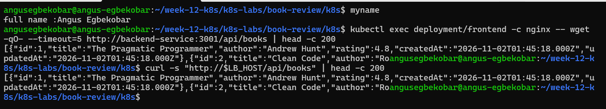

---

# Task 8 — Validate the Application End to End

## Goal

Prove that the frontend, backend, and MySQL database work together and collect operational evidence.

### Evidence

#### Screenshot 14 — `kubectl get all` output for the book-review namespace

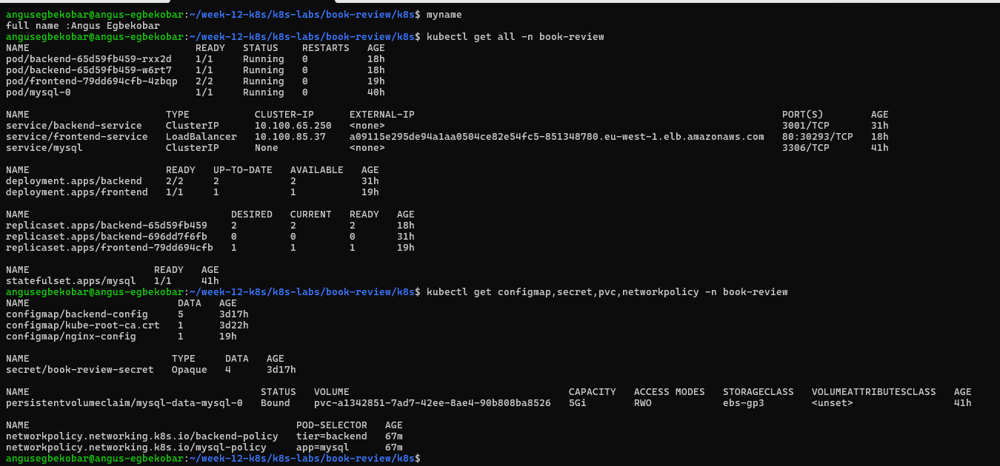

---

#### Screenshot 15 — Functional Book Review App in the browser with the URL visible, including evidence of a successful user flow

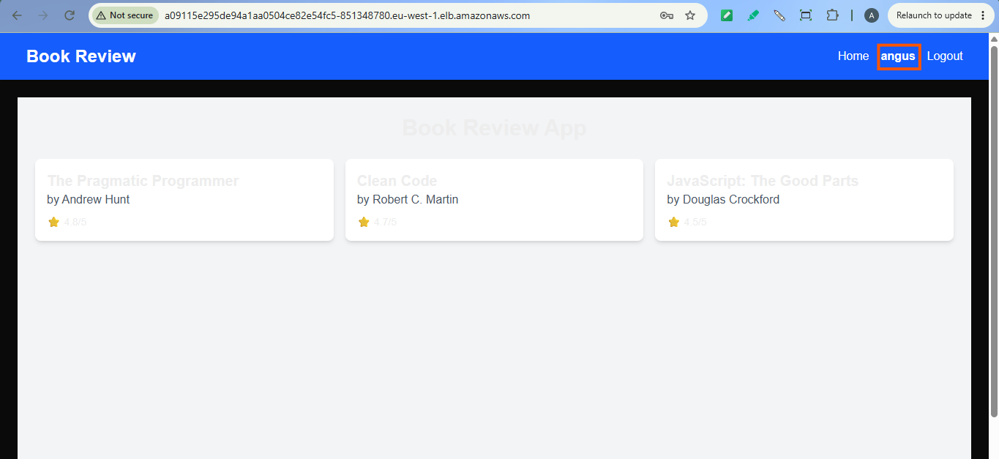

---

#### Screenshot 16 — Frontend or Nginx container logs

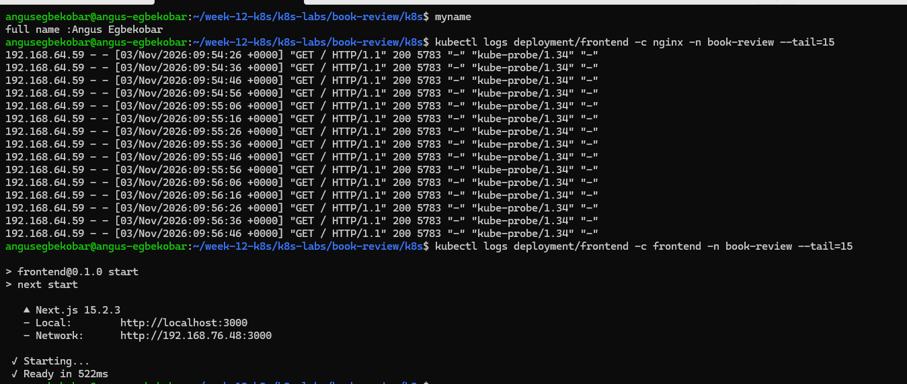

---

#### Screenshot 17 — Backend logs and evidence of a successful database-backed operation

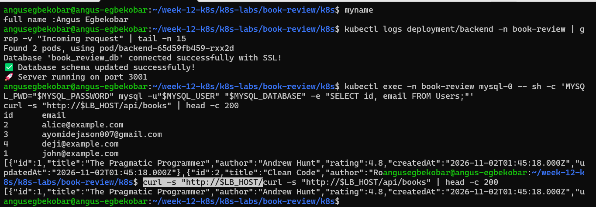

---

#### Screenshot 18 — Optional: Kubernetes dashboard

Add your screenshot here, or write “Not attempted.”

Not attempted.

---

# Task 9 — Optional: Implement Production Improvements

## Goal

Add selected improvements without breaking the required three-tier architecture.

### Evidence

#### Screenshot 19 — Optional: Evidence of selected Helm, HPA, probe, or TLS improvements

Not attempted

---

# Task 10 — Publish Your Book Review App Deployment on LinkedIn

## Goal

Explain your three-tier architecture, demonstrate the working application, and share what you learned.

### Evidence

#### Screenshot 20 — Published LinkedIn post about your Book Review App deployment on Kubernetes

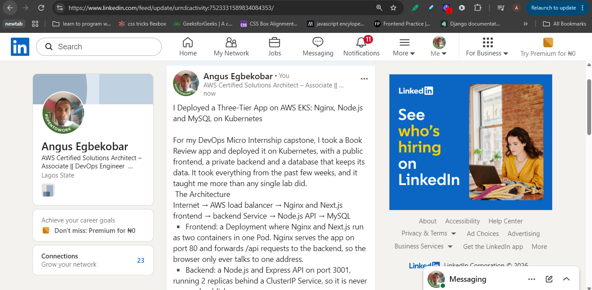

### LinkedIn Post URL

https://lnkd.in/p/eTDbvhEF

---

# Final Summary

## What Worked

Describe the application components and user flows you successfully deployed and tested.

I deployed the Book Review app as a three-tier application on AWS EKS (cluster eks-lb-lab, eu-west-1, one t3.medium node) in the book-review namespace.

Frontend: a Deployment whose Pod runs two containers, Next.js and Nginx. Nginx serves the app on port 80 and forwards /api requests to the backend, using a ConfigMap for its configuration. It is exposed publicly through a LoadBalancer Service, which created an AWS load balancer.
Backend: a Node.js and Express API with 2 replicas behind an internal ClusterIP Service on port 3001. Its logs confirmed a successful database connection, schema creation, and sample users, books and reviews.
Database: MySQL as a StatefulSet behind a headless internal Service, with a 5Gi EBS volume provisioned through the EBS CSI driver and a gp3 StorageClass. The database has no public address.
Configuration: a ConfigMap holds the application settings, and a Secret holds the credentials, so no passwords are in the images or manifests.
Access tests: the app loaded in the browser through the load balancer, /api/books returned data from MySQL through the public address, and the browser’s request showed the correct CORS headers.
Network restrictions: NetworkPolicies allow only the frontend to reach the backend and only the backend to reach MySQL. A test Pod labelled as the frontend reached the backend with HTTP 200.

## Issues and Fixes

Describe the main issues encountered, their causes, and how you resolved them.

Copy-paste damage in the guide’s commands. Missing $ signs, underscores and spaces turned variables into plain text, for example "CLUSTERNAME"--region"AWS_REGION". I replaced each broken command with a corrected one and checked variables with echo before using them.
Empty $ROLE_ARN. The EBS add-on install failed with “Invalid length for parameter serviceAccountRoleArn”. The variable had never been set, so I read the role’s ARN from AWS with aws iam get-role and re-ran the command.
STS timeout. eksctl create iamserviceaccount failed once with a DNS i/o timeout for the STS endpoint, which was a network problem on my side, and it worked when I retried.
MySQL client “using password: NO”. The interactive -p prompt did not appear inside kubectl run -it, so an empty password was sent. I passed the password through the MYSQL_PWD environment variable, read from the Secret.
Region mismatch. The guide used eu-north-1 in places, but the cluster was in eu-west-1, so I used the cluster’s real region everywhere.
Login “Invalid email or password” (HTTP 400). The network request showed that the browser, load balancer, Nginx and backend were all working, and that CORS was correct. The error came from the app’s credential check, which meant the account I typed did not exist, so I registered a user or used the seeded accounts.
Stuck PVC deletion. The PVC stayed in Terminating because the mysql-0 Pod still had it mounted. Deleting the StatefulSet released it, and the EBS volume was then deleted automatically.

## Tools and Sources Used

List the documentation and tools that helped you complete the assignment.

Tools: kubectl, eksctl, the AWS CLI, Docker and Docker Hub, curl, the MySQL client, the AWS Management Console (EC2, EKS), browser developer tools, and Git.
Sources: the DMI assignment guide, the official Kubernetes documentation (Services, StatefulSets, PersistentVolumes, NetworkPolicy), the AWS documentation for the EKS Amazon EBS CSI driver add-on and IAM roles for service accounts, and Claude for explaining commands and troubleshooting.

## Optional Improvements

Describe any optional improvements implemented, or write “Not attempted.”

Not attempted.

## Cleanup or Reuse Plan

State which resources were removed or why the environment is being retained.

The MySQL StatefulSet, PVC and its 5Gi EBS volume were deleted, which I verified in the EC2 console. After taking all my screenshots, I deleted the LoadBalancer Service first so that the AWS load balancer was removed, then deleted the whole cluster with eksctl delete cluster, which also removes the node group and its root disk. I then confirmed that no clusters, load balancers or volumes remained in eu-west-1.

---

# Submission Instructions

- Include your Kubernetes manifests or Helm chart in the linked repository.
- Submit Secret examples containing placeholders only.
- Include Screenshot 1, Screenshots 3–17, and Screenshot 20.
- Include Screenshot 2 only if using Helm.
- Screenshots 18–19 are optional.
- Keep screenshot numbering consistent with the guidelines.
- Use clear, readable screenshots showing relevant configuration, commands, and outputs.
- Make your full name visible in required screenshots.
- Complete the submission details and Final Summary.
- Include your published LinkedIn post URL.
- Capture required evidence before cleanup.
- Do not expose passwords, tokens, JWT secrets, actual Secret values, kubeconfig contents, cloud credentials, or confidential account information.

---

# Completion Checklist

- [ ] Selected and configured a supported Kubernetes platform
- [ ] Confirmed the context and Ready nodes (Screenshot 1)
- [ ] Created and selected the book-review namespace
- [ ] Inspected the application repository
- [ ] Prepared images accessible to the cluster
- [ ] Confirmed Helm if using charts (Screenshot 2, conditional)
- [ ] Created the architecture diagram (Screenshot 3)
- [ ] Created ConfigMaps and Secrets (Screenshots 4–5)
- [ ] Excluded actual Secret values from Git and screenshots
- [ ] Provisioned private managed MySQL or persistent Kubernetes MySQL (Screenshot 6)
- [ ] Initialized the required database and schema
- [ ] Verified database connectivity or schema (Screenshot 7)
- [ ] Deployed one or two backend replicas listening on port 3001
- [ ] Created the backend ClusterIP Service (Screenshot 8)
- [ ] Verified backend-to-database connectivity (Screenshot 9)
- [ ] Deployed one or two frontend replicas behind Nginx (Screenshot 10)
- [ ] Configured API proxying through the internal backend Service (Screenshot 11)
- [ ] Configured and documented frontend access (Screenshot 12)
- [ ] Enforced backend access restrictions (Screenshot 13)
- [ ] Confirmed that the backend and database are not publicly exposed
- [ ] Captured resource status for book-review (Screenshot 14)
- [ ] Tested application functionality and database writes (Screenshots 15 and 17)
- [ ] Verified saved data after application restart
- [ ] Captured frontend and backend logs (Screenshots 16–17)
- [ ] Included optional dashboard or improvement evidence if attempted (Screenshots 18–19)
- [ ] Published the LinkedIn post (Screenshot 20)
- [ ] Included the LinkedIn post URL
- [ ] Documented issues, fixes, and useful sources
- [ ] Recorded cleanup status or reuse plans
- [ ] No sensitive data exposed

---

## 📌 About DMI & CloudAdvisory

DevOps Micro Internship (DMI) is a project-based DevOps program run by Pravin Mishra (The CloudAdvisory) focused on real-world execution, systems thinking, and career readiness.

It helps learners build strong DevOps foundations with hands-on experience.

---

## 📌 Resources

- 🌐 DMI Official Website: https://dmi.pravinmishra.com?utm_source=github&utm_medium=readme  
- 🎓 University: https://university.pravinmishra.com?utm_source=github&utm_medium=readme  
- 💬 Discord Community: https://discord.pravinmishra.com?utm_source=github&utm_medium=readme  
- 📝 Blog: https://dmi.pravinmishra.com/blog?utm_source=github&utm_medium=readme  
- ▶️ YouTube Playlist: https://www.youtube.com/playlist?list=PLFeSNDtI4Cho  
- 🔗 Pravin Mishra (LinkedIn): https://www.linkedin.com/in/pravin-mishra-aws-trainer/  
- 🏢 CloudAdvisory (LinkedIn): https://www.linkedin.com/company/thecloudadvisory/

---

*This submission is part of DevOps Micro Internship (DMI) — Agentic AI Track.*
