# Assignment 11 — AI-Assisted Kubernetes Incident Triage

Part of the DevOps Micro Internship (DMI) with Agentic AI

---

## Purpose

Configure a read-only Bash triage script for your Book Review App, connect it to Claude Code through `/k8s-triage`, simulate one controlled failure, recover the application manually, and verify recovery.

**Workflow: Gather → Analyze → Human Act → Verify**

---

## Submission Details

**Full Name:** Angus Egbekobar

**Kubernetes Platform:** Amazon EKS (personal lab cluster `eks-lb-lab-2`, eu-west-1, Kubernetes 1.34, one managed t3.medium node, created with eksctl)

**Selected Workload:** backend` Deployment (container `backend`, Pod selector `app=backend`, Service `backend-service`)

**Namespace:** book-review

**GitHub Repository URL:** https://github.com/angus-egbekobar

**Simulated Incident:** Invalid image (`angusegbekobar/book-review-backend:does-not-exist`)

**Baseline Status:** HEALTHY (exit code 0, 6 PASS, 0 WARN, 0 FAIL)

**Recovery Status:** Explained WARN (exit code 1), with no FAIL. The only warning is historical Warning events from the failed Pod `backend-6dff449dd9-5lpfn`, which no longer exists. The Pod `backend-857f7fb66c-ml684` is `1/1 Running` with 0 restarts, and `backend-service` has a ready backend at `192.168.42.107`.

---

# Task 1 — Discover the Application and Capture a Healthy Baseline

## Goal

Identify the actual application configuration and prove that the selected workload is healthy before incident simulation.

### Evidence

#### Screenshot 1 — Healthy Pods and ready Service backends

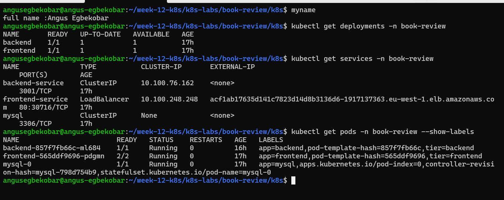

---

#### Screenshot 2 — Workspace directory structure

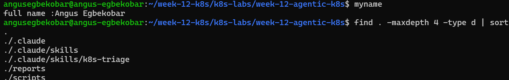

### Notes

**1. What proves the selected Pods are ready, not merely running?**

Running only means the container process has started. Readiness is a separate signal, shown in the READY column (1/1) and in the Pod’s Ready condition. For the backend, the readiness probe does an HTTP GET on / at port 3001, and the Pod only counts as ready once that probe succeeds. In my cluster, kubectl get pods -n book-review -l app=backend -o wide showed backend-857f7fb66c-ml684 as 1/1 Running, which means the container is up and passing its readiness probe. A Pod can be Running with 0/1 ready, and Kubernetes keeps such a Pod out of Service traffic.

**2. What proves the Service has ready backends?**

The EndpointSlice for backend-service lists the Pod IPs that can receive traffic. kubectl get endpointslice -n book-review -l kubernetes.io/service-name=backend-service -o yaml shows an endpoint address (192.168.42.107, the backend Pod’s IP) with conditions.ready: true. Only Pods that pass readiness are added as ready endpoints, so this proves the Service can route traffic to a healthy backend. The Service existing is not enough proof: a Service with no ready endpoints would have an empty endpoint list.

**3. Why must the original image be recorded before incident simulation?**

The incident changes the Deployment’s image to a tag that does not exist (does-not-exist). Once that is applied, the Deployment no longer shows the working image, so I would have to guess or dig it out of rollout history. Recording angusegbekobar/book-review-backend:v1 beforehand gives me the exact known-good value to restore with kubectl set image. Restoring a different tag could fail again or run a different version, so recovery depends on having the exact original recorded.

---

# Task 2 — Configure CLAUDE.md

## Goal

Define the project configuration, incident workflow, and safety boundary for Claude Code.

### Evidence

#### Screenshot 3 — CLAUDE.md showing application configuration, workflow, safety rules, and output rules

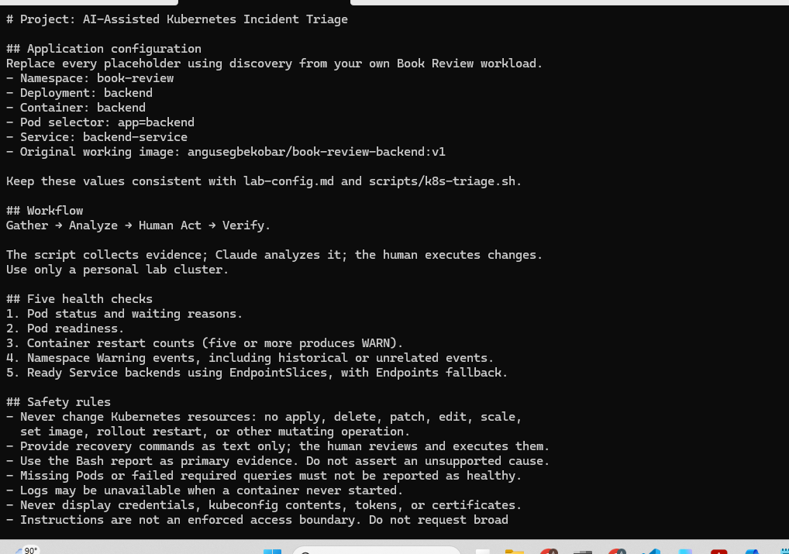

### Notes

**1. Why does Claude need project-specific cluster rules?**

Claude has no built-in knowledge of my cluster. Without project rules it would have to guess the namespace, Deployment, container, Pod selector and Service, and a wrong guess could mean investigating the wrong workload. CLAUDE.md gives it the exact configuration (`book-review` namespace, `backend` Deployment and container, `app=backend` selector, `backend-service`, and the original image `angusegbekobar/book-review-backend:v1`). It also defines the Gather → Analyze → Human Act → Verify workflow, the five health checks, and the safety boundary: no mutating operations, no credential disclosure, and reports written only through the supplied script. Every session therefore starts with the same context and the same limits, which makes the triage consistent and repeatable.

**2. Why must a human execute recovery commands?**

Recovery commands such as `kubectl set image` or `rollout restart` change a live system, and the engineer is accountable for those changes. Claude can analyze evidence, but it can misread it or miss context it cannot see, like business impact, timing, or whether the cluster is the intended one. A human review confirms that the command targets the right namespace, Deployment and container before anything changes. CLAUDE.md therefore says to provide recovery commands as text only, so I review and run them myself. It also notes that instructions are not an enforced access boundary, which is another reason I do not approve cluster-changing commands from Claude.

**3. Which rule prevents an unsupported diagnosis?**

The rule is "Use the Bash report as primary evidence. Do not assert an unsupported cause." It requires every conclusion to be backed by evidence in the report, such as Pod status, readiness, restart counts, Warning events or Service backends. Two related rules support it: "Missing Pods or failed required queries must not be reported as healthy," which stops Claude from filling gaps with assumptions, and "Logs may be unavailable when a container never started," which stops it from inventing log-based explanations when there are none.

---

# Task 3 — Plan the Read-Only Triage Workflow

## Goal

Ask Claude Code to explain the five health checks before running the supplied script.

### Evidence

#### Screenshot 4 — Claude Code showing the five-check read-only plan

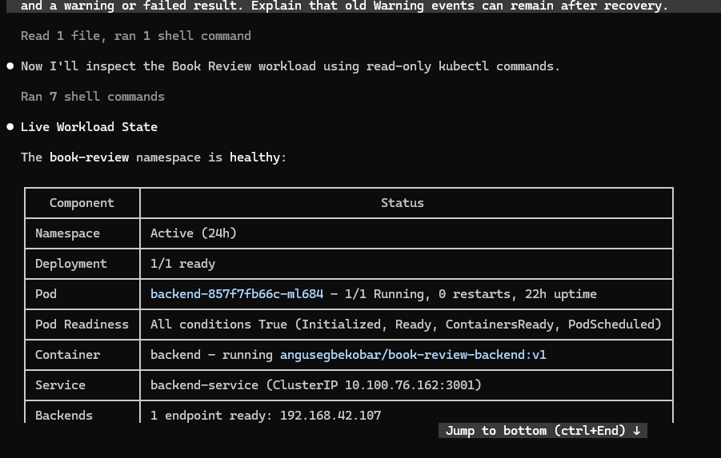
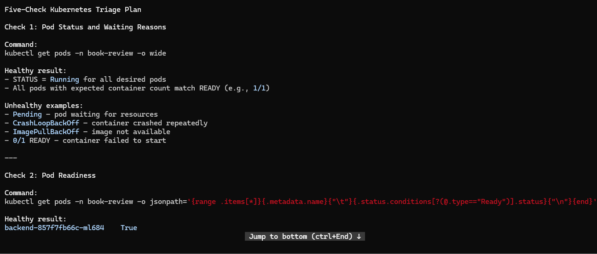

### Notes

**1. Which part represents the Gather phase?**

The five checks in the plan are the Gather phase: Pod status, Pod readiness, restart counts, namespace Warning events, and ready Service backends. Each one is a read-only `kubectl get` command that collects facts about the `backend` workload in the `book-review` namespace (for example, `kubectl get pods -n book-review -l app=backend -o wide` and the EndpointSlice query for `backend-service`). Nothing is interpreted or changed at this stage. The commands only collect the evidence that the Analyze phase will use. Once the script is configured, the Bash script takes over this phase.

**2. How did you verify that Claude did not change anything?**

I reviewed Claude Code's tool activity and approved only read-only commands. Claude read CLAUDE.md and ran five `kubectl get`/`describe` commands against the `book-review` namespace. There was no `apply`, `delete`, `patch`, `scale`, `set image` or `rollout restart`, and no files were created or edited. I then confirmed the cluster state was unchanged: the `backend` Deployment still shows 1/1 ready with the image `angusegbekobar/book-review-backend:v1`, and the backend Pod is the same one (`backend-857f7fb66c-ml684`) with 0 restarts. Because Claude reported the live state before and after matched, I could rule out any change.

**3. Why is planning before coding useful for incident triage?**

Planning lets me review what will be checked, what healthy and failed results look like, and whether every operation is read-only before any script exists or runs. During an incident, a poorly thought-out script can miss a check, misreport a failure as healthy, or touch the cluster. Reviewing the plan first catches those problems cheaply. It also defines the pass/warn/fail criteria up front, so the script is built to match them and the output is easy to interpret under pressure. Finally, it keeps the Gather → Analyze → Human Act → Verify order intact: I agree on what evidence to collect before anything is run.

---

# Task 4 — Configure and Validate the Bash Script

## Goal

Configure the supplied triage script for the selected workload and validate its syntax.

### Evidence

#### Screenshot 5 — Script configuration variables and checks array

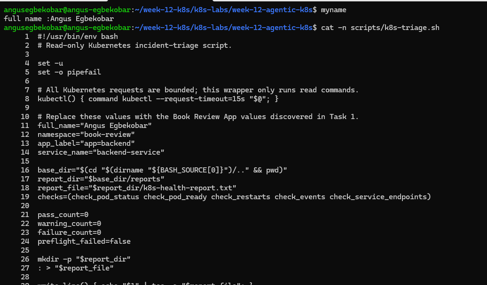

---

#### Screenshot 6 — Functions for status, readiness, restarts, events, and Service backends

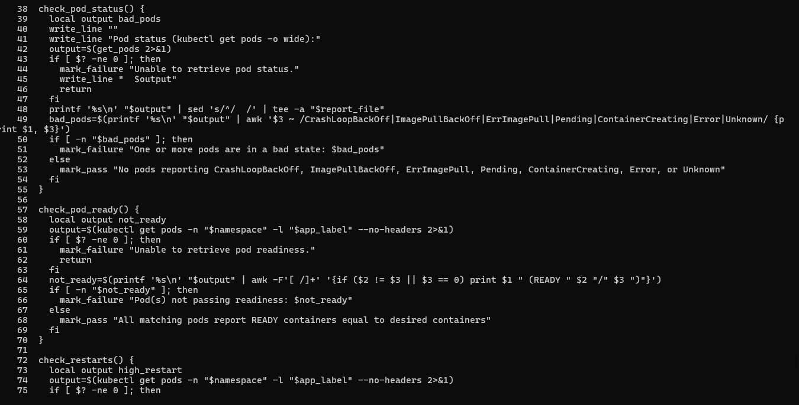
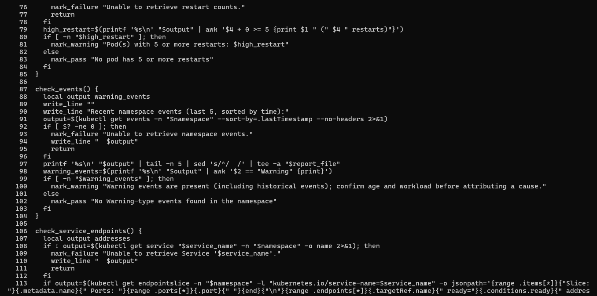
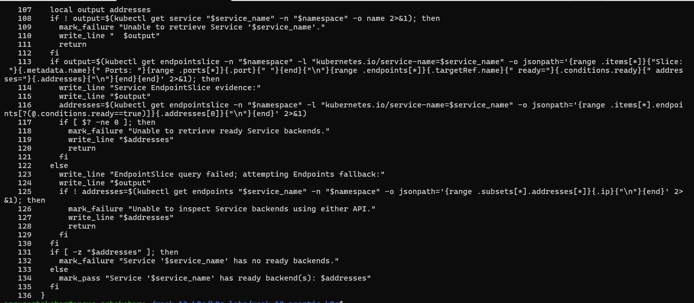

---

#### Screenshot 7 — Preflight, summary, and exit-code logic

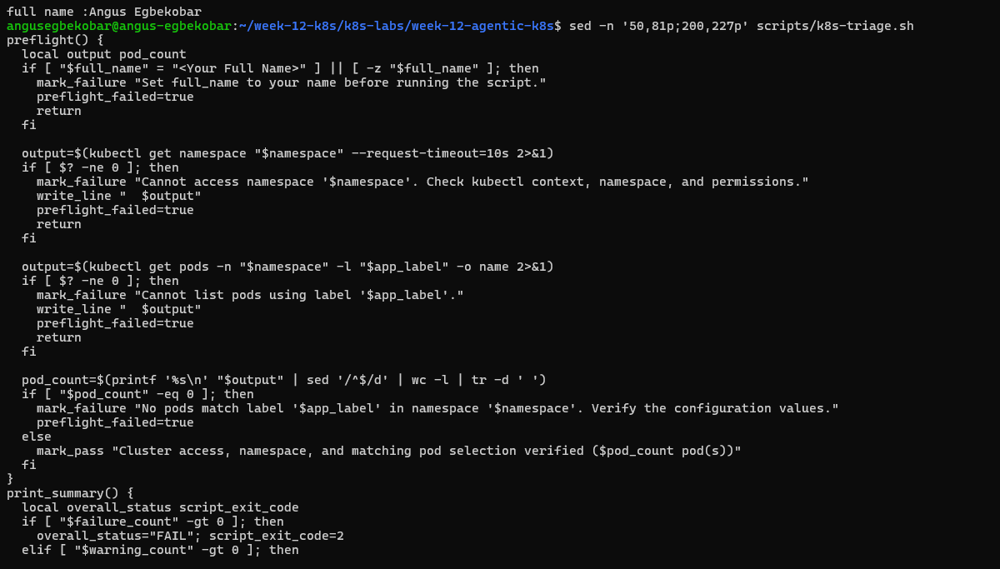

---

#### Screenshot 8 — Successful syntax validation and executable permission

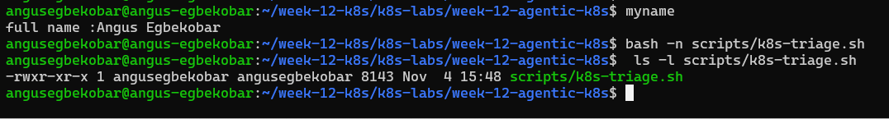

### Notes

**1. Why must the script fail when no Pods match the configured selector?**

If no Pods match `app=backend` in `book-review`, there is nothing to inspect, and an empty result must not be read as healthy. With zero Pods, the status, readiness and restart checks would have no bad rows to flag and would pass by default, so the report would claim a healthy workload while nothing is running. It could also mean the selector or namespace is misconfigured, so the script would be watching the wrong workload. The `preflight` function counts matching Pods and, if the count is 0, calls `mark_failure "No pods match label ..."` and sets `preflight_failed=true`. That skips the other checks and the final status becomes FAIL with exit code 2. This matches the CLAUDE.md rule that missing Pods or failed required queries must not be reported as healthy.

**2. How does the readiness check detect a running but unready Pod?**

check_pod_ready` runs `kubectl get pods -n book-review -l app=backend --no-headers` and splits the READY column (for example `1/1`) on `/` with `awk`. It flags any Pod where the ready count does not equal the total (`$2 != $3`), or where the total is 0. A Pod whose container is running but failing its readiness probe shows `0/1` while its STATUS is still `Running`, so it is caught as `[FAIL] Pod(s) not passing readiness`. Running only means the process started; the READY column reflects whether the readiness probe (HTTP GET `/` on port 3001) is passing.

**3. Why are Service backends checked separately from Pod health?**

Pod health and Service routing are separate things. The Service sends traffic only to endpoints listed as ready in its EndpointSlice, and that depends on the Service's selector matching the Pods and on those Pods being ready. A Pod can look healthy while the Service has no backend, for example if the selector or ports are wrong. The reverse also happens during a rollout: a new Pod can be failing (`ImagePullBackOff`) while an older ready Pod keeps serving, so the Service still has a backend. `check_service_endpoints` queries the EndpointSlice for `backend-service` (with an Endpoints fallback) and fails if there are no ready addresses. It confirms that users can actually reach a healthy backend, which the Pod checks alone cannot show.

**4. What do exit codes 0, 1, and 2 represent?**

`print_summary` sets the exit code from the counters. **0 (HEALTHY)** means all checks passed with no warnings or failures. **1 (WARN)** means no check failed, but at least one warning needs review, such as a Pod with 5 or more restarts or Warning events in the namespace (which can be historical). **2 (FAIL)** means at least one required check failed, such as a bad Pod state, an unready Pod, no ready Service backends, a failed query, or no matching Pods. FAIL takes priority over WARN, and WARN over HEALTHY. Automation or a human can act on the exit code without reading the full report.

---

# Task 5 — Run the Healthy Baseline Report

## Goal

Run the script on the healthy application and confirm that it contains no failed checks.

### Evidence

#### Screenshot 9 — Baseline report showing your full name and all checks

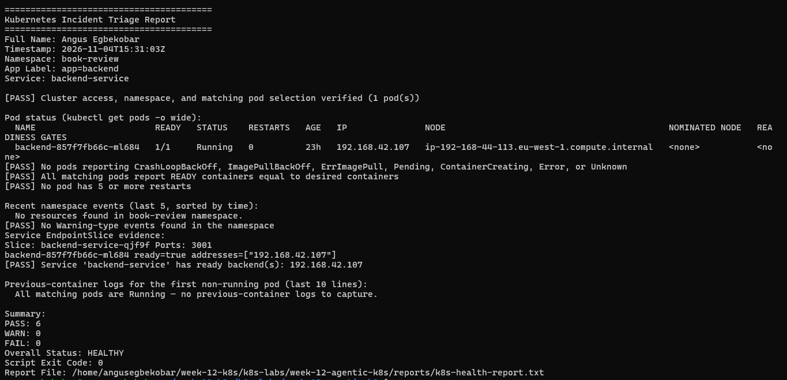

---

#### Screenshot 10 — Captured exit code and final summary

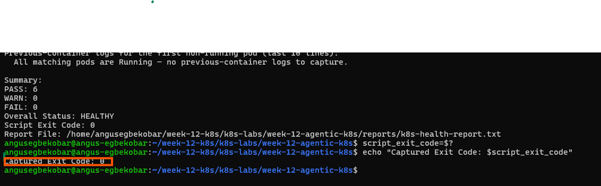

### Notes

**1. What is the baseline status?**

The baseline status is **HEALTHY**, with exit code 0 (timestamp 2026-11-04T15:31:03Z). The report shows PASS: 6, WARN: 0, FAIL: 0. The six passes are the preflight check (one matching Pod found) plus the five health checks:
- The Pod `backend-857f7fb66c-ml684` is `Running` with no bad states.
- It is `1/1` ready.
- It has 0 restarts.
- There are no Warning events in the `book-review` namespace.
- `backend-service` has a ready backend.

The captured exit code (0) matches the report's `Overall Status: HEALTHY`, so no recovery action is needed.

**2. Which evidence proves the Service has a ready backend?**

The EndpointSlice evidence in the report proves it. The slice `backend-service-qjf9f` (port 3001) lists `backend-857f7fb66c-ml684 ready=true addresses=["192.168.42.107"]`. The script then recorded `[PASS] Service 'backend-service' has ready backend(s): 192.168.42.107`. That address is the same IP the Pod shows in the status table, which confirms the Service routes to the selected backend Pod and that the Pod is passing readiness.

**3. What is the difference between a warning and a failure?**

A **failure** means a required check did not pass: a Pod in `CrashLoopBackOff` or `ImagePullBackOff`, a Pod that is not ready, no ready Service backends, no matching Pods, or a kubectl query that errored. Any failure makes the overall status FAIL (exit code 2), and recovery cannot be declared until it clears.

A **warning** means no required check failed, but something needs a human to review it, such as a Pod with 5 or more restarts or Warning events in the namespace. These events may be historical. The status is WARN (exit code 1). A warning alone does not justify changing the cluster. I would first check the event's age and the object it refers to.

---

# Task 6 — Configure and Run the Claude Code Skill

## Goal

Connect the Bash script to a manually invoked Claude Code evidence-analysis workflow.

### Evidence

#### Screenshot 11 — SKILL.md showing frontmatter and safety rules

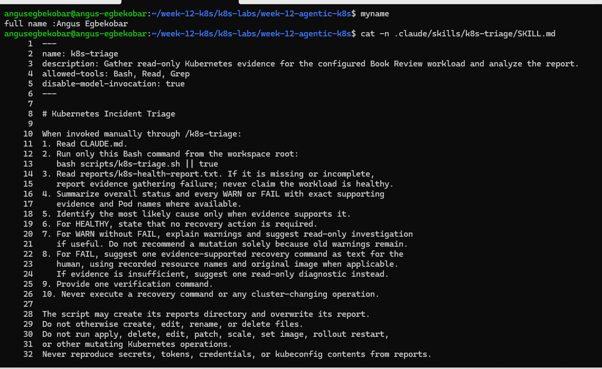

---

#### Screenshot 12 — Baseline `/k8s-triage` analysis

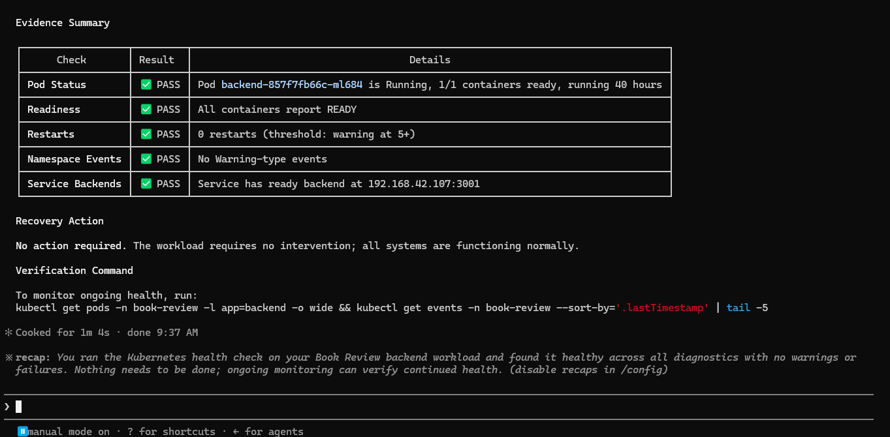

### Notes

**1. What does Bash do in this workflow?**

Bash does the Gather phase. `scripts/k8s-triage.sh` runs the same fixed set of read-only `kubectl` queries every time: Pod status, readiness, restart counts, namespace events, and `backend-service` EndpointSlice backends. It records each result as PASS, WARN or FAIL, writes the evidence to `reports/k8s-health-report.txt`, and sets the exit code (0, 1 or 2). It is deterministic, so the same cluster state gives the same report, and it makes no interpretations or changes. The skill calls it with `bash scripts/k8s-triage.sh || true`. The `|| true` keeps a WARN or FAIL exit code from being treated as a tool error, so Claude can still read the report.

**2. What does Claude do in this workflow?**

Claude does the Analyze phase. When I invoke `/k8s-triage`, it reads `CLAUDE.md`, runs the one script command, and reads the report. It then summarizes the overall status and any WARN or FAIL with exact evidence, such as Pod names, and names a likely cause only when the evidence supports it. For the HEALTHY baseline it states that no recovery action is required. For a FAIL it suggests one recovery command as text and one verification command, and I review and run them myself. If the report is missing or incomplete, it reports an evidence-gathering failure and never claims the workload is healthy. Claude never executes recovery.

**3. Why are instructions alone insufficient to guarantee read-only access?**

CLAUDE.md` and `SKILL.md` only describe the behavior I expect. They do not enforce it. The model could misread an instruction, be steered by unexpected text in a report or log, or simply make a mistake. In `SKILL.md`, `allowed-tools: Bash, Read, Grep` pre-approves the Bash tool, but it does not limit which commands run through it, and the file itself says it does not enforce read-only Kubernetes permissions. Claude runs `kubectl` with my kubeconfig credentials, so it technically has whatever access I have, including `delete` and `set image`. The script's `kubectl` wrapper only adds a timeout and applies only inside the script. A real read-only guarantee needs technical controls: Kubernetes RBAC credentials limited to `get`, `list` and `watch`, plus reviewing every tool request and declining anything that changes the cluster.

---

# Task 7 — Simulate One Controlled Incident

## Goal

Create one controlled failure, save its evidence, and let Claude analyze it without executing recovery.

### Evidence

#### Screenshot 13 — Failed or unready Pod evidence and current Service backends

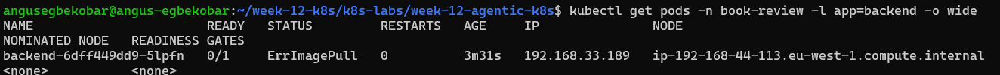
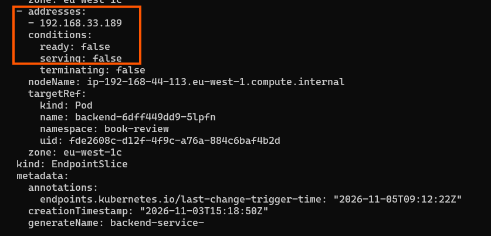

---

#### Screenshot 14 — Failed `/k8s-triage` analysis with evidence and a suggested manual recovery command

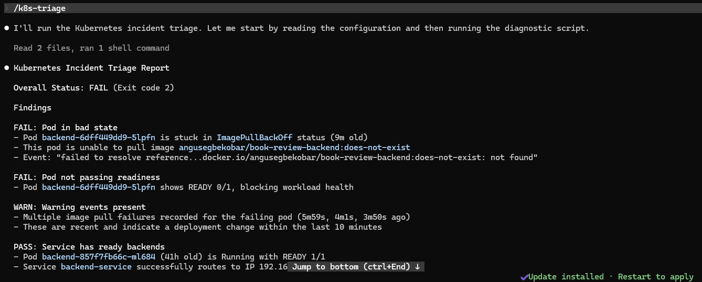
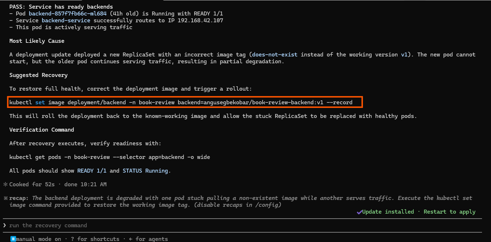
---

#### Screenshot 15 — Saved `incident-failure-report.txt`

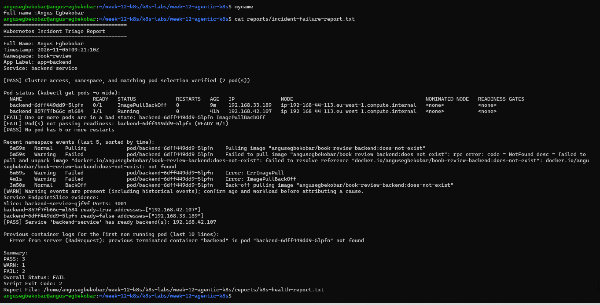

### Notes

**1. Which failure did you choose?**

I chose Option A, the invalid image. From a regular terminal, I ran `kubectl set image deployment/backend backend=angusegbekobar/book-review-backend:does-not-exist -n book-review`, which replaced the working image `angusegbekobar/book-review-backend:v1` with a tag that does not exist. The Deployment created a new ReplicaSet and a new Pod, `backend-6dff449dd9-5lpfn`, that could not pull its image.

**2. Which checks failed, and what evidence proved it?**

Two checks failed, and the report's overall status was FAIL (exit code 2):
- **Pod status:** `[FAIL] One or more pods are in a bad state: backend-6dff449dd9-5lpfn ImagePullBackOff`. The Pod table shows the Pod as `0/1 ImagePullBackOff`.
- **Pod readiness:** `[FAIL] Pod(s) not passing readiness: backend-6dff449dd9-5lpfn (READY 0/1)`.

**3. Did Claude execute recovery? Why is that important?**

No. Claude's tool activity showed only "Read 2 files, ran 1 shell command", which was the triage script. It gave `kubectl set image deployment/backend ... backend=angusegbekobar/book-review-backend:v1` as text for me to review, and I did not run it through Claude. This matters because a recovery command changes a live system. Claude could misread the evidence or lack context about timing and impact, and instructions alone do not technically prevent mistakes. Keeping the human as the one who reviews and runs the change means the engineer stays accountable. It also preserved the failure evidence before anything was altered.

**4. Why might the Service retain ready backends during the incident?**

The Deployment uses a rolling update. It keeps the old ReplicaSet's Pod running until the new Pod becomes ready. The new Pod never became ready, so the old Pod `backend-857f7fb66c-ml684` (1/1 Running) stayed in place. A Service only routes to endpoints marked ready in its EndpointSlice, so `backend-service` kept sending traffic to `192.168.42.107` (`ready=true`) and excluded the new Pod (`ready=false`). That is why the Service check passed while the Pod checks failed. The old Pod hid the user-facing impact, but the rollout was still broken, and the report caught it.

---

# Task 8 — Recover Manually and Verify

## Goal

Restore the healthy configuration yourself and verify recovery using a second triage report.

### Evidence

#### Screenshot 16 — Recovered Pods and ready Service backends

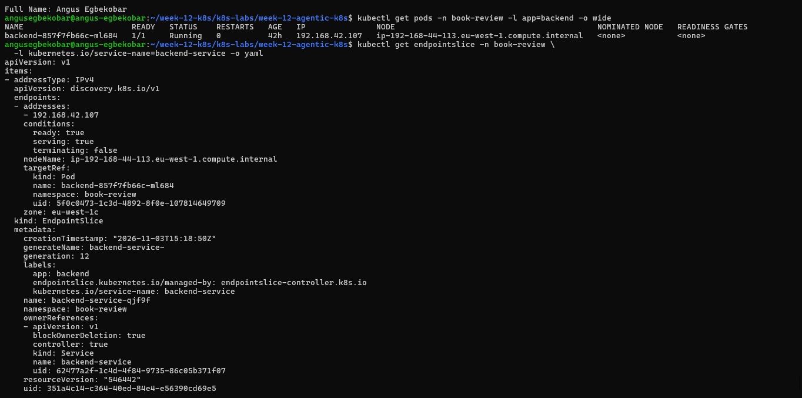

---

#### Screenshot 17 — Recovered `/k8s-triage` analysis

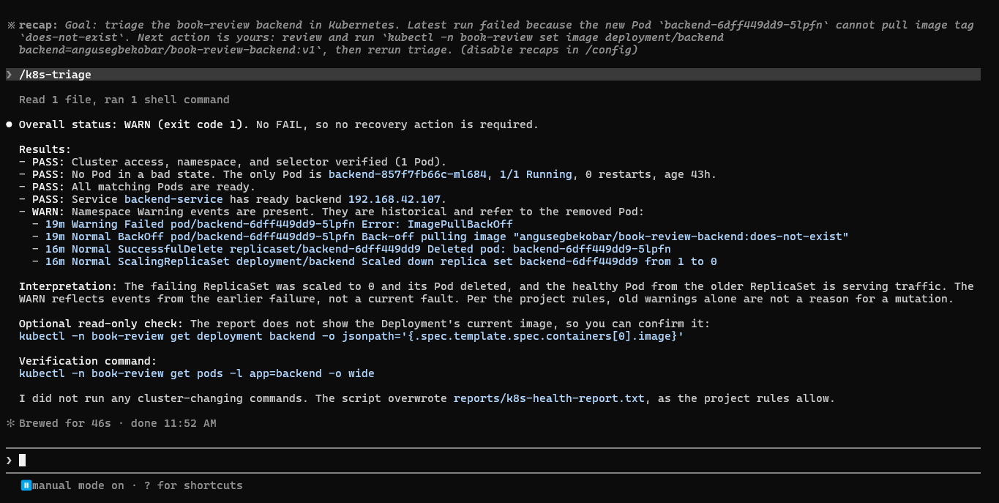

---

#### Screenshot 18 — Reports directory showing failure and recovery reports

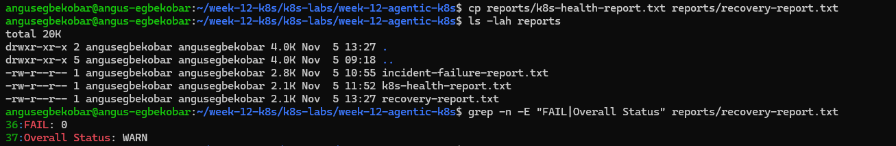

---

#### Screenshot 19 — `incident-summary.md` with all required sections

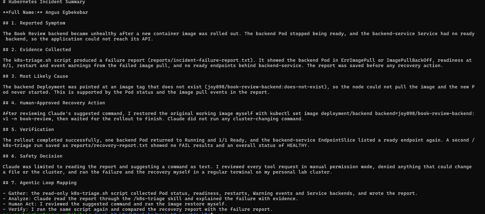

### Notes

**1. What manual recovery action did you execute?**

From a regular terminal, not Claude Code, I restored the original working image with `kubectl set image deployment/backend backend=angusegbekobar/book-review-backend:v1 -n book-review`. I then ran `kubectl rollout status deployment/backend -n book-review --timeout=180s`, which reported that the deployment was successfully rolled out. The Deployment's pod template matched the original ReplicaSet (`backend-857f7fb66c`) again, so Kubernetes scaled the broken ReplicaSet (`backend-6dff449dd9`) down to 0 and deleted its failed Pod. The healthy Pod kept running, so no new Pod was needed.

**2. What proves the workload recovered?**

- `kubectl get pods -n book-review -l app=backend -o wide` shows only `backend-857f7fb66c-ml684`, `1/1 Running` with 0 restarts. The failed `backend-6dff449dd9-5lpfn` Pod is gone.
- The `backend-service` EndpointSlice lists `192.168.42.107` as ready and no longer lists the failed Pod's address.
- The recovery triage report has no FAIL. Its Pod status, readiness, restart and Service backend checks all show PASS, and the overall status is WARN (exit code 1) only because of historical Warning events.

**3. Why is the second triage run necessary?**

A successful `rollout status` only says the rollout finished. It does not show that the whole workload is healthy. The second run uses the same script and the same five checks as the failure report, so the before and after results are directly comparable. It also confirms the Service has a ready backend and that no Pod is still in a bad state. It produces a saved report I can submit as evidence, and it shows that the recovery worked rather than assuming it did.

**4. Why should AI not automatically restart every failing production workload?**

A restart or image change alters a live system, and the AI only sees the evidence in a report. It can misdiagnose, or miss context such as business impact, timing, ongoing deployments or the real root cause. In this incident a restart would have been unnecessary, because the old Pod was still serving traffic. Restarting a Pod can also destroy evidence such as logs and state, hide the underlying problem, or cascade into a bigger outage if the cause is a bad config or an overloaded dependency. A human should review every change, and the AI should stay in the Analyze role with limited permissions.

### Remaining WARN Results

Explain any WARN results remaining after recovery, or write “None.”

One WARN remains: "Warning events are present (including historical events)". The events are from the incident, for example `Failed ... Error: ImagePullBackOff` on `pod/backend-6dff449dd9-5lpfn`, which appeared about 19 minutes before the recovery run. They refer to the failed Pod, which no longer exists, because its ReplicaSet was scaled to 0 and the Pod was deleted. The current checks all PASS: the only Pod is `backend-857f7fb66c-ml684` at 1/1 Running with 0 restarts, and `backend-service` has a ready backend at `192.168.42.107`. The WARN reflects past events, not a current fault, and these events expire from the namespace on their own. No further action is needed.

---

# Task 9 — Publish Your Kubernetes Incident-Triage Workflow on LinkedIn

## Goal

Share the incident-triage workflow you completed and explain the role of human control.

### Evidence

#### Screenshot 20 — Published LinkedIn post about your Kubernetes incident-triage workflow

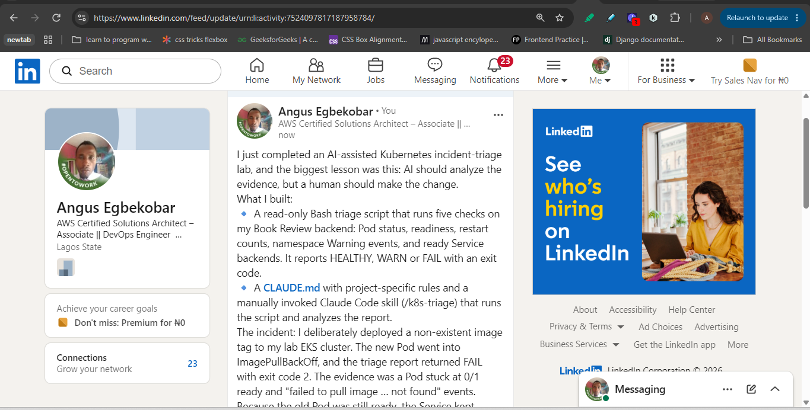

### LinkedIn Post URL

https://lnkd.in/p/ez5BhYQB

---

# Required Project Files

Include these files in your project repository:

- `CLAUDE.md`
- `lab-config.md`
- `scripts/k8s-triage.sh`
- `.claude/skills/k8s-triage/SKILL.md`
- `reports/incident-failure-report.txt`
- `reports/recovery-report.txt`
- `incident-summary.md`

Your `incident-summary.md` must contain:

1. Reported Symptom
2. Evidence Collected
3. Most Likely Cause
4. Human-Approved Recovery Action
5. Verification
6. Safety Decision
7. Agentic Loop Mapping

---

# Final Summary

## Evidence and Cause

Summarize the evidence and the supported cause of the incident.

Add your summary here.

## Manual Recovery

Describe the command or configuration change you performed.

Add your summary here.

## Verification

Explain how the recovery report and Kubernetes outputs confirmed recovery.

Add your summary here.

## Safety Decision

Explain how you kept Claude’s role limited to evidence gathering and analysis.

Add your summary here.

---

# Submission Instructions

- Include all 20 required screenshots under their corresponding Evidence sections.
- Complete all Notes questions in your own words.
- Include the required project files in your linked repository.
- Include your published LinkedIn post URL.
- Use clear, readable screenshots showing relevant commands, configuration, and outputs.
- Display your full name before taking required terminal screenshots.
- Preserve the failure report before recovery.
- Ensure the baseline and recovery reports contain no FAIL results.
- Explain any WARN results remaining after recovery.
- Review reports, logs, configuration records, and screenshots before publishing.
- Do not expose credentials, kubeconfig contents, tokens, certificates, JWT secrets, or confidential account information.

---

# Completion Checklist

- [ ] Confirmed the personal lab context
- [ ] Discovered and recorded application configuration
- [ ] Recorded the original working image
- [ ] Captured healthy Pods and ready Service backends (Screenshot 1)
- [ ] Created the workspace (Screenshot 2)
- [ ] Configured CLAUDE.md (Screenshot 3)
- [ ] Reviewed the five-check triage plan (Screenshot 4)
- [ ] Configured and reviewed the supplied script (Screenshots 5–7)
- [ ] Passed Bash syntax validation and set executable permission (Screenshot 8)
- [ ] Captured a baseline report with no FAIL (Screenshot 9)
- [ ] Captured the correct exit code (Screenshot 10)
- [ ] Configured and invoked `/k8s-triage` (Screenshots 11–12)
- [ ] Simulated one controlled incident manually (Screenshot 13)
- [ ] Reviewed Claude’s failed-state analysis (Screenshot 14)
- [ ] Saved failure evidence before recovery (Screenshot 15)
- [ ] Executed recovery manually and waited for rollout completion
- [ ] Confirmed recovered Pods and ready Service backends (Screenshot 16)
- [ ] Captured recovery analysis with no FAIL (Screenshot 17)
- [ ] Explained any remaining warnings
- [ ] Saved failure and recovery reports (Screenshot 18)
- [ ] Completed the seven-section incident summary (Screenshot 19)
- [ ] Answered all Notes questions
- [ ] Published the LinkedIn post (Screenshot 20)
- [ ] Included the LinkedIn post URL
- [ ] Included all required project files
- [ ] Checked that no sensitive information is exposed

---

## 📌 About DMI & CloudAdvisory

DevOps Micro Internship (DMI) is a project-based DevOps program run by Pravin Mishra (The CloudAdvisory) focused on real-world execution, systems thinking, and career readiness.

It helps learners build strong DevOps foundations with hands-on experience.

---

## 📌 Resources

- 🌐 DMI Official Website: https://dmi.pravinmishra.com?utm_source=github&utm_medium=readme  
- 🎓 University: https://university.pravinmishra.com?utm_source=github&utm_medium=readme  
- 💬 Discord Community: https://discord.pravinmishra.com?utm_source=github&utm_medium=readme  
- 📝 Blog: https://dmi.pravinmishra.com/blog?utm_source=github&utm_medium=readme  
- ▶️ YouTube Playlist: https://www.youtube.com/playlist?list=PLFeSNDtI4Cho  
- 🔗 Pravin Mishra (LinkedIn): https://www.linkedin.com/in/pravin-mishra-aws-trainer/  
- 🏢 CloudAdvisory (LinkedIn): https://www.linkedin.com/company/thecloudadvisory/

---

*This submission is part of DevOps Micro Internship (DMI) — Agentic AI Track.*
